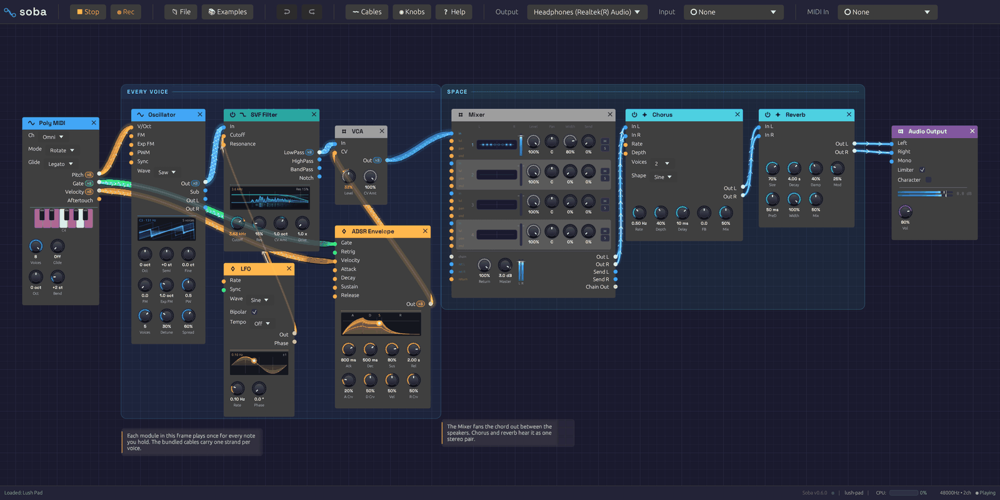
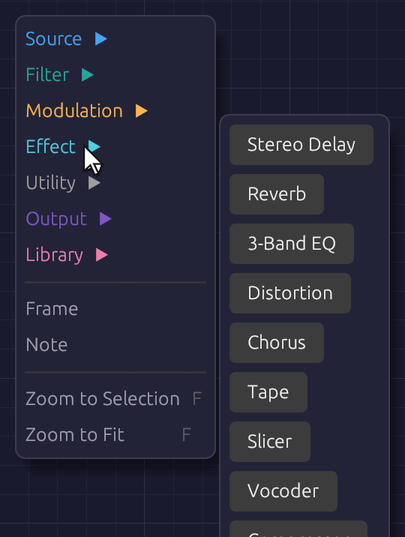
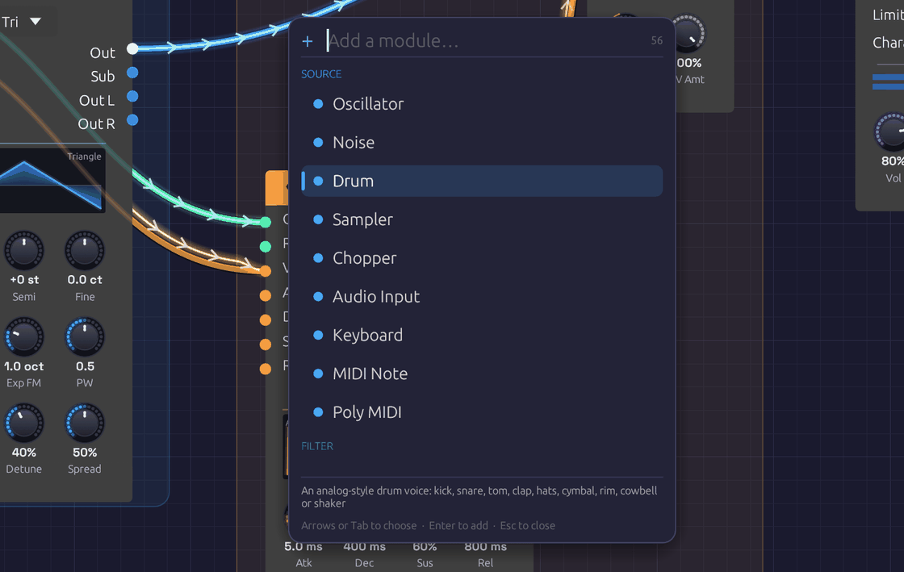
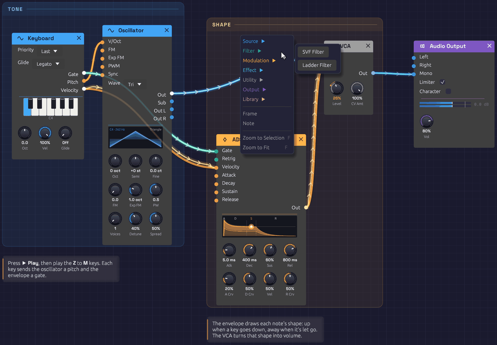

# Interface Overview

The Soba window has three parts: a toolbar along the top, the canvas where you build patches, and a status bar along the bottom.

*The toolbar, the canvas with a patch on it, and the status bar.*

## The toolbar

From left to right:

| Group | Controls |
|-------|----------|
| **Transport** | **▶ Play** starts the patch; **⏹ Stop** stops it. The app opens stopped. **● Rec** records what you hear: see [Recording](#recording). |
| **File** | **📄 New**, **📂 Open**, **🕘 Recent**, **📚 Examples**, **💾 Save**, **💾 Save As**, **🔗 Share**: see [Sharing a patch by link](#sharing-a-patch-by-link), and **🌱 Plant**: see [Planting it in the garden](#planting-it-in-the-garden). At the foot of **📚 Examples**, **🌱 Visit the garden** opens the Patch Garden in your browser |
| **Edit** | **↩ Undo** and **↪ Redo**. Hover either to see which edit it will undo or redo. |
| **〰 Cables** | How signal flow is drawn along cables: **Chevrons**, **Dots** or **Comets**. **Under modules and labels** sets how much of a cable shows through a module, frame title or note it passes behind (5% at first). **Patch under a probe** sets how far the patch is turned down while you [probe a cable](#probing-a-cable) |
| **◉ Knobs** | How knobs are drawn: **LED ring**, **Hybrid**, **Arc**, **Machined** or **Classic** |
| **❓ Help** | **📖 Manual** opens this manual, and **⌨ Keyboard Shortcuts** (`F1`) lists the [shortcuts](#keyboard-shortcuts), and **🎓 Lessons** opens the [lessons](lessons.md) you take inside the app. **Check for Updates…**, **Check for Updates Automatically**, and **Roll Back** after an update: see [Updates](installation.md#updates) |
| **Output** | The audio device to play through |
| **Input** | The microphone, guitar or line input that [Audio Input](../modules/sources/audio-input.md) modules hear. It starts at **None**: nothing is opened until you choose a device. A filled dot (●) means it's open. |
| **MIDI In** | The MIDI controller to listen to. A filled dot (●) means it's connected. |

At the right end, the toolbar shows a CPU meter while the patch plays, the device's sample rate and channel count, and whether the audio engine is running. While an input is open, **In** shows how much audio is held between the input and output devices, in milliseconds; it turns amber for a moment after a dropout. Hover it for details.

## The status bar

The status bar reports what just happened: a file saved, modules pasted, a cable refused and why. When there's nothing to report, it counts the modules and cables in the patch. On the right it names the open patch, with a dot (●) if it has unsaved changes. At the far right is the version, with a small dot after it that lights up blue when a newer version is out: click it to see what's new, or, while it's dark, to check.

If a patch loads with problems (a module this version doesn't know, a cable to a jack that no longer exists), a **⚠ load warning** appears on the right. Hover it to read the warnings; click it to dismiss them.

## Moving around the canvas

| To | Do this |
|----|---------|
| Zoom | Scroll the mouse wheel. A trackpad pinch, or `Ctrl` and scroll, zooms about the pointer |
| Pan | Drag with the middle mouse button, or hold `Ctrl` and drag empty canvas |
| On a touch screen | Pinch to zoom; drag empty canvas with one finger, or two, to pan. Hold a finger still on empty canvas for the [add menu](#the-add-menu) |
| Bring it all into view | Press `F` with nothing selected: the view glides to fit the whole patch, frames and notes too (inside a group, everything in it). It comes no closer than life size, and a patch too big to fit at the furthest zoom shows from its top left |
| Zoom to the selection | Press `F`: the view glides to fit the selected modules, frames and notes, closing in a little past life size on a single module. `Shift + F` fits everything even with a selection. Both are in the canvas's right-click menu too |
| Select a module | Click it |
| Select several | Drag a box across empty canvas. It also takes in any frames and notes wholly inside it |
| Move modules | Drag a module by its body; a selection moves together |

The background grid moves and zooms with the patch, with a brighter line every five squares.

## Adding modules

### The add menu

Right-click empty canvas to open the add menu. It lists the six categories in their header colors; hover or click one to see its modules, then click a module to place it where you right-clicked. Hover a module's name to read what it does. Groups you've saved are under **My Modules**, in rose (see [Groups](../concepts/groups.md#my-modules)). Below the categories, **Frame** and **Note** add a [frame or a note](#frames-and-notes).

On a touch screen, hold a finger still on empty canvas for half a second instead. The menu opens with finger-sized rows. Tap a category to see its modules, then tap a module. To read what a module does, rest a finger on it and the footer under the list tells you. If you then lift the finger after a moment, nothing is added. On a phone, a category's modules often have no room beside the menu, so they open in its place, with **‹ Back** at the top.

*Right-click empty canvas, pick a category, then a module.*

### Quick add

Press `Space` or `Tab` with the mouse over the canvas. A search box opens at the cursor, listing every module by category, with your saved groups first under **My Modules** and the ready-made groups of the [Library](../concepts/groups.md#the-library) last. Type a few letters to narrow the list, then press `Enter`, and the module appears where the box opened. (With a group selected, `Tab` opens the group instead.) In the browser, the **+** button on the toolbar opens it too, in the middle of the view: the way in on a phone, which has neither key.

*Type a few letters of a module's name or category, then press Enter.*

The search is forgiving. Letters only need to appear in order, so `lfo`, `svf`, `dly` and `s&h` all find what you'd expect. Typing a category name (`effect`, `mod`) lists that category. Move through the list with the arrow keys or `Tab`, add the highlighted module with `Enter`, or close the box with `Escape`.

## Anatomy of a module

Every module has the same layout:

- **Header.** The module's name and category icon, on a bar in the category's color. Hover the header to read what the module does. The **×** at the right end deletes the module. Filters and effects also have a power switch at the left end: see [Bypass](#bypass).
- **Inputs**, down the left edge. Each jack is labeled and colored by the signal it expects.
- **Outputs**, down the right edge, colored by the signal they send. An output lights up while signal is coming out of it.
- **Displays.** Many modules draw what they're doing: the oscillator its waveform, the envelope its shape, filters their frequency response, the LFO its wave with a dot riding its phase.
- **Knobs**, along the bottom, with the current value under each.

Hover any jack's name or knob for a tooltip: what it does, its signal type in the cable's color, and for knobs, its range.

## Knobs

| To | Do this |
|----|---------|
| Change a value | Drag up or down |
| Make fine adjustments | Hold `Shift` while dragging |
| Nudge it | Hold `Alt` and scroll over it, or click it and press the arrow keys |
| Set an exact value | Right-click, type into **Value** and press `Enter`: `440`, `1.2 kHz`, `250 ms`, `-6 dB`, `C#3` |
| Return to the default | Double-click, press `Home` once you've clicked it, or right-click and **Reset** |
| Map to a MIDI controller | Right-click, then **Learn MIDI** |
| Let the DAW automate it (in the [plugin](installation.md#the-plugin-clap-and-vst3)) | Right-click, then **Map to Macro** |

A knob's ring lights up in its module's header color. Knobs with a range either side of zero, like **Semi** and **Fine**, light outward from the top, so you can see at a glance which way they're set. A small mark stands where zero is, so a knob at zero shows a dark ring with its pointer on the mark.

Some knobs move in whole steps, like the Oscillator's **Oct** and **Semi**: they click from one value to the next as you drag.

### Knobs with a jack

Many parameters have both a knob and an input jack of the same name. Patch a cable into the jack and the knob sets the center while the incoming signal moves the value around it. Each module page gives the scale.

The knob stays live while the cable is patched, so you can keep moving the center as the signal plays. Its pointer stays where you set it. Once signal arrives, an orange bead on the knob's rim shows where the signal has carried the value, joined to the pointer by a thin orange arc. A faint band behind the bead shows the range the signal has covered over the last second or so, so you can see how deep an LFO swings even when it's too fast to follow. The number under the knob turns orange and reads that carried value. Hover over the knob or drag it and the number goes back to white and shows the center you're setting. Unplug the cable and the knob alone sets the value again.

In a busy patch, hover over a patched knob to find the cable carrying its signal: that cable glows and the rest dim, and its route shows through any module it runs under. It works the other way too. Hover over a cable and the bead on the knob it feeds swells and glows.

Until signal arrives, a small green dot above the knob shows that a cable is patched in.

## Cables

Drag from an output to an input to patch a cable; a jack turns white when the cable is close enough to land on it. You can also drag from an input to an output. Cables only connect where the signals make sense: audio and control mix freely, and a gate can drive a control input, but a cable between jacks that can't work won't attach, and the status bar says why when it can. [Signal Types](../concepts/signal-types.md) has the full rules.

- **One output can feed many inputs.** Each gets the full signal.
- **Each input takes one cable.** Dropping a new cable onto an occupied input replaces the old one.
- **No loops.** A cable that would feed a module's output back into its own input, directly or through other modules, is refused, and the status bar names the modules round the loop.
- **To remove a cable,** drag its end off the input jack and let go over empty canvas.

Cables run behind the modules, and behind frame titles and notes, showing faintly through them so a route can still be followed without covering the controls or the words. **〰 Cables ▸ Under modules and labels** sets how faintly.

While the patch plays, cables show what their signal has been doing over the last few seconds. [Reading the signal in a cable](../concepts/connections.md#reading-the-signal-in-a-cable) explains what you're seeing.

### Probing a cable

To hear what a cable carries on its own, hold `Alt` over it while the patch plays. You'll hear the LFO before it reaches the filter, or the dry voice before the reverb. A small scope beside the pointer shows the signal's waveform and names the output it comes from. The probe plays on top of the patch at the same fixed level as a Sampler's ▶. It never comes out louder than that. While you probe, the rest of the patch is turned down beneath it: by 20 dB under an audio cable, which all but solos it, and by 6 dB under a control or gate cable, so you can still hear the music the signal moves. **〰 Cables ▸ Patch under a probe** sets each amount, from **Off** to **Solo**, and Soba remembers them. Neither the probe nor the ducking goes into a recording. The probe fades in, and when you let go of `Alt` or move off the cable it fades out and the patch comes back up.

- **Audio** cables play as they are. On a polyphonic cable, all the voices are summed.
- **Control** cables play as a quiet sine whose pitch follows the value: A3 at 0, two octaves higher at 1, and two octaves lower at -1. You hear an LFO as a siren and a stepped sequence as a tune.
- **Gate** cables play a soft click each time the gate opens, with a faint tone while it's held, so you can hear how long each gate lasts as well as when it starts.

Probing works on cables inside groups and on cables into a group's jacks, where you hear the module output the cable carries. MIDI cables have no sound to probe.

## Editing modules

### The module menu

Right-click a module's header or body (anywhere but a knob) to open its menu. **Bypass** appears only on filters and effects.

| Item | Shortcut | Effect |
|------|----------|--------|
| **Duplicate** | `Ctrl + D` | Copies the module, slightly below and to the right |
| **Copy** | `Ctrl + C` | Copies the module to the clipboard |
| **Bypass** / **Switch on** | `Ctrl + B` | Takes a filter or effect out of the signal path, or puts it back |
| **Reset to defaults** | | Returns every knob to its default |
| **Group** | `Ctrl + G` | Collapses the module, or the selection, into a [group](#groups) |
| **Record into a new Sampler** / **Resample into a new Sampler** | | On a module with audio outputs: a [Sampler](../modules/sources/sampler.md#recording-into-it) beside it, patched from it and recording from the next sound. An Audio Input records; the rest resample. Right-clicking an audio output's name does the same for that output. With a Clock in the patch, it also offers a take of 1, 2 or 4 bars, starting on the next bar line and looped |
| **Delete** | `Delete` | Removes the module and its cables |

If the module is part of a selection, the item applies to the whole selection.

### Copy, paste and duplicate

**Duplicate** (`Ctrl + D`) copies the selected modules a little down and to the right. Cables between them are copied too; cables to the rest of the patch aren't. The copies are selected, so pressing `Ctrl + D` again makes a row of them.

**Copy** (`Ctrl + C`) and **Cut** (`Ctrl + X`) put the selected modules on the clipboard. **Paste** (`Ctrl + V`) drops them at the mouse cursor, keeping their layout, settings and the cables between them. Pasting again without moving the mouse fans the copies out.

The clipboard holds modules as patch text, so you can paste between two Soba windows, or paste the contents of a whole patch file to add its modules to the current patch. MIDI mappings stay with the original modules.

### Bypass

Filters and effects can be bypassed: their audio inputs pass straight to their outputs, as if the module weren't there. Click the power switch at the left of the header, choose **Bypass** from the module menu, or select modules and press `Ctrl + B`. A bypassed module's header fades to gray and its controls dim. Switching takes a 20 ms crossfade, so it never clicks, and a bypassed module uses no CPU.

### Mutate

Select a module or a group and press `Ctrl + M`. Each of its knobs moves a small random step, and pressing it again wanders further. Hold it, and the knobs glide out further the longer you hold, from a nudge to a big jump; let go when you like what you hear. It's a way to explore by listening: mutate a Library group until it's yours.

- **What moves:** every knob of the selected modules, and of every module inside a selected group. `Ctrl + Alt + M` moves their whole-number knobs, switches and dropdowns too.
- **What doesn't:** a knob a cable drives, the Audio Output, and any knob that sets how loud something is (a level, gain, makeup, drive or feedback), so a variation is never louder than the patch was.
- **Keeping one:** a strip of chips under the selection holds the knobs as they were and the last eight variations, each drawn as a tick per knob, as high as the knob is turned. Click one to go back to it.
- **Undo:** each variation, and each click on the strip, is one step.
- **Keeping it for good:** `Ctrl + Shift + M` keeps the knobs as they stand in the next free scene of a [Scenes](../modules/utilities/scenes.md) module: the one in the selection's group, or the patch's.

## Frames and notes

A patch can explain itself. A **frame** is a titled, tinted backdrop behind a group of modules, like a section printed on a synth's front panel: *Voice*, *Modulation*, *Echoes*. A **note** is a card of text on the canvas. Neither makes a sound. Every example patch uses them, so you can read how it works while you play it.

*Two frames and two notes. Right-click a frame's title to rename or recolor it.*

### Frames

- **To frame some modules,** select them and press `Ctrl + Shift + F`, or right-click empty canvas and choose **Frame**. The frame is drawn around the selection and takes the color most of its modules share. Type its name and press `Enter`.
- **To add an empty frame,** right-click empty canvas with nothing selected and choose **Frame**.
- **To move a frame,** drag its title. Every module and note inside it moves with it, along with any smaller frame inside it. Its body lets clicks through to the canvas, so you can still add modules inside it or drag a selection box across it.
- **To resize it,** drag any edge or corner.
- **To rename it,** double-click its title.
- **To change its color,** right-click its title and pick a swatch. The same menu can **Select modules inside** it, or **Delete frame**. Deleting a frame leaves its modules where they are.

### Notes

- **To add a note,** right-click empty canvas, choose **Note**, and type. Click away or press `Escape` when you're done. A note left empty disappears.
- **To edit it,** double-click it. Plain text, with `**bold**` for emphasis.
- **To move it,** drag it. **To change where its lines wrap,** drag its right edge.

### Selecting, copying and undoing

Click a frame's title or a note to select it, and `Shift`-click to add to the selection. `Delete`, `Ctrl + C`, `Ctrl + X`, `Ctrl + D` and `Ctrl + V` work on selected frames and notes along with any selected modules, so a framed section copies and pastes as a whole. Undo covers adding, moving, resizing, renaming, recoloring, editing and deleting them; typing a frame's name or a note is one step.

Frames and notes are saved with the patch. Versions of Soba from before frames and notes existed open the patch without them.

## Groups

A group collapses modules into one node of your own, with jacks where cables crossed into it and the controls you choose on its face. [Groups](../concepts/groups.md) has the whole story; in short:

- **Group:** select modules and press `Ctrl + G`, then type a name and press `Enter`.
- **Go inside:** double-click the group, select it and press `Tab`, or click the miniature on its face. A trail at the top of the canvas shows where you are; click it, or press `Escape`, to go back out.
- **Pin a control:** inside the group, right-click a knob, dropdown or toggle and choose **Show on group**.
- **Add a jack:** inside the group, right-click a port's name and choose **Show on group**. Right-click a jack to rename it, move it up or down, or remove it.
- **Rename:** select the group and press `F2`, or right-click it and choose **Rename**.
- **Ungroup:** select the group and press `Ctrl + Alt + G`.
- **Keep it:** right-click the group and choose **Save to My Modules**. It's then in the add menu and quick-add palette of every patch.

A group's right-click menu also has **Open**, **Duplicate**, **Copy** and **Delete**.

## Undo and redo

**Undo** (`Ctrl + Z`) and **Redo** (`Ctrl + Shift + Z` or `Ctrl + Y`) cover adding, deleting, moving and bypassing modules, patching and unpatching cables, turning knobs, grouping and ungrouping, adding, renaming, moving and removing a group's jacks, and every change to [frames and notes](#frames-and-notes). Hover the toolbar buttons to see which edit is next, such as *Move Oscillator*, *Set SVF Filter Cutoff* or *Move frame Voice*.

A whole drag is one step: turning a knob from 200 Hz to 2 kHz and back undoes in one go. A deleted module comes back with its settings, its cables and its MIDI mappings. Knobs moved by a MIDI controller aren't recorded, and opening a patch starts a fresh history.

## Playing

### Transport

Nothing sounds until you press **▶ Play** (or `Shift + Space`, which also stops it). **⏹ Stop** silences the patch, lets the last of the signal drain out of the cables, and clears echoes and reverb tails, so they don't resume when you play again.

### The computer keyboard

The bottom row of letter keys plays like a piano, starting from C4 (middle C), with the sharps on the row above it. The top row and the numbers above it are a second piano, an octave higher, as in a tracker:

| Keys | Notes |
|------|-------|
| `Z` `X` `C` `V` `B` `N` `M` | C D E F G A B |
| `,` `.` `/` | C D E, an octave up |
| `S` `D` `G` `H` `J` | C♯ D♯ F♯ G♯ A♯ |
| `L` `;` | C♯ D♯, an octave up |
| `Q` `W` `E` `R` `T` `Y` `U` | C D E F G A B, an octave up |
| `I` `O` `P` | C D E, two octaves up |
| `2` `3` `5` `6` `7` | C♯ D♯ F♯ G♯ A♯, an octave up |
| `9` `0` | C♯ D♯, two octaves up |

The two pianos overlap: `,` `.` `/` play the same notes as `Q` `W` `E`.

The keys play every [Note In](../modules/midi/note-in.md#key-layout) module in the patch (unless its **Source** is MIDI), with or without a MIDI controller, in the browser and inside a DAW as well; use its **Oct** knob to shift it up or down. A Note In with more than one voice plays chords from them. How hard they play is set by its **Key Vel** knob, MIDI velocity 100 by default. Keys typed into the quick-add box, or held with `Ctrl` or `Alt`, don't play notes. While a [Chord Sequencer](../modules/utilities/chord-sequencer.md#playing-a-chord-into-a-step)'s chord popover is open, the keys write chords into it instead.

### MIDI

Choose your controller in the toolbar's **MIDI In** menu; Soba doesn't connect to one until you do. If the controller isn't listed, plug it in and click **🔄 Refresh** at the bottom of the menu. **None (Disconnect)** lets it go. Soba remembers your choice: next launch it connects the same controller, and if you plug it in after Soba starts it connects within a couple of seconds (choosing **None** makes it forget). Disconnecting or switching devices releases any notes that were held. If a controller can't be opened, the reason appears in the status bar.

**In the browser**, **MIDI In** starts as a **🎹 Connect MIDI** button. A web page may use MIDI only once you allow it, so click it and your browser asks; Firefox first offers a small add-on for the site that allows it. Then the menu lists your controllers, and a controller you plug in later appears by itself, with no Refresh needed. Allowing it lets [MIDI Out](../modules/output/midi-out.md) play your devices too. If you said no, allow MIDI in the site settings (the icon to the left of the address) and click **Connect MIDI** again. Chrome, Edge and Firefox have MIDI; Safari doesn't, and the button says so.

Two modules listen to the controller: [Note In](../modules/midi/note-in.md), for one voice or chords, and [MIDI Monitor](../modules/midi/midi-monitor.md) to see what's arriving.

### MIDI Learn

Any knob, toggle or dropdown can follow a control on your MIDI controller: a knob, a fader, a pad or a key. So can the [Looper](../modules/utilities/looper.md)'s footswitches, the [Sampler](../modules/sources/sampler.md)'s **Rec** and the pads of [Scenes](../modules/utilities/scenes.md).

1. Right-click it and choose **Learn MIDI**. A purple badge blinks on it, and the status bar asks you to move something.
2. Turn a knob, move a fader, or hit a pad on your controller.

The badge stops blinking and stays. Right-click again to see what it's mapped to (`CC 74 · ch 1`, or `C2 · ch 10` for a pad), to **Re-learn MIDI**, or to **Clear MIDI**. Mappings are saved with the patch, and playing them isn't added to the undo history.

What a control does depends on what it's mapped to:

| Mapped to | A knob or fader (a CC) | A pad or key (a note) |
|---|---|---|
| A knob | turns it across its range | holds it at the top while held |
| A toggle | switches it on from halfway up | flips it on each hit |
| A dropdown | sweeps through the choices | steps to the next choice, and round |
| A footswitch or **Rec** | presses it from halfway up | presses it while held |
| A Scenes pad | recalls the scene from halfway up | recalls the scene |

**Faders that don't jump.** A fader or knob with ends doesn't yank the knob it's mapped to. Until you move the hardware past where the knob stands, a purple tick on the knob's rim shows where the hardware is, with a faint arc back to the knob, so you can see which way to go. Once the hardware reaches the knob it picks it up, the tick fades, and the knob follows. Turn the knob with the mouse, recall a scene or undo, and it waits to be picked up again. To have it jump instead, untick **Pick up** in its right-click menu.

**Endless encoders.** Many controllers have knobs that turn forever and send steps rather than a position. Soba listens to the first few values after you learn one and tells it apart from a fader, so the knob steps from wherever it stands, a hundred steps end to end, and one number at a time on a whole-number knob. If it guesses wrong, choose under **Hardware** in the knob's right-click menu. **Invert** turns any mapping upside down.

A controller turns a knob the way the mouse does: a fader sweeps a frequency by octaves, so the middle of its throw is in the middle of what you hear.

A mapping listens on the MIDI channel it was learned on, so the keys and the pads of one controller can send the same note numbers without mixing up. (Mappings made before Soba learned channels still listen on all of them.)

To back out before moving anything, press `Escape`, or right-click the blinking control and choose **Cancel MIDI Learn**. Choosing **Learn MIDI** on a different control moves learn mode there instead.

## Recording

When something good happens (a filter sweep you rode by hand, a lucky generative passage, an improvisation on a MIDI keyboard), press **● Rec** or `Ctrl + R` to keep it. If the patch is stopped, Rec starts it.

While recording, the button turns red, with a slowly pulsing light and the length of the take so far. Press it again, press `Ctrl + R`, or press **⏹ Stop** to end the take. A note pops up in the corner with the take's name and length, and **📂 Show in folder** opens it in your file manager.

- **What's recorded:** exactly what you hear, after the output limiter, sample for sample. It's a 32-bit float WAV at your audio device's sample rate and channel count.
- **Where it goes:** `Music/Soba`, named after the patch and the minute you pressed Rec, such as `First Sound 2026-10-08 14-03.wav`. To use another folder, right-click **● Rec** and choose **Change…**; **Open Folder** opens it.
- **The patch comes too.** Every take is saved with the patch beside it, as a `.json` with the same name, so you can always open the patch that made a recording. It's saved when the take ends, so knobs you rode during the take are saved where you left them.
- **Edit freely.** Turning knobs, patching cables, even opening another patch: the recording keeps going through all of it.
- Switching the **Output** device ends the take cleanly. Closing the window while recording asks first, and then saves the take.

Recording runs alongside the audio, never in its way. If your disk ever falls more than two seconds behind, the missing audio is skipped rather than allowed to cause a glitch, and the note tells you how much was lost.

## Patches

Patches are saved as `.json` files holding every module, setting, cable and MIDI mapping.

| Action | Shortcut |
|--------|----------|
| **New** | `Ctrl + N` |
| **Open** | `Ctrl + O` |
| **Save** | `Ctrl + S` |
| **Save As** | `Ctrl + Shift + S` |

### Examples

The **📚 Examples** menu holds ready-made patches on two shelves. **Recipes** has **First Sound**, which opens when the app starts, and a patch for each [recipe](../recipes/basic-subtractive.md) in this manual, each built around one idea. **Songs** has whole pieces that play themselves from start to end, each with a [page](../songs/from-one-sine.md) of its own. Hover an example to read what it is. Each one is laid out in frames, with notes on how it works and what to try. Saving an example always asks for a file name, so you save a copy and the original stays intact.

### Samples

A [Sampler](../modules/sources/sampler.md) keeps the path to its sound file in the patch. A file beside or below the patch is saved by a path relative to it, so the patch's folder can be moved or shared whole. **Save As** copies samples from anywhere else into a `<patch name> samples` folder beside the patch, asking first if they come to more than 50 MB. A patch whose sample has gone missing still opens, with the missing file among the load warnings.

A [Looper](../modules/utilities/looper.md)'s loop is kept the same way. Saving the patch writes each loop that changed as a WAV into a `<patch name> loops` folder beside it, asking first if they come to more than 50 MB, and opening the patch brings each loop back, stopped and ready to play. A loop whose file has gone missing is a load warning, and its Looper opens empty. See [Keeping the loop](../modules/utilities/looper.md#keeping-the-loop).

### Sharing a patch by link

**🔗 Share** copies a link to the patch you have open, short enough for a chat, a slide or a QR code: `https://soba.chaps.dev/s/fdb945uF`. Whoever opens it gets the patch in their browser, in [Soba's web version](https://soba.chaps.dev/), with nothing to install: the same modules, cables, knobs, frames and notes, stopped until they press **▶ Play**. What they change stays with them.

To keep the link short, the patch is kept on soba.chaps.dev, where anyone with the link can open it. Sharing the same patch again gives the same link. If you'd rather nothing were kept, press **Copy the long link instead** in the note that says the link was copied. The long link holds the whole patch itself, after the `#`, so it's never sent to a server, and it works offline. When the link service can't be reached, Share copies the long link anyway, and says so.

A link carries the patch and the samples that come with Soba's examples, and nothing else. If a Sampler plays a file of your own, Share says which files, and offers **Save As** instead, to send the patch as a folder with its samples (in the browser, Save downloads it as a zip with them).

Long links come to a few thousand characters for most patches. The biggest songs come to 30,000 or so, which some chat apps cut short; email or a document carries them whole. Pasting a Soba link of either kind onto the canvas opens it too, asking first if there are unsaved changes.

### Planting it in the garden

The [Patch Garden](https://soba.chaps.dev/garden/) is a page of patches people have planted, each drawn as its own cable diagram, to hear and open. **🌱 Plant**, beside Share, puts the patch you have open there. Give it a title (40 characters at most) and, if you like, your name, which is remembered for next time, and press **🌱 Plant** or `Enter`.

**Sharing keeps a patch behind a link; planting publishes it.** A shared patch can only be found by someone you send its link to. A planted one is listed in the garden for anyone to hear, open and grow their own from. A new plant appears once it's been approved, and the note that says it's planted gives its short link, which plays it right away. Planting the same patch again changes nothing: it keeps its first title.

If you opened the patch from a short link, the garden remembers which, and shows your patch as a branch growing from that one. Change something first: the very patch you were sent is already that link. A patch that plays files of your own can't be planted, as it can't be shared, and Soba offers **Save As** instead. When the garden is busy or can't be reached, a quiet note says so and goes away by itself; nothing has changed, so plant it again in a while.

### Recent patches

**🕘 Recent** lists the last eight patches you opened or saved, newest first. Hover one to see where it lives. A file that has since been moved or deleted is grayed out. **Clear Recent** empties the list.

### Unsaved changes

While a patch has unsaved changes, the window title starts with a dot (`● Lush Pad · Soba`), and so does its name in the status bar. Undoing back to the saved state clears the dot. Recording into a [Looper](../modules/utilities/looper.md#keeping-the-loop) counts as a change too.

**New**, **Open**, opening an example or a recent file, and closing the window all ask first when there are unsaved changes:

- **Save** saves the patch (asking where, if it has never been saved), then carries on. Cancelling the save dialog cancels the whole thing.
- **Don't Save** (**Quit Without Saving**, when closing) carries on and lets the changes go.
- **Cancel**, or `Escape`, goes back to the patch.

Closing the window while a [recording](#recording) is running asks too, even with nothing unsaved, and the prompt shows how long the take is. Quitting stops the take and saves it before the window closes.

### Autosave and recovery

Every 30 seconds, a patch with unsaved changes is autosaved alongside the app's settings. Saving the patch, or choosing **Quit Without Saving**, clears the autosave, so one only survives if Soba closes without asking: after a crash or a forced quit.

The next time the app starts, it offers the patch back. **Recover** reopens it exactly as it was at the last autosave, still marked unsaved; **Discard** lets it go. At most, you lose the last 30 seconds of work. An autosave doesn't keep Loopers' loops, though: they come back as last saved with the patch, and the prompt says so.

Recent files, the autosave, your cable style and the window's size and position are kept in the settings file:

- Windows: `%APPDATA%\Soba\data\app.ron`
- macOS: `~/Library/Application Support/Soba/app.ron`
- Linux: `~/.local/share/soba/app.ron`

## Keyboard shortcuts

**Help ▸ Keyboard Shortcuts**, or `F1`, shows these in the app too, with the letter keys drawn as the piano they play.

On a Mac, hold `⌘ Command` where these say `Ctrl`, and `Option` for `Alt`. The app writes them that way there.

### Canvas

| Shortcut | Action |
|----------|--------|
| `Space` or `Tab` | Quick add a module at the cursor |
| `F` | Zoom to the selection, or with nothing selected, to fit the whole patch |
| `Shift + F` | Zoom to fit the whole patch |
| `F1` | Show or hide the Keyboard Shortcuts window |
| `Escape` | Close the add menu, quick-add box or Keyboard Shortcuts window, cancel MIDI Learn, finish typing a frame's name or a note, or go back out of a group |

### Editing

| Shortcut | Action |
|----------|--------|
| `Delete` or `Backspace` | Delete the selected modules, frames and notes |
| `Ctrl + D` | Duplicate the selected modules, frames and notes |
| `Ctrl + C` / `Ctrl + X` | Copy / cut the selected modules, frames and notes |
| `Ctrl + V` | Paste at the cursor |
| `Ctrl + Shift + F` | Frame the selected modules |
| `Ctrl + B` | Bypass or switch on the selected filters and effects |
| `Ctrl + Z` | Undo |
| `Ctrl + Shift + Z` or `Ctrl + Y` | Redo |

### Knobs

| Shortcut | Action |
|----------|--------|
| `Shift` + drag | Fine knob adjustment |
| Double-click a knob | Reset it to its default |
| `Alt` + scroll over a knob | Turn it, finely with `Shift` held too |
| Click a knob, then the arrow keys | Nudge it: `Shift` finer, `Page Up` and `Page Down` further, `Home` to its default |
| `Ctrl + M` | Mutate the selected modules' knobs: hold it to go further |
| `Ctrl + Alt + M` | Mutate their switches and dropdowns too |
| `Ctrl + Shift + M` | Keep the knobs as the next free scene of a Scenes module |

### Groups

| Shortcut | Action |
|----------|--------|
| `Ctrl + G` | Group the selected modules |
| `Ctrl + Alt + G` | Ungroup the selected group |
| `Tab` | Open the selected group |
| `F2` | Rename the selected group |

### File

| Shortcut | Action |
|----------|--------|
| `Ctrl + N` | New patch |
| `Ctrl + O` | Open a patch |
| `Ctrl + S` | Save |
| `Ctrl + Shift + S` | Save as |

### Playing

| Shortcut | Action |
|----------|--------|
| `Shift + Space` | Play or stop the patch |
| `Ctrl + R` | Record, or end the take |
| `Alt` over a cable | Hear what the cable carries |

The letter keys play notes: see [The computer keyboard](#the-computer-keyboard).
