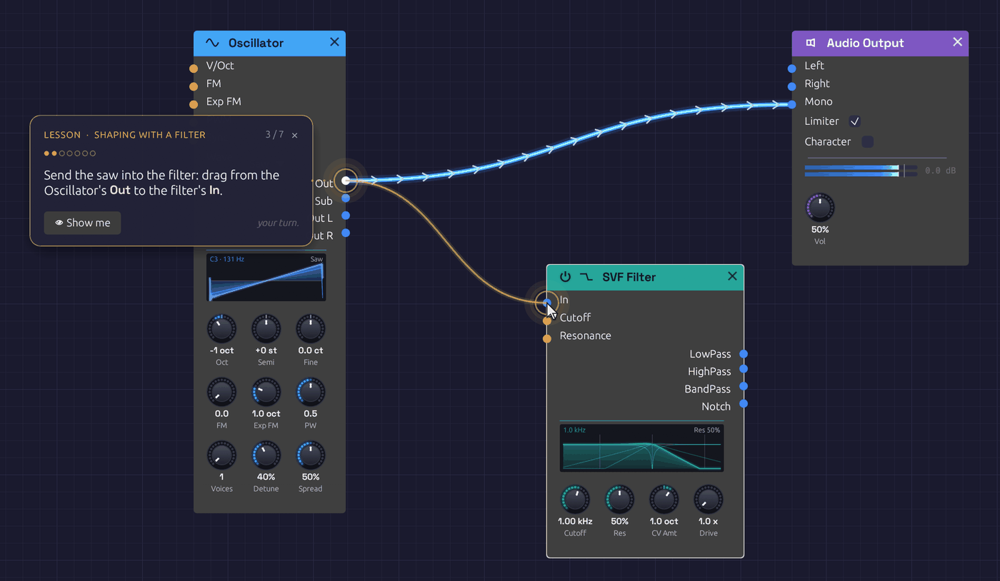

# Lessons

Lessons are short tutorials that run inside Soba, and you learn by doing each step yourself. A caption sits beside the part of the patch it's about, and that part glows. A ghost pointer shows the move once, then the lesson waits until you've made it. When the patch shows you've done the step, it ticks and moves on to the next one.


*A lesson's caption and its ghost pointer, showing the cable to make.*

Open them from **❓ Help › 🎓 Lessons**. Each lesson starts from its own patch, or from an empty canvas, so if the patch you have open has unsaved changes, Soba first asks whether to save them.

## The lessons

Take them in order. Each one builds on the one before, and the five together cover what [Your First Patch](./your-first-patch.md) explains on paper.

| Lesson | What you do | In the browser |
|---|---|---|
| **1. First Sound** | Add an oscillator and an output, patch them together, and change the wave. | [Start](../play/?lesson=first-sound) |
| **2. Shaping with a Filter** | Carve a bright saw with a lowpass filter, then hold `Alt` over a cable to hear what it carries. | [Start](../play/?lesson=shaping-with-a-filter) |
| **3. Envelopes** | Give a tone that never stops a shape in time, from a pluck to a swell. | [Start](../play/?lesson=envelopes) |
| **4. Your First Sequence** | A Clock and a Step Sequencer play a bass line, and you write the tune. | [Start](../play/?lesson=your-first-sequence) |
| **5. Groups** | Fold four modules into one, go inside the group, and come back out. | [Start](../play/?lesson=groups) |

## Taking a lesson

- **Do it your way.** A step checks the patch, not how you got there. A cable dragged from either end counts. So does a module added from the right-click menu or from the `Space` palette, and a knob turned by dragging or by a cable. If you do a step before the lesson asks for it, the lesson ticks it off as soon as it gets there.
- **👁 Show me** plays the ghost pointer's move again.
- **Lost the part?** At the start of a step, the view pans to bring the part it's about into sight. After that, the view is yours to move.
- **Leave at any time.** Click **×** on the caption. The lesson goes, and the patch stays exactly as you left it: an ordinary, unsaved patch to keep playing or to save. Opening another patch or example also ends the lesson.
- **When you're done,** the caption offers the next lesson.

## From the command line

`soba --lesson first-sound` starts a lesson as Soba opens, and in the browser, so does `?lesson=first-sound` on the end of the address. The name is the lesson's file in the `lessons` folder of the source, without its `.txt`.

## Writing a lesson

A lesson is a text file in `lessons/`. Each line says something, points at something, shows a move or waits for one, and each `wait` closes a step:

```text
title First Sound
about An oscillator, an output and one cable: a sound from nothing

say Drag from the Oscillator's **Out** jack to the Audio Output's **Mono** jack.
point osc.sine out:Out
point output.audio in:Mono
show drag osc.sine out:Out to output.audio in:Mono
wait connect osc.sine Out -> output.audio Mono
```

Parts are named the way capture scripts name them. Steps can wait for a module, a cable, a knob's value, the transport, notes played or a cable probed. The whole format is described at the top of `src/app/lesson.rs`, and the tests check every shipped lesson against the modules it names.
