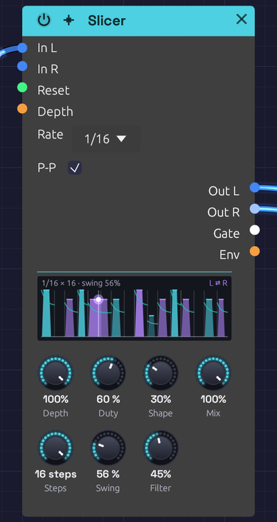

# Slicer

**Module ID** `fx.slicer` · **Category** Effect

*Each step draws the slice it cuts: as tall as it's loud, as wide as Duty holds it open, its edges as soft as Shape. Ties join slices into one slab, the swung steps sit late, the filter's line falls through each slice, and with Ping-Pong the slices bound for the right are violet. A dot rides the slice playing*

The Slicer chops whatever passes through it into a rhythm, in time with the patch, the way a slicer pedal does. Hold a chord into it and out comes a gated sixteenth-note figure. A pad becomes a pulse and a drone becomes a groove. A live voice or guitar from [Audio Input](../sources/audio-input.md) gets chopped as it's played.

A row of sixteen steps says which slices open and how hard. It runs on the patch's [Clock](../modulation/clock.md), so step 1 falls on the bar and the slices land with everything else.

## How it works

Each step is one of five things:

| Step | Drawn as | What it does |
|------|----------|--------------|
| **Accent** | A full-height slice | Opens at full level, and brightest through the Filter |
| **Hit** | A slice most of the way up | Opens at 80% |
| **Ghost** | A low slice | Opens at 45%, for the quiet notes between |
| **Tie** | The slice before, carried on | Holds the slice before it open through its step too, without striking again |
| **Rest** | An empty floor | Closed: the sound is cut, as deep as **Depth** says |

A slice opens at the start of its step and stays open for **Duty** of it, then closes. A tie after it holds it open to the end of its step, so `X===` is one slice a beat long.

**Shape** sets how each slice opens and closes. At 0 the edges are crisp, about a millisecond in and a few out: short enough to sound cut, long enough not to click. Turned up, the slices swell in over up to half their step and fade out over more, so a fast pattern turns to a soft tremolo.

**Depth** sets how far the gaps cut: to silence at 100%, halfway at 50%, not at all at 0. **Mix** blends the input back in, untouched.

### The step filter

**Filter** gives each slice a resonant lowpass that opens as it strikes and closes through its step. A harder step strikes brighter: an accent opens it all the way, a ghost only partly. Turned all the way up, a soft step closes the filter as far as 6 octaves down.

With Depth at 0 nothing is cut, and only the filter steps. That's the "wah step" of a slicer pedal's filter patterns: the sound stays whole, and its brightness jumps from step to step.

### Ping-Pong

With **Ping-Pong** on, the slices alternate from side to side: the first in the row on the left, the next on the right, and so on. A tie stays on the side of the slice it holds. Each pass of the row starts on the left again, so a row with an odd number of slices plays the same way every time round.

### Timing

The row follows the transport's beat: while a Clock plays, step 1 is the first downbeat, and the Slicer keeps its place however the tempo moves. Without a playing Clock it keeps a beat of its own, at the Clock's tempo or 120 BPM. A live input is still chopped while the transport is stopped.

A rising edge at **Reset** starts the row over from step 1, on that beat: patch an [Arranger](../utilities/arranger.md)'s section trigger there to line the row up with a section.

**Steps** shortens the row. 12 steps against a bar of 16 drift across the bar and come back round every three bars. **Swing** pushes every second step late, as a drum machine's swing does: 50% is straight, 66% a triplet shuffle.

## Inputs

| Port | Signal Type | Description |
|------|-------------|-------------|
| **In L** | Audio (Blue) | Left audio to slice: a held chord, a pad, a drone, a live input |
| **In R** | Audio (Blue) | Right audio to slice. When unpatched, it copies In L |
| **Reset** | Gate (Green) | A rising edge starts the row over from step 1, on that beat |
| **Depth** | Control (Orange) | Adds to Depth: +1 adds 100%. An Arranger lane here brings the slicing in and out |

## Outputs

| Port | Signal Type | Description |
|------|-------------|-------------|
| **Out L** | Audio (Blue) | Left, sliced |
| **Out R** | Audio (Blue) | Right, sliced |
| **Gate** | Gate (Green) | High while a slice is open. It drops for a sample where one slice strikes straight after another, so each is its own trigger |
| **Env** | Control (Orange) | The slices' level, 0 to 1, shaped as they're shaped. Patch it to a filter's cutoff and the filter breathes with the slices |

## Parameters

| Control | Range | Default | Description |
|---------|-------|---------|-------------|
| **Depth** | 0 – 100% | 100% | How deep the gaps cut |
| **Duty** | 5 – 100% | 55% | How much of its step a slice stays open: choppy low, legato at 100% |
| **Shape** | 0 – 100% | 10% | How each slice opens and closes: crisp at 0, swelling at 100% |
| **Mix** | 0 – 100% | 100% | The input untouched (0%) to sliced (100%) |
| **Steps** | 1 – 16 | 16 | How many steps the row plays before it starts over |
| **Swing** | 50 – 75% | 50% | How late every second step falls |
| **Filter** | 0 – 100% | 0% | How far the step filter closes through each slice |
| **Rate** | 1/8, 1/16, 1/32, 1/8T, 1/16T | 1/16 | How long each step is (dropdown on the node) |
| **P-P** (Ping-Pong) | Off / On | Off | Sends alternate slices left and right (checkbox on the node) |

## Editing the row

- **Click an empty step** to open a slice there, as loud as how high you click: near the top for an accent, the middle for a hit, low for a ghost.
- **Click a slice** to rest it.
- **Drag a slice** up or down to change its level.
- **Shift+click** a step to tie it to the slice before (or untie it).
- **Right-click** a step to choose what it is, to load one of the patterns, to rotate the whole row a step earlier or later, or to clear it.

Every edit is one undo step. The top of the face says the step length and how many steps play, and names the pattern while the row is still one of them, as written.

## Patterns

The right-click menu starts the row from one of these. They're written a step to a character: `X` an accent, `x` a hit, `.` a ghost, `=` a tie, `-` a rest.

| Pattern | Row | Feel |
|---------|-----|------|
| **Trance** | `X-xXx-x-X-xXx-xx` | The classic gated pad. A new Slicer starts on this |
| **Sixteenths** | `XxxxXxxxXxxxXxxx` | Every step, the beat accented |
| **Eighths** | `X=x=X=x=X=x=X=x=` | Every other step, held through the next |
| **Offbeats** | `--X=--X=--X=--X=` | The upbeat stab of house and dub |
| **Gallop** | `X-xxX-xxX-xxX-xx` | An eighth and two sixteenths |
| **Reverse Gallop** | `Xx-xXx-xXx-xXx-x` | Two sixteenths and an eighth |
| **Tresillo** | `X==X==X=X==X==X=` | 3 + 3 + 2, twice a bar |
| **Clave** | `X--x--X---x-X---` | The son clave, 3-2 |
| **Ghosts** | `X..xX..xX..xX.xx` | Soft notes filling the gaps |
| **Stutter** | `XxXxXxXx-.-.X=--` | Busy, then breaking off |
| **Pulse** | `X===----X===----` | Two long throbs a bar |
| **Breath** | `X=======.=======` | Half a bar open, then half a bar barely there. Turn Shape up |
| **Threes** | `X-xX-xX-xX-xX-x-` with 12 steps | Threes across the bar |

## Tips

- **Start from a held sound.** The Slicer only cuts what it's given, so it suits a sustained chord, a pad, a drone or a [Looper](../utilities/looper.md)'s layers more than a plucked note.
- **After the slicer, add space.** A [Reverb](./reverb.md) or a [Stereo Delay](./delay.md) after it fills the gaps with tails, and the chop sounds like part of the room.
- **Breathe a filter with it.** Patch **Env** to an [SVF Filter](../filters/svf-filter.md)'s **Cutoff** jack for a sweep on every slice, or **Gate** to an [ADSR](../modulation/adsr.md) for a different shape per note.
- **Bring it in and out.** An [Arranger](../utilities/arranger.md) lane into **Depth** turns the slicing on for the chorus and off for the verse.
- **Soften the edges for a tremolo.** Shape up and Duty near 100% turn any pattern into a rhythmic tremolo, not a chop.
