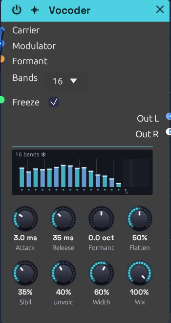

# Vocoder

**Module ID** `fx.vocoder` · **Category** Effect


*Frozen mid-word: a bar for each band shows how loud the voice was there, held solid while the snowflake shows. Flatten is halfway*

The Vocoder makes one sound speak with another's mouth. It takes the **spectral envelope** of a **modulator**, usually a voice: which parts of the spectrum are loud and which are quiet, moment to moment. It then lays that envelope over a **carrier**, usually a synth chord. The chord takes on the voice's vowels and consonants and keeps its own pitch and harmony. It's the sound of Kraftwerk's robots, Herbie Hancock's *I Thought It Was You*, and Air's *Sexy Boy*.

## How it works

1. The modulator is split into **Bands**, a bank of band-pass filters spaced evenly in pitch from 100 Hz to 6.4 kHz.
2. A follower on each band tracks how loud the voice is there. It rises at the **Attack** rate and falls at the **Release** rate.
3. The carrier is split by a second, matching bank.
4. Each carrier band is turned up and down by its twin's follower, and the bands are summed. Where the voice has a formant, the carrier gets one too.

Each band is two band-pass sections in a row, so it's steep enough to keep neighbours apart. Neighbouring bands cross at −3 dB, so a carrier with every follower open comes through with an even spectrum.

Three more paths help speech come through:

- **Formant** slides the carrier's bank against the voice's, by up to an octave either way, so the vowels land higher or lower on the chord.
- **Sibilance** lets the voice's own highs, above the bank, straight through.
- **Unvoiced** swaps the carrier for noise while the voice hisses.

Two more change how the bank itself plays:

- **Freeze** holds every band where it is, so a vowel lasts as long as the chord does.
- **Flatten** evens out the carrier's own spectrum before the voice's is put on it, so a dull carrier speaks as clearly as a bright one.

## Inputs

| Port | Signal Type | Description |
|------|-------------|-------------|
| **Carrier** | Audio (Blue) | The sound that's played: a synth, a chord, noise. A polyphonic cable is summed, so a whole chord can come in on one cable |
| **Modulator** | Audio (Blue) | The sound whose spectrum the carrier wears: a voice from a [Sampler](../sources/sampler.md) or an [Audio Input](../sources/audio-input.md), or drums |
| **Formant** | Control (Orange) | Adds to the Formant knob: +1 moves the carrier's bands an octave up |
| **Freeze** | Gate (Green) | While high, the bands hold where they are. Patched, it takes over from the **Freeze** switch |

## Outputs

| Port | Signal Type | Description |
|------|-------------|-------------|
| **Out L** | Audio (Blue) | The odd bands (the 1st, 3rd, 5th...), leaning left as **Width** opens |
| **Out R** | Audio (Blue) | The even bands, leaning right |

The sibilance and the dry carrier (below 100% **Mix**) sit in the middle of both.

## Parameters

| Control | Range | Default | Description |
|---------|-------|---------|-------------|
| **Bands** | 8 / 16 / 24 | 16 | How finely the spectrum is split (dropdown on the node) |
| **Freeze** | Off / On | Off | Holds every band where it is (a switch on the node) |
| **Attack** | 0.5 – 200 ms | 4 ms | How fast a band opens when the voice gets louder there |
| **Release** | 5 ms – 2 s | 40 ms | How fast a band closes again |
| **Formant** | −1 – +1 oct | 0 | The carrier's bands against the voice's: up for a smaller throat, down for a larger one |
| **Flatten** | 0 – 100% | 0% | How far the carrier's own spectrum is evened out before the voice is put on it |
| **Sibil** (Sibilance) | 0 – 100% | 25% | How much of the voice's highs pass straight through |
| **Unvoic** (Unvoiced) | 0 – 100% | 25% | How far noise replaces the carrier while the voice hisses |
| **Width** | 0 – 100% | 50% | How far apart the odd and even bands sit |
| **Mix** | 0 – 100% | 100% | From the carrier alone (0%) to the vocoded sound (100%) |
| **Level** | −24 – +12 dB | 0 dB | The output's gain, after everything else |

The **Formant** input adds to the knob, and the sum stops at an octave either way. While it's patched, the knob stays live and sets the centre the CV works around.

Attack and Release are the time a band takes to cover most of a change (63%), like the RC follower on an analog vocoder's band.

## The display

Bars stand on a frequency axis, one per band, each as tall as the voice is in that band right now. Watch them while the voice speaks and you can see the vowels change. An "ee" lifts the bars at both ends, and an "oo" piles them up at the left.

- **Colours.** Odd bands are cyan and even bands violet. The colours part as **Width** opens, to show which side each band plays on.
- **Formant.** When Formant moves the carrier's bands, each bar leaves a white cap where the carrier plays it, joined to its own foot by a slanting line. The shift shows top right.
- **Sibilance.** The strip on the right is the range Sibilance passes. Its column is the voice's level up there, lit as brightly as the knob lets it through.
- **Unvoiced.** While the voice hisses and Unvoiced lets noise in, the bank glitters.
- **Freeze.** Frozen, the bars stop and turn solid, with icy caps, and a snowflake sits beside the band count. The sibilance column goes dark, because the voice's own highs are muted while the bands hold.
- **The feet.** The dots under the bars lie along the carrier's slope as the bank plays it. A dull carrier's feet fall away to the right. Turn up **Flatten** and they level out, and a faint line stays behind on the slope the carrier came in with. Hover over the display to read both slopes in dB an octave.

## Shaping the sound

**Bands.** Eight bands sound like a machine talking: rough, buzzy and only just readable, the classic robot. Sixteen is the all-rounder. Twenty-four is the clearest and most like the voice itself. Loudness stays within a few dB whichever you choose. Changing Bands fades the bank out and in over a few milliseconds, so it never clicks.

**Attack and Release.** Speech wants a fast attack (2 to 5 ms) and a short release (20 to 50 ms), so each syllable starts and stops cleanly. Lengthen the release past a few hundred milliseconds and the words smear into a choir that lingers on each vowel. Very short times on the low bands start to buzz, because the follower begins to trace the waveform itself.

**Formant.** Moving the carrier's bank up makes a smaller throat: the voice turns childlike, then cartoonish. Moving it down makes a giant. The pitch you hear doesn't move, because that comes from the carrier. Small amounts (a quarter octave or so) change the character without hurting the words. An LFO on the Formant input makes the voice wobble between the two.

**Sibilance and Unvoiced.** Consonants like "s", "t" and "f" are mostly noise above 4 kHz, where many carriers have little to give. **Sibilance** passes the voice's own highs straight through, so they stay crisp. **Unvoiced** handles the hiss inside the bank. When the voice's level above 4 kHz grows past 30% of its whole level, noise starts replacing the carrier, and by 60% it has replaced it as far as the knob allows. The "s" is then spoken by noise, through the voice's own bands. With no carrier at all, Unvoiced still lets the consonants through on their own. Vowels don't trigger it.

**Width.** At 0% the vocoder is mono. Wider, neighbouring bands split left and right, and the voice seems to fill the space between the speakers. At 100% each side carries only its own bands.

**Mix.** At 0% you hear only the carrier, centred. In between, a little of the raw chord fills the gaps between the words.

**Level.** Turns both outputs up or down, the dry carrier, the bank and the sibilance alike, and changes nothing else: the bands, the display and Flatten's weighting hear the same thing at any Level. Set the part's loudness here and leave the faders after it free for the mix.

**Freeze.** Sing an "ahh", switch on Freeze, and every band holds exactly where it was. Now play chords: each one says the same vowel for as long as you hold it, and you can stop singing. The voice's own highs (the Sibilance path) are muted while frozen, so whatever you say next doesn't leak through, and the Unvoiced noise holds where it was too. With **Flatten** up, the voice's weighting of the bands holds as well, so a held vowel keeps one level through the whole chord. Switch Freeze off and the bands carry on from where they were held, at the Attack and Release rates, so there's no jump. Patch a gate into the **Freeze** input and it takes over from the switch: high holds, low lets go.

**Flatten.** The bank can only put the voice where the carrier has something to give. A dull carrier, like a pad through a low-pass filter or a triangle or sine chord, is loud low down and nearly silent at 2 kHz, where much of a vowel lives. Its words come out muffled. Flatten measures the carrier in each band and lifts the quiet bands and lowers the loud ones until they're even, before the voice's levels are applied. At 0% the carrier keeps its own tilt, exactly as before. At 100% every band of the carrier is the same level, the "spectral whitening" of modern vocoders. In between, it goes that share of the way, in dB. Flattened, a triangle chord speaks its vowels as plainly as a saw does unflattened.

A few things keep Flatten clean:

- A band is lifted no more than about 40 dB above where the carrier has it, and nothing below −100 dBFS is lifted at all, so empty bands and a silent carrier don't turn into hiss.
- When a new note fills a band that was being lifted, the lift comes off at once, so the note doesn't burst through.
- The vocoder stays about as loud as you turn it, within a dB or so. The level every band is brought to is weighted by where the voice has been over the last second, so evening the carrier out doesn't turn down the bands the voice uses most. A chord and a voice are both loudest low down. Frozen, the weighting holds with the bands.

Flatten can only even out what the carrier has. A pure sine chord has nothing above its top note, and there's nothing there to lift, so give it a little brightness first: a triangle or a soft saw is plenty. A bright saw is already close to even across the bank, so Flatten changes it little.

## Carriers that work

The vocoder can only carry what the carrier has to give. A **bright, sustained** carrier works best: saws, pulses, a supersaw, a chord on a polyphonic cable, or noise for a whisper. A dark, filtered pad has nothing up high for the voice's upper bands to open, so the words come out muffled. Filter the carrier after the vocoder, not before, or turn up **Flatten** to bring out what highs it has.

**Keep the carrier low.** A carrier's harmonics are where the vowels get drawn, and a high note spaces them too far apart to trace the formants. Measured with speech recognition on a spoken line, a saw at A2 or A3 kept about 60% of the words, and the same saw at A4 about 20%. A chord voiced low and wide, held while the words move, works best of all. [Clair de Satellite](../../songs/clair-de-satellite.md) sings on the string section's chord for this reason, not on its melody.

The output follows both inputs: a loud chord and a loud voice make a loud vocoder. A five-note chord of detuned saws arrives several times louder than one voice, so turn **Level** down to sit it with the rest.

Turning the carrier down is a poorer way to the same place. The bank does come down with it, dB for dB, with or without **Flatten**. But the Sibilance path and the Unvoiced noise take their level from the voice, not the carrier, so they stay where they were. The vocoder comes down by less than the carrier did, and the mix tips toward hiss. **Level** turns everything down together.

## Bypass

Click the power switch in the node header, press **Ctrl+B** with the module selected, or choose **Bypass** from its right-click menu. The **Carrier** passes straight to both outputs, and the modulator is heard nowhere, like a pedal's footswitch. The switch crossfades over 20 ms.

## Starting points

| Sound | Bands | Attack | Release | Formant | Sibil | Unvoic |
|-------|-------|--------|---------|---------|-------|--------|
| Classic vocoder | 16 | 3 ms | 35 ms | 0 | 35% | 40% |
| Robot | 8 | 2 ms | 20 ms | 0 | 20% | 0% |
| Clear speech | 24 | 2 ms | 30 ms | 0 | 50% | 50% |
| Choir smear | 24 | 30 ms | 600 ms | −0.2 oct | 10% | 0% |
| Small and bright | 16 | 3 ms | 35 ms | +0.5 oct | 35% | 40% |

Any of these works on a dull carrier with **Flatten** at 70 to 100%. Freeze and Flatten start off.

## Patch ideas

**A phrase that speaks on every chord.** A [Sampler](../sources/sampler.md) in One-Shot plays a recorded line, and a [Clock Divider](../utilities/divider.md) fires it every two bars. A [Chord Sequencer](../utilities/chord-sequencer.md) plays the chords on a saw voice. The [Soba Speaks](../../recipes/soba-speaks.md) example is built this way:

```text
[Sampler L] ──> [Vocoder Modulator]
[Oscillator Out] ──> [Vocoder Carrier]     (a saw, on the Chord Sequencer's Pitch)
[Vocoder Out L] ──> [Mixer Ch 1]
[Vocoder Out R] ──> [Mixer Ch 2]
```

**Your own voice.** Patch an [Audio Input](../sources/audio-input.md)'s **L** into **Modulator**, and speak or sing into a microphone while the chords play. Wear headphones, or the mic will hear the speakers and the vocoder will start to howl.

**Drums that play chords.** Patch a drum loop into **Modulator** and a held chord into **Carrier**. The chord pulses in the rhythm of the drums: the kick opens the low bands, and the hats open the high ones.

**A whisper.** Patch [Noise](../sources/noise.md) (white) into **Carrier** and the voice comes back whispered, with no pitch at all.

**A vowel to play chords on.** Sing or play a sustained vowel into **Modulator** and switch on **Freeze** mid-vowel. Now the [Chord Sequencer](../utilities/chord-sequencer.md) or a keyboard plays the chords, and each one comes out as "ahh" or "ooh", with no voice needed any more. A long **Release** before you freeze softens the held vowel.

**A stutter of held vowels.** Patch a [Clock Divider](../utilities/divider.md)'s **Gate** into **Freeze** while a voice speaks. Each gate holds the syllable it lands on for as long as the gate is high, then lets the voice run on until the next one. Short gates on the beat give a rhythmic, chopped vocal, and longer ones give a held word at the start of each bar. [Held Vowels](../../recipes/held-vowels.md) turns this round: its gate is high for three beats of every four and lets go only for the beat a singer sings on, so each new chord holds the vowel sung just before it.

```text
[Clock Divider Gate] ──> [Vocoder Freeze]
[Sampler L] ──> [Vocoder Modulator]
```

**A pad that speaks.** A triangle chord, or a saw through a low-pass, makes a soft pad but a mumbling vocoder. Turn **Flatten** up to 100% and the vowels come through. Mix the pad back in beside the vocoder and it still sounds soft. [Held Vowels](../../recipes/held-vowels.md) sings on a triangle chord this way.

## Related modules

- [Audio Input](../sources/audio-input.md): a live voice to vocode
- [Sampler](../sources/sampler.md): a recorded voice that plays itself
- [Chord Sequencer](../utilities/chord-sequencer.md): chords for the carrier, on one cable
- [Compressor](./compressor.md): the other effect that listens to a second signal
- [Chorus](./chorus.md) and [Reverb](./reverb.md): space for the voice afterwards
