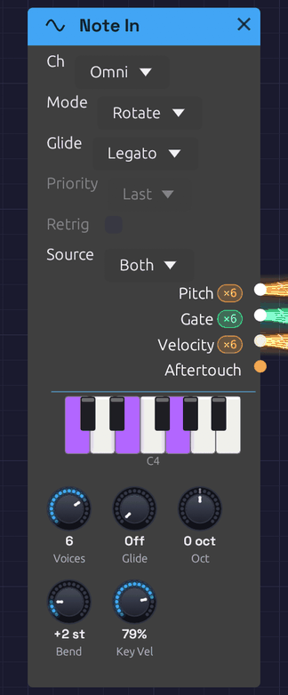

# Note In

**Module ID** `input.poly_midi` · **Category** Source


*A chord from a MIDI keyboard and a note on the computer keys, lit on its piano.*

Note In is how you play a patch. It takes notes from your computer keyboard, from the piano on its face (held with the mouse or a finger), and from a MIDI device: a keyboard, a pad controller, or a DAW or sequencer sending MIDI. It turns them into a V/Oct **Pitch**, a **Gate**, a **Velocity** and an **Aftertouch** signal that any module can use. It needs no setup and no hardware, which makes it the quickest way to hear a patch: the [First Sound](../../getting-started/your-first-patch.md) example that opens with the app is played from one.

With **Voices** at 1 it plays one note at a time, as a classic monosynth does: **Priority** decides which held key sounds. With more voices it plays chords. Every note you play gets a voice of its own, and the **Pitch**, **Gate** and **Velocity** cables carry all the voices at once, one channel per voice. Patch them into the polyphonic modules (Oscillator, SVF and Ladder filters, ADSR, VCA) and each held note plays through its own oscillator, filter and envelope. See [Polyphony](../../concepts/polyphony.md) for how polyphonic cables work.

Every note, from the keys or from MIDI, starts on its exact sample, however short it is.

## Outputs

| Port | Signal Type | Channels | Description |
|------|-------------|----------|-------------|
| **Pitch** | Control (Orange) | One per voice | Each voice's note as V/Oct, with pitch bend. C4 (MIDI note 60) is 0.0 |
| **Gate** | Gate (Green) | One per voice | High while the voice's key, or the sustain pedal, holds its note |
| **Velocity** | Control (Orange) | One per voice | Each note's velocity, 0 to 1 |
| **Aftertouch** | Control (Orange) | 1 | Channel pressure, 0 to 1, shared by every voice |

Once the patch is playing, each polyphonic output shows its channel count in a small pill beside its label: **×8** means it carries eight voices. The **Gate** output lights up while a note is held.

## Parameters

| Control | Range | Default | Description |
|---------|-------|---------|-------------|
| **Source** | Both / Keys / MIDI | Both | Where the notes come from: the computer keys and the piano, a MIDI device, or both (see [Sources](#sources)) |
| **Ch** (Channel) | Omni / 1 – 16 | Omni | The MIDI channel to listen to. Omni hears all of them, except the notes a [Pads](./pads.md) module claims (see [Claimed notes](#claimed-notes)). The keys aren't on a channel, so this never turns them away |
| **Voices** | 1 – 8 | 8 | How many notes can sound at once, and so how many channels the cables carry. 1 plays one at a time |
| **Mode** (Allocation) | Rotate / Reuse | Rotate | With several voices, how a new note picks its voice (see [Voice allocation](#voice-allocation)) |
| **Priority** | Last / Low / High | Last | With one voice, which held key sounds (see [One voice](#one-voice)) |
| **Retrig** (Retrigger) | Off / On | Off | With one voice, restarts the gate when you move between held keys |
| **Oct** (Octave) | −4 to +4 | 0 | Shifts every note by whole octaves |
| **Bend** (Bend Range) | 0 – 12 semitones | 2 | How far the pitch bend wheel bends every voice |
| **Glide** | Off – 2 s | Off | How long the pitch takes to slide to a new note (see [Glide](#glide)) |
| **Glide** (Glide Mode) | Always / Legato | Legato | Which notes slide: all of them, or only those played while another key is held |
| **Key Vel** (Key Velocity) | 0 – 100% | 79% | How hard the computer keys and the piano play. A computer key can't tell soft from hard, so this sets it for all of them. 79% is MIDI velocity 100 |

**Priority** and **Retrig** only do anything with one voice, and **Mode** only with several, so the ones that don't apply are drawn faded. They can still be set, ready for when **Voices** changes.

Each voice runs a full copy of every polyphonic module downstream, so eight voices cost about eight times the CPU of one. If a patch is heavy, turn **Voices** down.

## Sources

**Both** plays from everything: the computer keys, the piano on the face, and MIDI on the chosen **Ch**. **Keys** plays only from the computer keys and the piano, so a MIDI controller in the same patch can play something else. **MIDI** plays only from MIDI, so the computer keys can play something else. Two Note Ins, one on **Keys** and one on **MIDI**, give one patch a bass on the computer keys and a lead on a controller.

The piano on the face lights the notes held, from wherever they come.

### Key layout

The bottom two letter rows form a piano keyboard starting at C4. The bottom row plays the white keys and the row above it plays the black keys, sitting between them as they would on a piano. The top letter row and the numbers above it are a second piano laid out the same way, an octave higher, as in a tracker:

```text
Black keys:    2   3       5   6   7       9   0
White keys:  Q   W   E   R   T   Y   U   I   O   P
Note:        C5  D   E   F   G   A   B   C6  D   E

Black keys:    S   D       G   H   J       L   ;
White keys:  Z   X   C   V   B   N   M   ,   .   /
Note:        C4  D   E   F   G   A   B   C5  D   E
```

That's C4 to E6, a little over two octaves. The pianos overlap by a few notes: **,** **.** **/** play the same C, D and E as **Q W E**, so a run up the bottom row can carry on along the top. Turn **Oct** to move the whole range.

The piano on the face plays too. Hold a key with the mouse, or a finger on a touch screen, and it plays like a computer key; slide across the keys and the pitch follows. It's how Note In is played on a phone.

Keys don't play notes while you hold **Ctrl** or **Alt** (those are shortcuts), while you're typing in a text field, or while the quick-add palette is open. **Space** and **Tab** open the palette, so they're never notes. The app has to have keyboard focus: if nothing happens, click the canvas. Switching to another window lets go of every key held.

The keys play every Note In whose **Source** isn't MIDI, in the browser and inside a DAW as well as in the app, with or without a MIDI device. The [MIDI Monitor](./midi-monitor.md) shows them as **Keys**.

### Choosing a MIDI device

MIDI comes in from the devices ticked in **MIDI In** on the toolbar. The menu lists every MIDI input the system can see. Tick one and the dot fills in (●) once it's open. Tick as many as you play at once, up to eight: a keyboard, a pad controller and a drum machine sending clock can all be open together. Untick one to close it. **None (Disconnect)** closes them all.

- **Plugged in a device after starting Soba?** Open the menu and click **🔄 Refresh**.
- **In the browser,** the menu is a **🎹 Connect MIDI** button until you allow MIDI, and a device plugged in later appears by itself. See [MIDI](../../getting-started/interface-overview.md#midi).
- **Connection failed?** The reason appears in the status bar at the bottom of the window, and the device stays unticked. On Windows, a device another app already has open (a DAW, a browser, a controller's editor) can't be opened a second time, so close the other app and tick the device again.
- **Closing or unplugging a device** releases the notes still held on it, so nothing sticks. Notes held on the other devices play on.
- **Inside a DAW,** Soba plays the notes on its track, and there's no **MIDI In** menu.

Soba remembers the devices ticked and opens them again next launch, or as soon as each is plugged in.

### Listening to one device

Every Note In hears every device open, until you give it a **Device**. Right-click the module, open **Device** and choose one of the devices open. Its name appears faintly after the module's title, and from then on the module hears that device alone. Two keyboards can then play two synths, each through its own Note In, on the same MIDI channel. **Any** hears them all again.

The Device is saved with the patch, by the device's name, so the patch finds it on another computer with the same gear. While no device of that name is open, the name dims and the module hears no MIDI. It still hears the computer keys and the piano, which aren't a device.

[Pads](./pads.md), [Controls](./controls.md), the [Clock](../modulation/clock.md) and the [MIDI Monitor](./midi-monitor.md) have a Device too.

### Claimed notes

A [Pads](./pads.md) module claims the notes its pads listen to, on their channel: by default notes 36 to 43 on channel 10, which most pad controllers send. A Note In on Omni skips those notes, so hitting a pad plays its drum and not the synth as well. The piano doesn't light for them either.

A Pads set to one **Device** claims that device's notes alone. With the Pads on the pad controller, a keyboard's note 36 on channel 10 still plays the synth.

A Note In set to a channel hears all of that channel's notes, claimed or not. Set **Ch** to the pads' channel to play notes from the pads too. The computer keys and the piano are never claimed.

## How notes become CV

- **Note On** raises the voice's gate and moves its **Pitch** to the note.
- **Note Off** drops the gate. **Pitch** stays on the note, so a release tail stays in tune.
- **Pitch bend** moves **Pitch** by up to ±**Bend** semitones. It glides over about 5 ms between the wheel's steps, so bends never zipper.
- **Channel pressure** appears on **Aftertouch**.
- **The sustain pedal** (CC 64) holds notes after their keys come up. Lifting it releases them all.
- **All Notes Off** (CC 123) and **All Sound Off** (CC 120) release every note the device that sent them is playing, pedal or not, and lift its pedal. Soba sends one when a device is closed or unplugged, so a Note In on **Any** lets go of that device's notes and plays on with the others'. From a DAW, they release everything.

Each semitone is 1/12 on **Pitch**, so MIDI note 72 (C5) is +1.0 and note 48 (C3) is −1.0. With every tune knob at 0, the [Oscillator](../sources/oscillator.md) plays C4 at 0.0, so Note In plays it in tune with nothing to set.

### Timing

Notes are handled on the audio thread. Each one is stamped the moment it arrives, from a device or from the keys, and placed at the matching sample of the next audio buffer. Every note is delayed by the same amount, one audio buffer (a few milliseconds), so a steady sequence from a DAW plays back steady, with no jitter. Even the shortest note produces a gate.

## One voice

With **Voices** at 1, Note In plays legato. The first key raises the gate, and while any key is held the gate stays up: pressing another key moves **Pitch** to it without retriggering the envelope, so overlapping your key presses slurs one note into the next. When several keys are held, **Priority** picks the one that sounds:

| Priority | The key that sounds | Good for |
|----------|---------------------|----------|
| **Last** | The most recently pressed | Most playing |
| **Low** | The lowest | Basslines: a held bass note wins over anything played above it |
| **High** | The highest | Leads over a held drone |

Release the sounding key and another held key takes over, so you can trill against a held note.

With **Retrig** off, playing legato changes the pitch but keeps the gate high, so the envelope carries on, for smooth, connected lines. With **Retrig** on, each legato note drops the gate for a single sample, so the envelope starts again on every note.

The cables carry one channel, so a monophonic patch hears one note.

## Voice allocation

With several voices, **Rotate** gives each new note the next free voice in turn. A released note keeps ringing through its release while the next note sounds on a different voice, so release tails overlap naturally.

**Reuse** sends a note played again back to the voice that last played it, the way a piano string is struck again. Any other note takes the voice that has been free the longest, which gives release tails the most time to finish.

In either mode, a note played again while it's still sounding (held by the sustain pedal, say) restarts on its own voice rather than taking a second one.

### Voice stealing

When every voice is busy, a new note takes one over. It chooses:

1. a voice the sustain pedal is holding (its key already up), oldest first;
2. otherwise, the oldest note still held.

The taken voice's gate drops for one sample, so its envelope starts again for the new note.

## Glide

**Glide** makes the pitch slide from one note to the next instead of jumping, like the portamento on a classic monosynth. The knob sets how long the slide takes, from Off up to 2 seconds. Most of its travel covers the short times, where glide is most useful: 200 ms is a little past halfway.

- **Even across the keyboard.** The slide moves evenly in pitch, so it sounds the same low or high.
- **The same time for any distance.** An octave leap arrives as quickly as a step to the next semitone.
- **Eases in.** The pitch covers most of the distance early and settles gently onto the note: about two thirds of the way in the first fifth of the time, and within 1% of the note by the end of it.

The **Glide** dropdown picks which notes slide:

| Glide Mode | Which notes slide | Feels like |
|------------|-------------------|------------|
| **Legato** | Only a note played while another key is still held. A note after a gap starts on its own pitch | A Minimoog or a 303: you choose each slide with your fingers |
| **Always** | Every note, from wherever the last one left off | Portamento that's always on |

Pitch bend rides on top of the glide: the wheel moves the pitch at once while the note underneath slides. With one voice, **Glide** and **Retrig** work together, so with both on, each legato note restarts the envelope and slides into pitch.

With several voices, each voice slides from **its own** previous note. Change chords with Glide up and every voice takes its own path, crossing and converging, the way the voices of a vintage polysynth do. A stolen voice slides from wherever it was. **Mode** decides where each slide starts: with **Reuse**, a note played again returns to the voice that last played it, so it doesn't slide at all; with **Rotate**, the voices take turns, so each slide starts from a different note of the last chord or two. In **Legato** mode a chord struck from nothing starts on its own pitches: notes arriving within 30 ms of the first count as part of that chord, since no hand strikes every key at once.

To hear it, open First Sound and turn **Glide** to about 200 ms. Hold **Z** (C) and tap **B** (G): the pitch slides up to G and, when you let go of B, back down to C.

## MIDI Learn

Any knob in the patch can follow a MIDI controller (a mod wheel, a fader, a knob on your keyboard), and so can toggles, dropdowns and footswitches, from pads as well as knobs. This works with or without a Note In in the patch.

1. Right-click the knob and choose **Learn MIDI**. A purple **M** badge blinks above it, and the status bar asks you to move a control.
2. Move the knob or fader on your controller. The badge stops blinking: the knob is mapped.

Changed your mind, or no controller to hand? Press `Escape`, or right-click the blinking knob and choose **Cancel MIDI Learn**, and nothing is mapped. Starting learn on another knob moves it there instead.

The controller sweeps the knob's whole range, on the channel it was learned on. A fader picks the knob up where it stands rather than jumping it, and an endless encoder steps it. Right-click a mapped knob to see its CC number and channel, to **Re-learn MIDI**, or to **Clear MIDI**. Mappings are saved with the patch. Moves made by a controller aren't added to the undo history. [MIDI Learn](../../getting-started/interface-overview.md#midi-learn) in the interface overview says what pads do to each kind of control.

## Patch examples

The smallest playable voice, as in the First Sound example, with **Voices** at 1:

```text
[Note In Pitch] ──> [Oscillator V/Oct]
[Note In Gate] ──> [ADSR Gate]
[Oscillator Out] ──> [VCA In]
[ADSR Out] ──> [VCA CV]
[VCA Out] ──> [Audio Output Mono]
```

Chords, with **Voices** at 8:

```text
[Note In Pitch] ──> [Oscillator V/Oct]
[Note In Gate] ──> [ADSR Gate]
[Note In Velocity] ──> [ADSR Velocity]
[Oscillator Out] ──> [Ladder Filter In]
[Ladder Filter LP24] ──> [VCA In]
[ADSR Out] ──> [VCA CV]
[VCA Out] ──> [Audio Output Mono]
```

Hold a chord and each note has its own oscillator, filter and envelope. The Audio Output is a mono module, so it hears the voices summed. Voices add up, so a four-note chord is about four times as loud as one note: leave headroom with the VCA's **Level**. The [Lush Pad](../../recipes/lush-pad.md) example is built this way.

Velocity on the [ADSR Envelope](../modulation/adsr.md) makes harder notes louder. Patch **Aftertouch** into the filter's **Cutoff** to brighten a note as you press into the key.

Two voices on two channels, for a bass and a lead from one DAW:

```text
[Note In (Ch 1, Voices 1, Priority Low)] ──> [Bass voice]
[Note In (Ch 2, Voices 1, Priority High)] ──> [Lead voice]
```

## Older patches

Note In takes the place of three modules: Keyboard (the computer keys, one voice), MIDI Note (MIDI, one voice) and Poly MIDI (chords). A patch saved with any of them opens with Note In in their places, and plays as it did: a Keyboard becomes a Note In with one voice on **Keys**, at the Keyboard's velocity; a MIDI Note becomes one with one voice on **MIDI**; and a Poly MIDI is a Note In already.

## Troubleshooting

**No sound.** Press **Play**: notes only sound while the patch is playing. Check **Source**. For MIDI, check that the device is selected in **MIDI In** and that its dot is filled, and set **Ch** to Omni in case the device sends on another channel. A [MIDI Monitor](./midi-monitor.md) shows whether anything is arriving at all.

**Only one note of a chord sounds.** **Voices** is at 1, or the cables run into a module that isn't polyphonic, which hears one channel.

**Some notes don't play.** A [Pads](./pads.md) module in the patch claims its pads' notes from a Note In on Omni (see [Claimed notes](#claimed-notes)). Learn the pads onto other notes, or set **Ch** to the channel you play on.

**Wrong pitch.** Check **Oct**, and that the pitch bend wheel is centered.

**Stuck note.** Send All Notes Off from your controller, or select the device again in **MIDI In**. Either releases every note held from that device.

## Related modules

- [MIDI Monitor](./midi-monitor.md) – see the notes that are arriving
- [Pads](./pads.md) – a pad controller's pads as gates, for finger drums
- [Oscillator](../sources/oscillator.md) – where **Pitch** usually goes
- [ADSR Envelope](../modulation/adsr.md) – where **Gate** and **Velocity** usually go
- [Chord Sequencer](../utilities/chord-sequencer.md) – plays chords for you
