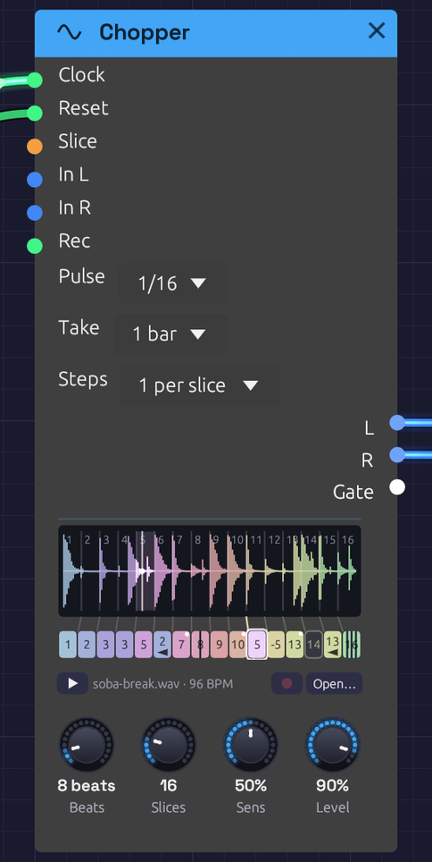

# Chopper

**Module ID** `source.chopper` · **Category** Source

*Two bars of a break in sixteen slices, each in a hue of its own, and the row of steps under them, each tinted like the slice it plays. Step 6 plays slice 2 backwards, step 12 plays its slice a fourth down, step 14 rests and step 16 stutters ×4. The dots in the corners are dice. The tick under the row is where the loop is in time; the white playhead is where it's reading.*

Chopper plays a drum break in time with the [Clock](../modulation/clock.md), and lets you rearrange it step by step.

A [Sampler](./sampler.md) sliced into a break plays a slice for each note: the right tool for playing a break from a keyboard. A break played in a groove asks for more. It has to stay in time, follow the patch's tempo without changing pitch, and be re-sequenced: a snare moved, a kick doubled, a fill stuttered, a hit played backwards. Doing that with a Sampler and a [Step Sequencer](../utilities/sequencer.md) means a note for every slice of every step, set by hand, and retuning the break whenever the tempo moves. The Chopper does it all in one module.

## How it keeps time

The break is cut into slices: equal ones, or one at each hit. Each slice starts on the beat it started on in the break, and plays at its own speed. A file that plays a REX loop works this way, and so did the samplers the breaks of jungle and hip-hop were chopped on.

- **Faster** than the break was played, each slice starts sooner and cuts the one before it short.
- **Slower**, each slice ends before the next begins, and a short fade closes the gap.
- **At its own tempo**, every slice runs on into the next, which fades in over the same 3 ms. The two read the same sound at that moment, so the crossfade is invisible and the break plays back exactly as recorded, round and round.

Either way the pitch never moves, and nor does the groove: a hit pushed late in the break is still late, by the same share of a beat, at any tempo.

Patch the Clock's **Gate** into **Clock**, and set **Pulse** to the Clock's own **Div**: 1/16 for sixteenths. Then set **Beats** to how long the break is: 4 for one bar of 4/4, 8 for two. The name under the waveform shows the tempo the break plays at unchanged, as long as **Beats** says. Patch the Clock's **Reset** into **Reset** too, so the loop starts from its top whenever the Clock does.

## The steps

Under the waveform is a row of steps, one for each slice. Each step's turn comes where its slice began in the break, and left alone it plays its slice. Unedited, the row runs through the slices' hues in order, a spectrum from end to end, and the break plays as recorded.

Each step can be told to play it differently:

- **Another slice.** Drag the step up or down, or right-click it and choose one. The step takes on that slice's hue, so a rearranged pattern can be read at a glance: which slices come back, which never play.
- **Backwards** (Alt+click). It plays its slice from the end, and carries an arrow pointing back.
- **Repeat ×2, ×3 or ×4** (Shift+click). It plays its slice from the top that many times, evenly across its turn: a stutter, or a roll at the end of a phrase. The step splits into its hits.
- **Pitch**, from 12 semitones down to 12 up (right-click). Tape-style: higher plays faster and leaves a gap before the next step, lower plays slower and is cut short by it. The step shows the semitones.
- **Rest** (click). Nothing plays, and the Gate stays low. The step is an empty outline.
- **Chance** (Ctrl+click steps through 0, 25, 50 and 100%). How often the step swaps its slice for one at random, so the break varies itself. A dot in the step's corner grows with the chance. A pattern plays its dice the same way each time the transport starts from the top.

A rest remembers what it was, so clicking it again plays it as before. Right-click a step for all of these, **Back to slice n, as it was**, **Shuffle the slices** (every step a slice at random, each slice once) and **Reset every step**. Every edit is a step you can undo.

## Loading a break

Load a file as on the Sampler: click **Open…**, or the empty panel, or drag a WAV, MP3 or Ogg file onto the node. While a dragged file is over the node you hear it, so you can audition files before you drop one. It plays once when it loads, so you hear what you chose, and **▶** plays it again at any time, dry, beside the patch. **Alt-click** a slice to hear just that slice.

The file should be the loop itself, start to end: a break cut on its downbeats, as you'd cut one to loop it in a sampler. The [Cut-Up](../../recipes/cut-up.md) example's break is made by Soba's own Drums (`tools/breaks/make_break.py`), so it's free to use however you like.

## Recording a break

The Chopper can record its own break. Patch something into **In L** (and **In R**, for stereo) and press the red **Rec** button beside **Open…**. It's the [Sampler's recorder](./sampler.md#recording-into-it): the same button, the same take drawn in red as it comes in, and the same file beside the patch when it's done. Play a phrase into the patch, from a [Keyboard](../midi/keyboard.md), an [Audio Input](./audio-input.md) or the patch's own drums, and chop it up straight away.

**Take** starts at **1 bar**. With a [Clock](../modulation/clock.md) running, Rec then waits for the next bar line, which the panel says, and records exactly that many bars, so the take is already a loop. When it ends, it's the break: it plays at once, from its top on the bar it ended, and **Beats** is set to its length, 8 for two bars of 4/4, so it loops in time. Undo brings back the break you had, with its **Beats**.

**Free** records until Rec is pressed again. A free take made while a Clock runs is set to as many beats as it nearly is; without a Clock, **Beats** is left as it was.

Patch a gate into the **Rec** jack and it takes over from the button: a take starts as it rises (or on the next bar) and ends as it falls. Right-click **Rec** to learn a MIDI footswitch for it.

## Slicing at the hits

**Slices** cuts the loop into 2 to 64 equal slices. Eighth notes suit a swung break, since swing moves the sixteenths in between, not the eighths. Turn it past 64 to **Onsets** and the loop is cut at its hits instead, exactly as on the [Sampler](./sampler.md#slicing-at-the-hits): **Sens** chooses how many hits count, and the markers drag, come off the panel and are added by double-click. Let go of a marker with **Alt** held to hear the slice it now begins.

Cut at the hits, the steps stay evenly spaced under the waveform but the slices don't, so the fan of rules between them leans. Each hit then starts on its own place in the beat, swing and all, and the step row still gives every hit a step.

## Inputs

| Port | Signal Type | Description |
|------|-------------|-------------|
| **Clock** | Gate (Green) | Each rising edge is a pulse, worth what **Pulse** says. The loop plays from the first pulse after a reset. With nothing patched, nothing plays |
| **Reset** | Gate (Green) | A rising edge starts over: the next pulse plays the loop from its top |
| **Slice** | Control (Orange) | Picks the slice each step plays as its turn comes, in place of its own: 0 to 1 across the slices. An [Arranger](../utilities/arranger.md) lane or a [Sample & Hold](../utilities/sample-hold.md) here rearranges the break from outside. Repeats, pitch and rests still come from the step |
| **In L**, **In R** | Audio (Blue) | What **Rec** records (see [Recording a break](#recording-a-break)). One side patched records on both |
| **Rec** | Gate (Green) | Records while high. Patched, it takes over from the button |

## Outputs

| Port | Signal Type | Description |
|------|-------------|-------------|
| **L** | Audio (Blue) | The left channel. A mono file plays the same on both outputs |
| **R** | Audio (Blue) | The right channel |
| **Gate** | Gate (Green) | High for half of each slice played, repeats included, and low through a rest. An envelope, a [Drum](./drum.md) or a sequencer's **Clock** here follows the chop |

## Parameters

| Control | Range | Default | Description |
|---------|-------|---------|-------------|
| **Pulse** | 1, 1/2, 1/4, 1/8, 1/16 | 1/16 | What each pulse at **Clock** is worth. Set it to the Clock's **Div** |
| **Beats** | 1 – 64 | 4 | How long the loop is, in beats |
| **Slices** | 2 – 64, Onsets | 16 | Equal slices, or one at each hit. Each slice gets a step |
| **Sens** (Sensitivity) | 0 – 100% | 50% | Sliced by **Onsets**, how strong a hit must be to get a marker |
| **Level** | 0 – 100% | 80% | Output level |
| **Take** | Free, 1 – 16 bars | 1 bar | In bars, with a Clock running, a take starts on the next bar and lasts that long, and sets **Beats** to match |

## Tips

- **Find the break's tempo.** A loop of 2.000 seconds at **Beats** 4 is 120 BPM, and the name under the waveform says so. If the number looks odd (91.3 BPM), **Beats** is likely wrong, or the file isn't cut on its downbeats.
- **Slow it right down** and the gaps between slices become part of the sound: a break at half speed is a sparse, clipped pattern of hits, each followed by silence.
- **One break, two Choppers.** Patch the same file into a second Chopper with another pattern and pan the two apart, or let one take over from the other by riding the Mixer.
- **Resample a groove.** Patch the mix of a few drums into **In**, record four bars, then rearrange what you just played: the drums can keep going beside it, or be muted for the chopped version to take over.
- **Follow the chop.** The **Gate** output rises on every slice, so a bass line clocked by it moves with the drums, and an envelope from it pumps a pad in time with each hit.
