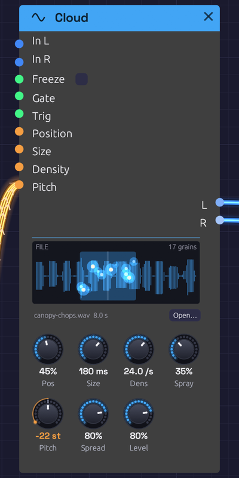

# Cloud

**Module ID** `source.cloud` · **Category** Source

*Canopy's twelve sung syllables, played as a cloud of a Dmaj9 chord. The wash is where grains may start: Position, as wide as Spray scatters them. Each spark is a grain, at its place in the file and as high or low as it sits in the stereo field, bright as it swells and fading as it ends*

Cloud is a granular source. It plays clouds of small grains read from a recording, each a few milliseconds to two seconds long, faded in and out under a smooth window. Every other sample tool in Soba ([Sampler](./sampler.md), [Chopper](./chopper.md), [Looper](../utilities/looper.md)) plays time in order. Granular takes it apart: a sung syllable stretched into a held chord, a drum loop turned into a hiss of sparks, a moment of a voice frozen and played for as long as you like.

It plays a WAV, MP3, FLAC or Ogg file, opened or dragged onto it as for the Sampler, or **live audio** patched into **In**: the last six seconds of it, which **Freeze** holds.

## How it works

A grain is a short read of the source:

1. **Where.** It starts at **Position**, across the source from its start (left) to its end (right). **Spray** scatters it either side.
2. **How long.** It lasts **Size**, under a Hann window that rises from nothing and falls back to nothing, so no grain clicks, however short.
3. **How high.** It reads the source faster or slower by **Pitch**, tape-style, so its pitch and its formants move together. A grain read faster than the recording runs through a steep lowpass of its own first, so nothing folds back down as aliasing, even three octaves up.
4. **Where in the field.** It sits at a random place across the stereo field, as wide as **Spread**.

**Density** says how many grains start each second. With **Spray** at nothing they start on a regular beat and read the same place, which buzzes at the Density's rate: turn Density into the audio range and Size down and you hear it as a pitch. Spray scatters them in place and in time until they blur into a cloud.

Up to 64 grains play at once. Past that, a new one waits for a free place: a dense, long-grained cloud thins out rather than clicking or overloading. However many overlap, the cloud keeps about the same loudness.

## Live audio and Freeze

Patch something into **In L** (and **In R**, or leave it and In L plays on both sides) and the Cloud plays the last six seconds of it in place of the file. Position 1 is just now, and 0 six seconds ago. Grains always read audio already recorded, and never the moment being written.

**Freeze** stops recording, so the six seconds it holds stay to be played. Turn the switch on, or patch a gate: while the gate is high, it's frozen. A [Clock Divider](../utilities/divider.md)'s Gate on Freeze catches a new moment every few bars; a footswitch catches whatever you just played.

While it fills, the face shows the part not yet recorded in the dark, and a grain needs a whole Size of audio behind it before it can start.

## Polyphony

A polyphonic cable into **Pitch** grows a cloud for each of its channels, each at its own pitch, out of the one pool of grains. A [Chord Sequencer](../utilities/chord-sequencer.md)'s Pitch into it plays a cloud of each chord: see [Choir of One](../../recipes/choir-of-one.md). A chord's clouds add up as a chord's notes do, so a four-note chord is louder than one note.

Patch a polyphonic **Gate** as well and each channel's cloud grows only while its gate is high. The grains still sounding play out.

## Trig

With **Trig** patched, grains no longer start on their own. Each rising edge starts a burst on every channel: as many grains as Density and Size would overlap, up to eight, scattered by Spray. Patch a [Clock](../modulation/clock.md) for grains in time.

## Inputs

| Port | Signal Type | Description |
|------|-------------|-------------|
| **In L** | Audio (Blue) | Live audio to play from in place of the file. When In R is unpatched, it plays on both sides |
| **In R** | Audio (Blue) | The right side of the live audio |
| **Freeze** | Gate (Green) | Holds the live audio while high. Patched, it takes over from the switch |
| **Gate** | Gate (Green) | Patched, each channel's cloud grows only while its gate is high. Polyphonic |
| **Trig** | Gate (Green) | Patched, grains start only on its rising edges, in bursts |
| **Position** | Control (Orange) | Adds to Position: +1 is the whole source |
| **Size** | Control (Orange) | Moves Size by an octave a unit: +1 doubles it |
| **Density** | Control (Orange) | Moves Density by an octave a unit |
| **Pitch** | Control (Orange) | V/Oct, on top of the Pitch knob. Polyphonic: a cloud for each channel |

Position, Size, Density and Pitch modulate around their knobs: the knob stays live and sets the centre the CV works around.

## Outputs

| Port | Signal Type | Description |
|------|-------------|-------------|
| **L** | Audio (Blue) | Left: every cloud, mixed |
| **R** | Audio (Blue) | Right |

## Parameters

| Control | Range | Default | Description |
|---------|-------|---------|-------------|
| **Freeze** | Off / On | Off | Holds the live audio (a switch beside its jack) |
| **Pos** (Position) | 0 – 100% | 50% | Where grains read, across the source. Playing live audio, 100% is just now |
| **Size** | 2 ms – 2 s | 120 ms | How long each grain is |
| **Dens** (Density) | 0.5 – 200 a second | 16 /s | How many grains start each second, on each channel |
| **Spray** | 0 – 100% | 10% | Scatters grains around Position (at 100%, over the whole source) and in time |
| **Pitch** | ±24 st | 0 st | Plays every grain higher or lower |
| **Spread** | 0 – 100% | 50% | How widely grains sit across the stereo field |
| **Level** | 0 – 100% | 80% | Output level |

A grain's place, size, pitch and pan are set as it starts, and it plays them out. Turning a knob changes the grains to come, never the ones already sounding, so nothing jumps.

## The face

The source's waveform, the file's or the live audio's, oldest on the left. A soft wash shows where grains may start, and the line through it is Position. Every grain is a spark at the place it's reading, raised or lowered by where it sits in the stereo field, bright as it swells and fading as its window closes. The header says what it plays (**FILE**, **LIVE** or **FROZEN**, when the waveform turns to ice) and how many grains are sounding.

Click the waveform, or **Open…**, to open a file, or drag one from your files onto the node.

## Sounds to try

- **A held vowel.** A sung note, Size 200 ms, Density 20, Spray 5%: the syllable it's at goes on as long as you like. Move Position slowly to walk through the word.
- **A shimmer.** Any file, Size 10–30 ms, Density 100+, Spray 60%, Pitch +12, into a [Reverb](../effects/reverb.md).
- **A pitch from a buzz.** Spray 0, Size 5 ms, Density 110: the grains themselves are the note, an A. The file only colours it.
- **Freeze a phrase.** An [Audio Input](./audio-input.md) into In, Position at 95%: sing or play, flip Freeze, and play the cloud of what you just did.
- **Grains in time.** A [Clock](../modulation/clock.md) at 1/16 into Trig, Size 40 ms, a [Sample & Hold](../utilities/sample-hold.md) on Position: a granular breakbeat.
- **A chord of a voice.** A [Chord Sequencer](../utilities/chord-sequencer.md)'s Pitch into Pitch: see [Choir of One](../../recipes/choir-of-one.md).

## Related

- [Sampler](./sampler.md): plays a recording in order, from a gate or a keyboard.
- [Looper](../utilities/looper.md): records live audio as a loop, to play back whole.
- [Vocoder](../effects/vocoder.md): another way to make a chord speak with a voice.
