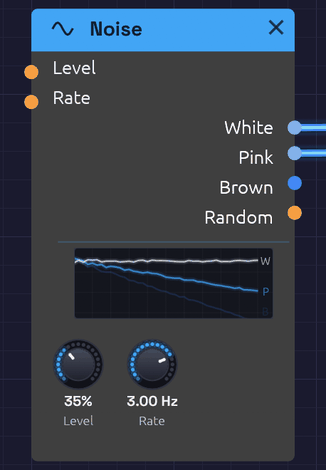

# Noise

**Module ID** `source.noise` · **Category** Source


*White and Pink are patched, so their lines are lit; Brown, unpatched, is dimmed.*

Noise is a sound with no pitch: every frequency at once, at random. Through a filter and an envelope it becomes a snare, a hi-hat, a breath, wind or surf. Sampled by a clock, it becomes a melody that never repeats.

The module makes three colours of noise, an output that wanders smoothly at modulation speed, and one that scatters triggers at random:

- **White**: equal energy at every frequency. Bright, hissing, like steam or an untuned radio.
- **Pink**: falls 3 dB per octave, so every octave holds the same energy. To the ear it is the most balanced noise: rain, surf, a waterfall.
- **Brown**: falls 6 dB per octave. A deep, soft rumble, like wind or thunder far away. The name is for Robert Brown, whose random walk of pollen grains it imitates, not the colour.
- **Random**: a smooth random voltage that glides to a new value **Rate** times a second.
- **Dust**: single triggers at random moments, **Rate** of them a second on average. Crackle, raindrops, a ghost note now and then.

Noise is polyphonic. Patch a polyphonic cable into **Level** or **Rate** and each voice plays noise of its own, so a four-note chord of filtered noise is four different hisses, not one copied four times.

## Inputs

| Port | Signal Type | Description |
|------|-------------|-------------|
| **Level** | Control (Orange) | Added to the **Level** knob, and followed instantly. An envelope here, with the knob at 0, shapes the noise into a hit |
| **Rate** | Control (Orange) | Speeds up or slows down **Random** and **Dust**. Each +1 doubles the rate; -1 halves it |

## Outputs

| Port | Signal Type | Description |
|------|-------------|-------------|
| **White** | Audio (Blue) | White noise, spread evenly over ±1 at full Level |
| **Pink** | Audio (Blue) | Pink noise, about -12 dBFS RMS at full Level |
| **Brown** | Audio (Blue) | Brown noise, about -12 dBFS RMS at full Level |
| **Random** | Control (Orange) | A smooth random voltage between -1 and 1. **Level** doesn't affect it |
| **Dust** | Gate (Green) | One-sample triggers at random moments, **Rate** a second on average. **Level** doesn't affect it |

## Parameters

| Knob | Range | Default | Description |
|------|-------|---------|-------------|
| **Level** | 0 – 100% | 50% | Level of White, Pink and Brown |
| **Rate** | 0.01 – 20 Hz | 1 Hz | How many new values **Random** glides to each second, and how many triggers **Dust** scatters |

## The display

The display draws the three noises the way a spectrum analyzer would read them, on a frequency axis from 20 Hz to 20 kHz. All three start from one point at the low end and fan out: **W** stays flat, **P** falls gently and **B** falls twice as steeply. The lines shimmer as a real reading of noise does, most at the low end, where an analyzer has fewer frequencies to average in each octave.

Patched outputs light up and unpatched ones dim, so you can see at a glance which noise a patch is using. The lines sink as **Level** comes down.

## Levels

White uses the whole ±1 range, so it makes a full-range random source for [Sample & Hold](../utilities/sample-hold.md). Pink and Brown are set about 7 dB lower, so their rare peaks stay inside ±1. A gentle ceiling holds those peaks in without touching anything below 0.8.

Brown is a *leaky* random walk: it rises 6 dB per octave as frequency falls, down to about 10 Hz, then levels off. That keeps it from drifting away from zero and pushing your speakers with a slow offset.

## Random

**Random** picks a new value between -1 and 1 **Rate** times a second, and glides to it along a cosine curve. It arrives at each value at rest and leaves it smoothly, so it has no corners. It sounds less like a stepped sample-and-hold and more like something drifting: a filter that breathes, or a pitch that wavers like an old tape.

At 0.05 Hz it takes twenty seconds to move, which is slow enough to change the character of a whole pad over time. At 10–20 Hz it becomes a fast flutter.

## Dust

**Dust** fires a trigger one sample long at moments nobody can predict. Every sample has the same small chance of one, **Rate** over the sample rate, so the triggers fall the way raindrops do: on average **Rate** a second, sometimes two close together, sometimes a long gap. (It's a Poisson process, and the name comes from the Dust generators of SuperCollider.)

At 0.5 Hz it's an occasional tick, a record's dust. At 20 Hz it's a steady drizzle, and **Rate** CV takes it up to a thousand a second, a hiss of grains. Random and Dust share **Rate**, so a Noise used for both moves them together; use a second Noise to set them apart.

A trigger, not a level: patch Dust into anything that listens for a rising edge, like a [Drum](./drum.md)'s **Trig**, an [ADSR](../modulation/adsr.md)'s **Gate** (with a short decay) or a [Sample & Hold](../utilities/sample-hold.md)'s **Trig**. To let only some of a regular rhythm through instead, use [Logic](../utilities/logic.md)'s **Maybe**.

## Patches

### Random melody

The classic: noise, sampled on every clock pulse, played as pitch.

```text
[Clock Gate] ──> [Sample & Hold Trig]
[Noise White] ──> [Sample & Hold In]
[Sample & Hold Out] ──> [Oscillator V/Oct]
[Clock Gate] ──> [ADSR Gate]
```

Each pulse catches a new value of the noise and holds it as a note. **Level** sets the range: at 50%, the notes wander up to half an octave either side of the oscillator's pitch. The pitches are unquantized, so they fall between the keys of a piano; put a [Quantizer](../utilities/quantizer.md) after the Sample & Hold to keep them in a key. A little **Slew** on the Sample & Hold turns the jumps into glides.

### Hi-hat

```text
[Clock Gate] ──> [ADSR Gate]                    (Atk 1 ms, Dec 45 ms, Sus 0, Rel 40 ms)
[ADSR Out] ──> [Noise Level]                    (Level knob at 0)
[Noise Pink] ──> [SVF Filter In]                (Cutoff 4.5 kHz, take HighPass)
```

The envelope opens **Level** for each hit, so no VCA is needed. Only the knob is smoothed; CV at **Level** is followed sample by sample, so a 1 ms attack stays a 1 ms attack. A short decay gives a closed hat; lengthen **Dec** to 250 ms for an open one. The [Rhythmic Sequence](../../recipes/rhythmic-sequence.md) example plays exactly this under its bassline.

### Snare

Mix a short burst of noise with a pitched body. Patch Pink through a bandpass around 2 kHz, open it with a 120 ms decay, and add a sine at 180 Hz with a shorter envelope. The noise is the snare wires; the sine is the drum.

### Wind and surf

```text
[Noise Pink] ──> [SVF Filter In]                (Res 60%, take BandPass)
[Noise Random] ──> [SVF Filter Cutoff]          (Noise Rate 0.1 Hz)
```

Random sweeps a resonant band slowly through the noise, so it rises and falls like gusts. Use Brown for a deeper, more distant wind. Put a slow LFO on a VCA after it, at about 0.1 Hz, and the swell of waves comes and goes.

The [Shoreline](../../recipes/shoreline.md) example builds a whole beach this way, using every output of one Noise module: Pink and Brown for the surf, Random to vary the waves, and White, through a Sample & Hold, to play a wind chime.

### Vinyl crackle

```text
[Noise Dust] ──> [Drum Trig]                    (Noise Rate 6 Hz; Drum: Rim, Tune +24, Decay short)
[Drum Out] ──> [SVF Filter In]                  (Cutoff 3 kHz, take HighPass)
```

Each trigger plays a tiny pitched-up click, at random, about six a second. Turn the Drum down until it sits under the music rather than on it. Patch Dust into a Sample & Hold's **Trig** with White in its **In**, and the S&H's **Out** into the Drum's **Tune**, and no two clicks are the same pitch.

## Related modules

- [Sample & Hold](../utilities/sample-hold.md): turns noise into stepped random values
- [Quantizer](../utilities/quantizer.md): snaps random pitches to a scale
- [SVF Filter](../filters/svf-filter.md): shapes noise into drums, wind and breath
- [Drum](./drum.md): a finished drum voice, with its noise and filters built in
- [ADSR Envelope](../modulation/adsr.md): gives noise a shape in time
- [LFO](../modulation/lfo.md): regular movement, where Random is irregular
- [Logic](../utilities/logic.md): **Maybe** passes a regular rhythm only sometimes, where Dust has none
