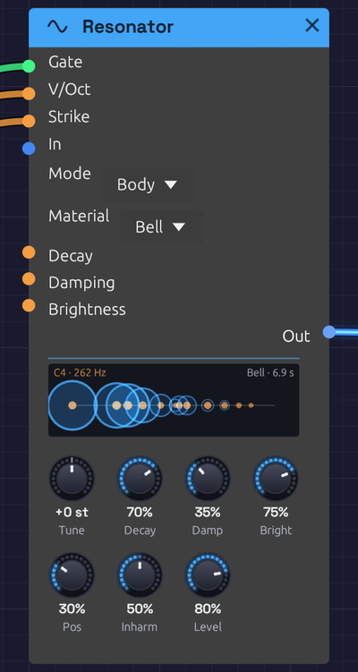
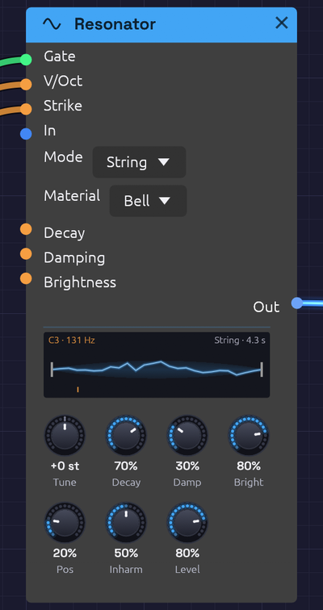

# Resonator

**Module ID** `source.resonator` · **Category** Source


*A bell 0.4 seconds after it was struck. Each mode is a ring on a log-frequency axis. The hum on the left is still ringing wide, and the high partials on the right have already shrunk back to their dots.*

Resonator is a physical model. It doesn't make a waveform and then shape it. It works out how a real string or a real bell would move when something plays it, sample by sample. That's why it sounds alive straight away, with no envelope to set. A pluck rings and fades by itself, its top dies before its note does, and no two plucks are quite alike.

Two models share one set of knobs:

- **String** is a plucked string, built the way Karplus and Strong built theirs in 1983: a burst of noise runs round a loop exactly one period long, and a gentle lowpass in the loop takes a little of the top off on every pass.
- **Body** is a struck bell, bar, glass or block of wood: twelve tuned modes, each ringing at its own frequency and dying at its own rate.

A **Gate** plays it, as a finger or a mallet would. So does any sound patched into **In**. A drum, a voice or a burst of noise makes it ring at its own pitch, the way a shout makes a piano's open strings hum. A Drum into a tuned Resonator is a new instrument in itself.

Resonator is polyphonic. A chord on its **V/Oct**, from a [Chord Sequencer](../utilities/chord-sequencer.md) or [Note In](../midi/note-in.md), is a string or a bell for each note, so a chord rings as a chord. One mono drum into **In** rings them all at once.

## The models

### String


*A string 80 ms after its pluck, still ragged with the top it's losing. The orange mark on the floor is where Position plucks it.*

A gate plucks the string with one period of noise under a smooth swell, as a finger pulls a string aside and lets go. **Brightness** is the pick: a soft thumb at 0, a plectrum at 100%. **Strike** is how hard: softer is quieter, and smoother too, with less of the pick's grain in it.

**Damping** is what the string is made of. At 0 every partial rings as long as the note, like a bright steel wire. Turn it up and the top dies faster than the note, towards nylon or a string under a felt. Damping never changes the pitch: the loop is shortened by exactly the delay its lowpass adds at the note.

**Position** is where along the string it's played. Near the end (0) the sound is thin and bright with every partial. In the middle (100%) it's hollow and round, because a string plucked in the middle has no even partials: they all have a node there.

### Body

A gate strikes the body with a mallet. **Brightness** is the mallet: felt is wide and dark, steel is narrow and rings every mode. **Position** is where it lands, from the edge to the middle. A mode with a node where the mallet lands barely sounds.

**Material** sets where the modes sit and how long they ring:

| Material | Modes (times the note) | Rings | Sounds like |
|----------|------------------------|-------|-------------|
| **Bell** | 1, 2, 2.38, 3.01, 4, 5.03 … | Long | A church bell: the hum, the prime an octave up, and the minor third above it that makes a bell sound like a bell |
| **Bar** | 1, 2.76, 5.40, 8.93, 13.3 … | Medium | An untuned glockenspiel or a struck metal rod |
| **Glass** | 1, 2.32, 4.25, 6.63, 9.38 … | Longest | A wine glass: pure, with little damping |
| **Wood** | 1, 2.57, 4.47, 6.60, 7.92 … | Short | A wood block or a thick wooden bar |

The lowest mode is always the note you play, so every material is in tune with the keyboard.

**Inharm** moves the modes. At 0 they sit on the harmonic series (1, 2, 3, 4 …), which turns any material into something string- or pipe-like. In the middle (the default) they're the material's own. At 100% they're stretched further apart, more clangorous and metallic. **Damping** makes the high modes die faster than the low ones, on top of the material's own.

## Inputs

| Port | Signal Type | Description |
|------|-------------|-------------|
| **Gate** | Gate (Green) | A rising edge plucks the string or strikes the body. Patch a sequencer's, a keyboard's or a MIDI **Gate** |
| **V/Oct** | Control (Orange) | Pitch, 1 per octave, added to **Tune**. A poly cable plays a string or a body per note |
| **Strike** | Control (Orange) | How hard each gate plays, from 0 to 1, read as it lands. Patch a sequencer's **Velocity**. Unpatched, every one is full |
| **In** | Audio (Blue) | Any sound to excite it with. It rings at its own pitch with whatever you feed it. You hear only the ringing, not the sound you fed in, so mix that in yourself if you want both |
| **Decay** | Control (Orange) | Added to the **Decay** knob |
| **Damping** | Control (Orange) | Added to the **Damping** knob |
| **Brightness** | Control (Orange) | Added to the **Brightness** knob, read at each pluck or strike |

## Outputs

| Port | Signal Type | Description |
|------|-------------|-------------|
| **Out** | Audio (Blue) | The string or the body. A full pluck at default settings peaks around -4 dBFS |

## Parameters

| Control | Range | Default | Description |
|---------|-------|---------|-------------|
| **Mode** | String, Body | String | Which model |
| **Material** | Bell, Bar, Glass, Wood | Bell | What a Body is made of. A String ignores it |
| **Tune** | ±24 st | 0 st | Pitch in semitones from C4, before **V/Oct** |
| **Decay** | 0 – 100% | 60% | How long the note rings, from 80 ms to 24 s, to fall 60 dB. A Body's material rings a multiple of this |
| **Damping** | 0 – 100% | 40% | How much faster the top dies than the note |
| **Brightness** | 0 – 100% | 60% | How hard the pick or the mallet is |
| **Position** | 0 – 100% | 30% | Where it's played, from near the end to the middle |
| **Inharm** | 0 – 100% | 50% | A Body's modes: harmonic, the material's own, then stretched. A String ignores it |
| **Level** | 0 – 100% | 80% | Output level |

Changing **Mode** lets go of whatever the other model was ringing.

## Nothing runs away

A string excited from **In** builds up for as long as the sound goes on, and at the longest Decay each pass round the loop keeps 99.99% of what went in. On an ideal string that would climb without end. This one can only swing so far, as a real one can: a soft ceiling sits inside the loop, so even full-scale noise held into the longest Decay rings loudly but stays inside ±1, with no blow-ups.

## The display

For a **String**, the display is the string itself, between its bridge and its nut. The shape is one period of the loop, read from the voice as it plays, so it moves the way the sound does: ragged just after a pluck, then smoothing to a single arc as the top dies away. The blue haze either side is how far it's swinging. The orange mark on the floor is where **Position** plucks it.

For a **Body**, it's the modes: a dot for each across a log-frequency axis, as large as a strike will ring it. Struck, each dot blooms into a ring as wide as the mode is loud, and shrinks as that mode dies. A bell's high partials vanish first and its hum lingers.

The note and its pitch are at the top left. What's ringing, and for how long, is at the top right. Hover the display for the modes' ratios.

## Patches

### Tuned drums

The [Sympathetic Strings](../../recipes/sympathetic-strings.md) example has no oscillators at all. A Rim Drum strikes a Glass tuned to E5, and a Shaker keeps a chord of four strings humming.

```text
[Drum (Rim)]           ──> [Resonator (Body, Glass) In]
[Drum (Shaker)]        ──> [Resonator (String) In]
[Chord Sequencer Pitch] ─> [Resonator (String) V/Oct]
```

### A plucked voice

```text
[Sequencer Pitch]    ──> [Resonator V/Oct]
[Sequencer Gate]     ──> [Resonator Gate]
[Sequencer Velocity] ──> [Resonator Strike]
```

A koto or a harp with **Position** low and **Brightness** high. A muted bass with **Damping** up and **Tune** at -24. A music box with Mode on **Body**, Material on **Bar** and **Inharm** at 0.

### A singing room

Patch a voice from an [Audio Input](./audio-input.md) into **In**, with Mode on **String**, a long **Decay** and **Damping** low. The string rings along at its pitch with whatever you sing, loudest when you hit its note or one of its partials. A [Chord Sequencer](../utilities/chord-sequencer.md) on **V/Oct** makes it a chord of strings that answer you.

### Bells on a beat

A [Clock](../modulation/clock.md) or a sequencer's **Gate** into a Body Bell, with an LFO into **Brightness** so some strikes are soft and some hard. Turn **Inharm** up for gamelan-like gongs, or down to 0 for tubular bells.

## Related modules

- [Drum](./drum.md): the best exciter, and in the [Sympathetic Strings](../../recipes/sympathetic-strings.md) example the only one
- [Noise](./noise.md): a burst of noise through an envelope into **In** bows a string that never stops
- [Chord Sequencer](../utilities/chord-sequencer.md) and [Note In](../midi/note-in.md): chords of strings or bells
- [Reverb](../effects/reverb.md): a room for them to ring into
