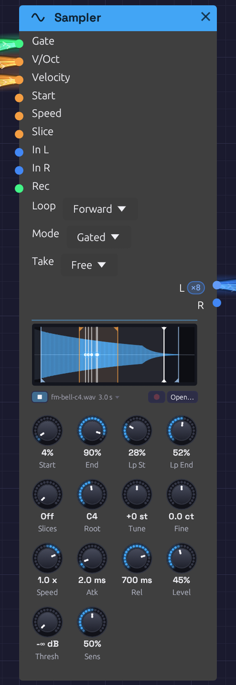
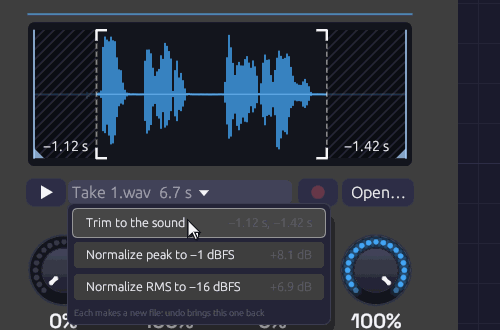
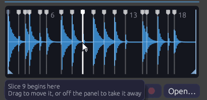

# Sampler

**Module ID** `source.sampler` · **Category** Source


*A five-note chord on a looped bell, and the file heard from **▶**. The orange flags mark the loop and the blue ones what plays. Each white line with a dot is a voice, circling inside the loop at its own speed. The line capped at both ends is **▶**'s, out in the bell's tail.*

Sampler plays a WAV file. Patch a gate in and it plays one-shots: a kick under a sequencer, a vocal chop, a door slam. Patch in V/Oct as well and a polyphonic gate, and it becomes an instrument: one recorded note spread across the keyboard, each key playing it at its own pitch.

Set **Slices** and it becomes a chopped break: the recording is cut into equal slices, or at each hit it finds, and each key plays one of them.

Every other sound in Soba is synthesized. The Sampler brings in sound you've recorded, or one Soba rendered itself, and keeps it with the patch. It can make the recording itself, too: patch something into **In** and press **Rec** (see [Recording into it](#recording-into-it)).

## Loading a file

- Click **Open…** under the waveform, or click an empty Sampler's display, and choose a WAV, MP3, FLAC or Ogg (Vorbis or Opus) file.
- Drag a sound file from your file manager onto a Sampler to replace its file. Drop one on empty canvas and a new Sampler appears there, already playing it. The node lights up under the file while you drag, to show where it will land, and plays the file from **Start** to **End** with its waveform on the panel. Over empty canvas, a faint Sampler follows the pointer where the new one would appear, and the whole file plays in its waveform. That way you can audition files from the file manager before you choose one, with or without a Sampler to try them on. It stops when the file leaves the node or you give up the drag, and a file dropped while it plays carries on. (In the browser a file can only be heard once it's dropped.)
- In the browser, drag a file onto the page the same way.

Loading a file is a step you can undo. A file is read and converted once. Samplers that play the same file share it. An MP3 plays without the silence its encoder leaves at the start, so a loop saved as an MP3 still loops cleanly. So does an Ogg file, whether it holds Vorbis or Opus audio (an `.ogg`, `.oga` or `.opus` file). A FLAC file plays exactly as it was recorded.

Opening or dropping a file plays it once, from **Start** to **End**, so you hear what you chose. Undoing back to an earlier file doesn't.

## Hearing it

You don't have to patch anything to hear what a Sampler holds.

- **▶**, beside the file's name, plays it from **Start** to **End** and stops there. It plays at the Sampler's **Tune** and **Fine**, at a **Speed** of 1. Press it again (it shows ■ while playing) to stop.
- **Alt-click** the waveform to play from that point to **End**. Past **End**, it plays on to the end of the file. With Alt held, a dashed line follows the pointer to show where it will start. Dragging the markers works as before.
- **Sliced**, **Alt-click** a slice to play just that slice, from its start to its end. With Alt held, the slice under the pointer is outlined.
- **Let go of a marker with Alt held** to hear what it now marks. A slice marker plays the slice it begins, **Start** the first slice and **End** the last. Unsliced, **Start** and **End** play **Start** to **End**. While you drag with Alt held, the slice you'll hear is outlined. You can nudge a marker and hear the result each time you let go, as in ReCycle or Simpler.

This works whether the transport is running or not. What you hear is the file itself, not the patch: it plays dry, beside the patch rather than through it, after the Audio Output's limiter, 6 dB below the file's own level. It isn't in a recording made with **Record**. It's how a sampler's or a DAW's file preview works.

One file plays at a time. Starting another, from this Sampler or any other, fades the first out over 5 ms. Deleting the Sampler or giving it another file stops it.

While it plays, a white playhead capped at both ends shows where it is, with the part it has played washed faintly behind it. The voices' playheads are lines with a blue dot, so the two never look alike.

## Recording into it

Patch something into **In L** (and **In R**, for stereo) and press the red **Rec** button beside **Open…**. Press it again to stop. There's no file dialog: the take plays at once, and becomes the Sampler's file.

- **Anything can be recorded.** Patch an [Audio Input](./audio-input.md) to record yourself. Patch the patch's own sound, a [Vocoder](../effects/vocoder.md)'s output or a [Mixer](../utilities/mixer.md)'s send, to *resample* it into a new instrument. One side patched records the same on both.
- **From a right-click.** Right-click an Audio Input and choose **Record into a new Sampler**. A Sampler appears beside it, already patched, with **Thresh** at −40 dB and **Rec** already pressed, so the next thing you say is the take. Any other audio output offers **Resample into a new Sampler**: on its module's menu (with a submenu where there's more than one, like a Mixer's **Out** and **Send**), or on the output's own name. If the patch is stopped, it starts playing. With a Clock in the patch, each of these offers **Free**, **1 bar**, **2 bars** or **4 bars**: a take in bars sets **Take** to match and **Thresh** to −∞, starts on the next bar line instead of the next sound, stops itself, and lands with **Loop** on Forward, ready to play.
- **Start on a sound.** Turn **Thresh** up from −∞ dB and Rec waits until **In** is that loud before it starts, keeping the 30 ms before. The take starts on your first word, not on reaching for the mouse. While it waits, the panel dims and shows how loud **In** is against the threshold.
- **Takes in bars.** Set **Take** to a number of bars with a [Clock](../modulation/clock.md) running. Rec then starts on the next bar line and stops after exactly that many bars, so the take is already a loop. As it records, the panel counts it in bars and beats, `REC 2.3 / 4`, not seconds. A press up to 50 ms after a bar line counts as on it.
- **Stopping.** Rec again, the **Rec** gate falling, the bars running out, or the room: a take lasts at most a minute. Stopping the transport ends a take there.
- **The Rec jack** takes over from the button, as **Freeze** does on the Vocoder: the Sampler records while the gate is high. A sequencer's gate resamples a phrase on cue.
- **Tidied as they're kept.** Right-click **Rec** and tick **Tidy takes**, and each take is trimmed to its sound and set to −16 dBFS RMS as it's kept (see [Tidy takes](#tidy-takes)).
- **On a footswitch or a pad.** Right-click **Rec** and choose **Learn MIDI**, then press a MIDI footswitch or hit a pad.

Live input reaches the patch a round trip after it was played, so the take is written that much earlier, as the [Looper](../utilities/looper.md)'s overdubs are. A take in bars begins with what you played on the bar line, within a few milliseconds at the latency your device reports. The patch's own sound has no round trip, and is taken as it comes.

While a take comes in, the panel draws it in red, across a span that doubles whenever the take outgrows it, with the time so far in the corner and **Rec** showing ■. The Sampler goes on playing its old file until the take is done. Recording needs the patch playing.

### Where takes go

When a take ends it's written as a WAV beside the patch, as `<patch name> samples/Take 1.wav`, `Take 2.wav` and so on, and the Sampler's file names it. That's a step you can undo: undo gives the Sampler back the file it had before. Saving the patch saves the take with it, and opening the patch plays it again.

A patch that hasn't been saved yet, a new one or an example, keeps its takes in a temporary folder until you save it. **Save As** then copies them beside the patch with its other samples. In the browser there's no folder beside the patch, so a take lives only in the tab, as a dropped file does. To keep one, save the patch: **💾 Save** then downloads a zip of the patch with its takes and dropped files, as WAVs in a `<patch> samples` folder beside it, the way **Save As** gathers them on the desktop. Unzipped, it opens whole in Soba on the desktop. To keep just one file, click its name under the waveform and choose **Download**, which saves it as a WAV. The browser also keeps each one for the page itself, so it's still there after a reload, when an autosave is recovered, or when you open the downloaded patch in the browser again. Once nothing names a file any more, the next visit lets it go.

Takes nobody keeps don't pile up. Saving removes the takes this session wrote that the patch no longer plays and undo can't bring back. Closing the patch (New, Open or Quit) removes those no saved patch names, the temporary folder among them. That covers the files Trim and Normalize write too. A file Soba didn't write is never touched. After a crash, the temporary folder it left behind is tidied too: [recovering](../../getting-started/interface-overview.md#autosave-and-recovery) the patch makes its takes this session's, and choosing Discard removes them.

Room for a take is set aside, a minute of stereo (about 23 MB at 48 kHz), when something is patched into **In**, so recording never has to find memory mid-take. Unpatch **In** and it's given back.

## Trim and Normalize

A take comes in raw: silence at each end, whatever level the mic gave it, perhaps a bump before the first word. Click the file's name, under the waveform, for two fixes. They work on any file the Sampler plays, not only takes.

- **Trim to the sound** cuts the recording from where its sound begins to 300 ms after it ends.
- **Normalize peak to −1 dBFS** turns the whole recording up (or down) until its loudest sample is at −1 dBFS. Its shape is unchanged.
- **Normalize RMS to −16 dBFS** sets the level of the sound itself, so recordings sit at one level: a quiet take and a loud one come out alike. Up to 6 dB of peaks over −1 dBFS are taken down by a gentle look-ahead limiter. A peak louder than that, such as a popped "p", lowers the whole recording instead, and the status bar says by how much it fell short.


*A spoken line with room at both ends, and **Trim to the sound** under the pointer. The hatched parts would go: 1.12 s from the start, up to the breath before the first word, and 1.42 s from the end. The crop marks frame what stays.*

Each item says what it would do before you choose it: how much each end loses, or how many dB the level moves. While the pointer is on an item, the waveform shows it too. A trim veils the parts it would cut and sets crop marks round what it keeps. A level writes its change across the panel, since the waveform is always drawn to fill it.

Neither touches the original. Each writes a new WAV beside the patch, in `<patch name> samples`, named for what was done (`Take 1 trimmed.wav`, then `Take 1 trimmed normalized.wav`), and the Sampler plays it once, as it does a file just opened. It's a step you can undo: undo brings back the untouched file. A trim moves **Start**, **End** and the loop's markers with the sound, so they mark the same moments in it. A marker in a part that was cut goes to that end. Sliced, the slices are cut from what's left.

### Tidy takes

To have every take come in tidy, right-click **Rec** and tick **Tidy takes**. Each take is then trimmed to its sound and normalized to −16 dBFS RMS the moment it's kept, both in one go, into one file: `Take 1 tidied.wav`. The panel frames the waveform in crop marks for a moment and says what was done, such as *Tidied −0.42 s, +5.2 dB*, and so does the status bar. While it's on, **Rec** wears small crop marks of its own. The choice is saved with the patch, Sampler by Sampler.

The take as it came in is still written first, as `Take 1.wav`, and tidying is its own step after it. One undo brings back the raw take, and a second gives the Sampler back the file it had before.

A take in bars (**Take** set to a number of bars) is never trimmed, since its length is the loop. It's only normalized. With **Thresh** turned up, the trim still finds where the sound begins: the 30 ms Thresh keeps before it is there for the trim to walk back into, and it keeps what it finds. A take that's already tidy, its sound filling it and its level on −16 dBFS, is left as it is.

### Where the sound begins

The rule is the one the [Soba Speaks](../../recipes/soba-speaks.md) example's voice was made with (`tools/voice/record.py`). The recording is measured in 10 ms steps, with any rumble under 70 Hz left out of the measurement. The room's level is that of its quietest tenth.

- The sound begins at the first **sustained** sound: one that lasts at least 80 ms, within 30 dB of the loudest and at least 10 dB over the room. A lone thump or lip smack is too short to count.
- From there the start walks back while the level keeps falling, to keep the breath before a word or a note's attack. It stops in the dip before anything earlier, such as a bumped stand, or where the level reaches the room, and never walks back more than 300 ms.
- The sound ends 300 ms after the last sustained sound, so a word can breathe out and a note ring.

A cut start fades in over 5 ms, and a cut end fades out over 80 ms. A recording with no quiet room to cut, a drone or a pad, has nothing to trim. Neither does one that's already been trimmed.

## Inputs

| Port | Signal Type | Description |
|------|-------------|-------------|
| **Gate** | Gate (Green) | A rising edge starts a note. In **Gated** mode the falling edge lets it go. A polyphonic gate plays a voice per channel |
| **V/Oct** | Control (Orange) | Pitch, 1 V an octave. 0 V (C4) plays the **Root** note: the recording as it was made. Read all the time, so pitch bend and glide work. When sliced, it picks the slice instead, as each note starts |
| **Velocity** | Control (Orange) | Each note's level, 0 to 1, read as the note starts. Unpatched, every note is full |
| **Start** | Control (Orange) | Added to the **Start** knob as each note begins. 1 V is the whole recording, or the whole slice when sliced |
| **Speed** | Control (Orange) | Added to the **Speed** knob while the note plays, as on tape: pitch follows, and below zero it plays backwards |
| **Slice** | Control (Orange) | When sliced, picks a slice as each note begins: 0 to 1 across the slices, added to the note's own. Does nothing with **Slices** off |
| **In L** | Audio (Blue) | What **Rec** records. Patched alone, it records on both sides |
| **In R** | Audio (Blue) | The right side of what **Rec** records |
| **Rec** | Gate (Green) | Records while high, starting as it rises (or as **Take** and **Thresh** say) and stopping as it falls. Patched, it takes over from the **Rec** button |

## Outputs

| Port | Signal Type | Description |
|------|-------------|-------------|
| **L** | Audio (Blue) | The left channel. A mono file plays the same on both outputs |
| **R** | Audio (Blue) | The right channel |

Both outputs carry a channel per voice when the gate is polyphonic.

## Parameters

| Control | Range | Default | Description |
|---------|-------|---------|-------------|
| **Loop** | Off, Forward, Ping-Pong | Off | Off plays once. Forward goes from Loop End back to Loop Start, crossfaded so it doesn't click. Ping-Pong plays back and forth between them |
| **Mode** | One-Shot, Gated | One-Shot | One-Shot plays to the end whatever the gate does. Gated lets go when the gate falls |
| **Take** | Free, 1 – 16 bars | Free | Free records until Rec is pressed again. In bars, with a Clock running, a take starts on the next bar and lasts exactly that long |
| **Start** | 0 – 100% | 0% | Where notes start, through the recording |
| **End** | 0 – 100% | 100% | Where notes end |
| **Lp St** (Loop Start) | 0 – 100% | 0% | Where the loop begins. Kept between Start and End |
| **Lp End** (Loop End) | 0 – 100% | 100% | Where the loop turns back. Kept between Start and End |
| **Tune** | ±24 st | 0 st | Transpose in semitones |
| **Fine** | ±100 cents | 0 | Fine tuning |
| **Slices** | Off, 2 – 64, Onsets | Off | Cuts **Start**–**End** into equal slices, or at **Onsets**, a marker where each hit begins. Each slice is played by its own key. See [Slices](#slices) |
| **Root** | C-1 – G9 | C4 | The note the recording was made at. Playing it plays the recording unchanged. When sliced, the key that plays slice 1 |
| **Speed** | −2 – 2× | 1× | Tape speed. 2 is twice as fast and an octave up, 0.5 half as fast and an octave down, and below 0 plays backwards |
| **Atk** (Attack) | 1 ms – 2 s | 2 ms | How long each note takes to fade in |
| **Rel** (Release) | 1 ms – 5 s | 10 ms | How long a note takes to fade out once let go |
| **Level** | 0 – 100% | 80% | Output level |
| **Thresh** (Rec Threshold) | −∞ – 0 dB | −∞ dB | At −∞ a take starts as soon as Rec is pressed. Turned up, it waits until **In** is this loud |
| **Sens** (Sensitivity) | 0 – 100% | 50% | Sliced by **Onsets**, how strong a hit must be to get a marker. See [Slicing at the hits](#slicing-at-the-hits) |

The four region knobs sit in the top row, under the waveform where their markers are. You can drag the markers instead of the knobs. **Slices** and **Root** start the second row, since together they say which key plays which slice. **Thresh** and **Sens** sit at the foot. Each says how loud something must be to count: **In**, to start a take, and a hit, to get a slice marker.

## Playing it

### One-shots

Patch a sequencer's **Gate** into **Gate**, and its **Velocity** into **Velocity**. Leave **V/Oct** unpatched and every hit plays at the recording's own pitch. **One-Shot** mode plays each hit to the end, however short the gate.

### Across the keyboard

Patch [Note In](../midi/note-in.md)'s **Pitch**, **Gate** and **Velocity** into **V/Oct**, **Gate** and **Velocity**, and set **Root** to the note the file was recorded at. Each key plays the recording faster or slower: an octave up is twice as fast and half as long, as on tape. Set **Mode** to **Gated** so that letting go of a key lets its note go, over **Rel**.

### Pitch and speed

Pitch and speed are one thing here, as on a tape machine. **Tune**, **Fine**, **Root**, **V/Oct** and **Speed** all set how fast the recording is read, and so how high it sounds and how long it lasts. A recording made at a different sample rate from your audio device still plays at its own pitch.

At negative **Speed** a note plays backwards, starting at **End** and finishing at **Start**. A Speed that changes sign mid-note turns the note around where it is: an LFO into **Speed** scratches, and an envelope that falls to zero is a tape stop.

## What plays

**Start** and **End** set the part of the recording a note plays. The rest of the waveform sinks into the background. A note fades out over its last 3 ms, so a recording cut mid-sound doesn't click at the end.

With **Loop** on, a note plays from **Start** to **Lp End**, then goes round. **Forward** jumps back to **Lp St**. **Ping-Pong** turns around and plays backwards to **Lp St**, then forwards again. Forward crossfades the jump over 8 ms, blending the end of the loop into the sound just before **Lp St**, so wherever the points sit the loop goes round without a click. A loop that starts at the very beginning of the recording has nothing before it to blend, so it borrows those 8 ms from its own start and comes round that much sooner. Ping-Pong never jumps.

In **Gated** mode a looping note keeps looping through its release, then fades. In **One-Shot** mode a looping note never ends. It plays until a new note takes its voice or the transport stops. That's a drone: a field recording slowed down an octave, looping forever.

## Slices

Set **Slices** to cut the recording into equal parts, and each key plays one part: **Root** (C4 unless you move it) plays slice 1, C#4 slice 2, D4 slice 3, and so on up the keys. This is how samplers lay a chopped drum break or a set of vocal phrases across the keyboard.

- **Each slice plays only itself.** A note starts at its slice's start and stops at its end, with the same 3 ms fade as at **End**. In **One-Shot** mode a short gate still plays the whole slice. In **Gated** mode the note stops at the slice's end or when the gate falls, whichever comes first.
- **The key picks the slice, not the pitch.** **V/Oct** no longer transposes. **Tune**, **Fine** and **Speed** still do, and a slice played faster goes by sooner. Notes below **Root**, or past the last slice, play nothing.
- **Slices divide Start–End.** Move **Start** past a silence at the head of the file and the slices are cut from there.
- **A loop goes round the slice.** With **Loop** on, a held note in **Gated** mode repeats its slice until it's let go. That's a stutter. The **Lp St** and **Lp End** markers step aside while sliced.
- **Backwards**, at negative **Speed**, a slice plays from its end to its start.
- **Start** CV moves where a note starts inside its slice. 0.5 V starts halfway in.

Patch an [Arranger](../utilities/arranger.md) lane, a [Sample & Hold](../utilities/sample-hold.md) or an LFO into **Slice** to pick slices without a keyboard. Its value spreads evenly across them, 0 for the first and 1 for the last, and adds to whatever the note picked. With **V/Oct** unpatched, **Slice** alone chooses.

On the display, rules divide the waveform into its slices, numbered while they're wide enough to read. The slice a voice is playing glows. Hover a slice to see which key plays it, and **Alt-click** it to hear it. Sliced by **Onsets**, the rules are markers you can drag (see [Slicing at the hits](#slicing-at-the-hits)).

### Slicing at the hits

Equal slices suit a file laid out in slots, a line or a note to each. A drum break or a spoken phrase isn't equal. Its hits and words land where they land, and a hit pushed a little early or dragged a little late is the feel that makes a break worth sampling. Equal sixteenths would cut through those hits.

Turn **Slices** past 64 to **Onsets** and the Sampler puts a marker where each hit begins: each drum, each syllable, each plucked note. Slice 1 runs from **Start** to the first marker, and each marker after that starts a slice of its own, up to **End**. As before, **Root** plays slice 1 and each key up plays the next.


*Two bars of a swung break, sliced by **Onsets** at 50%: a marker at every kick, snare and hat, wherever the swing put it. The pointer is on the marker that starts slice 9.*

- **Sens** sets how many hits count. Turned down, only the loudest hits get a marker: the kick and the snare. Turned up, ghost notes, hi-hats and quieter syllables get one too. The markers move as you turn it.
- **The markers are where the sound rises.** The recording is split into four bands, from the bass up. A hit is a moment when several of them suddenly get louder together: a quiet hi-hat over a ringing kick still counts, in the top band. A marker goes a millisecond before its hit, so the slice keeps the whole attack.
- **Drag a marker** (the white tabs along the top) to move it. **Drag it off the panel**, up or down, to take it away, and **double-click** between markers to add one. Each change is a step you can undo. Let go with **Alt** held to hear the slice the marker now begins.
- **Markers you've moved are kept with the patch.** Turning **Sens** finds them afresh, letting go of what you moved. Undo brings them back.
- **A new file finds them afresh** too, as does a new take. **Trim to the sound** moves them with the sound.
- **Up to 64 slices.** Markers outside **Start**–**End** cut nothing and are drawn faint. So are markers past the 63rd, and the last slice runs on to **End**.

The hits are found once, when the file loads. Turning **Sens** only chooses among them, so the markers move as soon as it turns. They're found on the file as it was recorded, so they're the same whatever your device's rate, and the [`render`](../../getting-started/installation.md#command-line) tool hears the same slices.

## Voices

Sampler is polyphonic. Each channel of the **Gate** cable is a voice of its own, with its own pitch, velocity and place in the recording. [Note In](../midi/note-in.md) hands each new note the next voice. When all its voices are busy, it takes the oldest note's voice, which lets go of the old note over 5 ms as the new one starts. Retriggering a note that's still sounding does the same, so fast repeated notes never click.

Loading a new file while notes play fades them out over 5 ms. The next notes play the new file.

## The display

The waveform shows the whole recording, scaled to fill the panel. What plays is lit blue, and the loop is washed orange. **Start** and **End** have blue flags at the foot, and the loop points orange flags at the head. Drag any of them like a knob. Hover a marker to see what it is, or the waveform to see the file's path, length and format.

Every voice draws a white playhead where it is in the recording, as bright as it is loud. A chord is several lines moving at their own speeds, and a released note fades where it stands.

Under the waveform are **▶** (see [Hearing it](#hearing-it)), the file's name and length, which open [Trim and Normalize](#trim-and-normalize), and **Rec** (see [Recording into it](#recording-into-it)), dim until something is patched into **In** and the patch is playing. A file that can't be found shows its name in orange. An empty Sampler asks for a file.

## Files and patches

The Sampler plays WAV files: 8-, 16-, 24- or 32-bit integer, or 32-bit float. Mono files play on both sides. Files with more than two channels play their first two. Each file is resampled to your audio device's rate when it loads, and again if the device's rate changes.

A Sampler keeps up to **five minutes** of audio, about 115 MB of stereo at 48 kHz. A longer file is cut to its first five minutes, and the status bar says so.

A patch saves each Sampler's file as a path:

- **Beside or below the patch**, the path is relative: `samples/kick.wav`. Move or zip the patch's folder and it still finds its samples.
- **Elsewhere**, the path is absolute: `C:/Music/choir.wav`.

**Save As** copies samples from outside the patch's folder into a folder beside it named `<patch name> samples`, and points the patch at the copies. The patch's folder then holds everything it needs to be shared. If the samples come to more than 50 MB, it asks first. Saving an example works the same way, so its samples come with the copy. **Save** does the same for a sample you've brought in since, from your Downloads say. If those come to more than 50 MB, it leaves them where they are and says so, rather than asking at every save; **Save As** offers to copy them.

A patch whose sample is missing still opens. The Sampler keeps the path but plays nothing, and the status bar lists the missing file with the other load warnings. Open the file again to fix it.

In the patch file, the path is the module's `file` field. Slice markers you've moved are its `slice_markers`, with the **Sens** they were placed at, as fractions of the recording. Modules without either leave them out, so patches from before the Sampler read and save as they always did:

```json
{
  "id": 2,
  "module_id": "source.sampler",
  "position": [300.0, 74.0],
  "parameters": [{ "name": "Mode", "type": "Select", "value": 1 }],
  "file": "samples/fm-bell-c4.wav"
}
```

The [`render`](../../getting-started/installation.md#command-line) tool finds a patch's samples the same way, relative to the patch file.

### Sound quality

Voices read between samples on a cubic (Hermite) curve. That's clean at ordinary speeds and pitches. Played more than an octave or so above its root, a bright recording begins to alias: its highest harmonics fold back as a faint metallic edge. Record the sample nearer the range you'll play it in, or filter it after the Sampler.

## Patches

### Sampled keys

The [Sampled Keys](../../recipes/sampled-keys.md) example plays a bell across the keyboard: one strike of the FM Synthesis example, rendered by Soba and loaded into a Sampler.

### A drum kit from recordings

```text
[Trigger Sequencer Gate 1] ──> [Sampler (kick.wav) Gate]
[Trigger Sequencer Vel 1]  ──> [Sampler (kick.wav) Velocity]
[Trigger Sequencer Gate 2] ──> [Sampler (snare.wav) Gate]
...
```

One Sampler per sound, each in **One-Shot** mode, into a [Mixer](../utilities/mixer.md) to place them. Mix them with [Drum](./drum.md) voices for a kit that's part recorded and part synthesized.

### A drone from anything

Load a long recording (rain, a room, a held note) and set **Speed** to 0.5, **Loop** to **Ping-Pong** with the loop over a steady stretch, **Atk** to 2 s and **Mode** to **One-Shot**. One gate starts a drone an octave down that never ends. Two Samplers on the same file, one at **Speed** 0.5 and one at 0.749 (a fifth above it), make a chord.

### A chopped break

Load a one-bar drum loop and set **Slices** to 8 or 16, so each slice is an eighth or a sixteenth note. Or set it to **Onsets**, so each hit is a slice however it was played, and move any marker that landed somewhere you don't want it. Patch a [Step Sequencer](../utilities/sequencer.md)'s **Pitch** into **V/Oct** and its **Gate** into **Gate**, clocked at the same division. Steps on C4, C#4, D4… play the break as recorded. Change a step's note and that step plays another hit. Patch a [Sample & Hold](../utilities/sample-hold.md) of noise into **Slice** instead of **V/Oct** and the break rearranges itself on every hit.

### Many lines in one file

The [Clair de Satellite](../../songs/clair-de-satellite.md) example keeps all eight of its sung lines in one file, a line to a slice. A Step Sequencer that steps every two bars sings line *k* on note C4 + *k*.

### Scrubbing

Patch a slow [LFO](../modulation/lfo.md) into **Start**, and a Clock into **Gate**. Each note starts a little further into the recording, so a spoken phrase or a melody comes out in stutters that wander through it.

## Related modules

- [Note In](../midi/note-in.md): plays the Sampler as an instrument, a voice per key
- [Trigger Sequencer](../utilities/trigger-sequencer.md) and [Step Sequencer](../utilities/sequencer.md): one-shots in time
- [Audio Input](./audio-input.md): outside sound live, as it happens. Patched into **In**, the Sampler records it
- [Looper](../utilities/looper.md): records and layers live loops, where the Sampler records a take to play from a key or a gate
- [Drum](./drum.md): synthesized drums to sit beside recorded ones
- [Vocoder](../effects/vocoder.md): a recorded voice that makes a chord speak, as in the [Soba Speaks](../../recipes/soba-speaks.md) example
