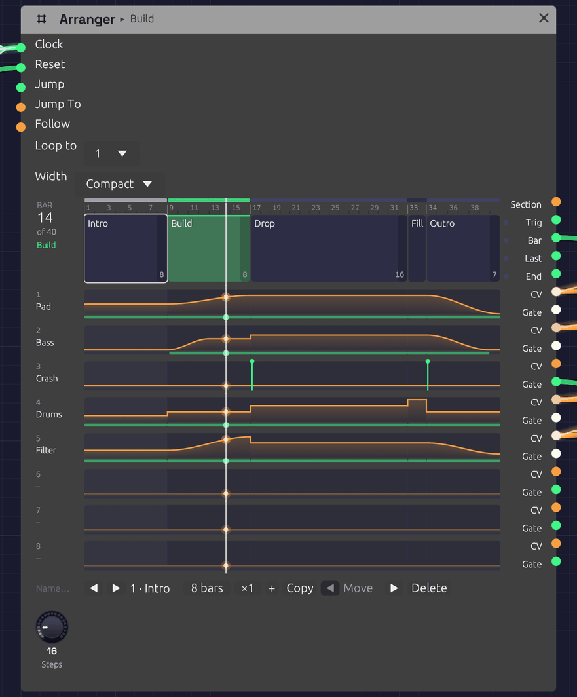
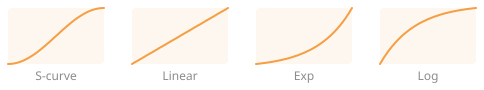

# Arranger

**Module ID** `seq.arranger` · **Category** Utility

*A five-section song, playing its Build. Each section is a block as wide as its bars, and each lane's level runs under them as an orange line, with a green strip wherever its gate is high. The ticks on the Crash lane are Hits. The white line is the playhead.*

The Arranger is a song's timeline. It holds up to 32 named **sections**, each some bars long and played ×1 to ×16 times, in order, and eight **lanes** of automation that the sections move. A lane can ride a part's fader, pick a drum pattern, open a filter over a build or press a Looper's button, and each section says what it does when the section starts: hold, jump, ramp or hit.

It counts bars from a [Clock](../modulation/clock.md), like the sequencers, so the song stays in step with everything else the Clock drives. Press **▶ Play** and it starts from the first section.

## Inputs

| Port | Signal Type | Description |
|------|-------------|-------------|
| **Clock** | Gate (Green) | Each rising edge is a step, and **Steps** of them make a bar. Patch the Clock that drives the sequencers |
| **Reset** | Gate (Green) | A rising edge starts over: the next clock starts section 1 |
| **Jump** | Gate (Green) | A rising edge goes to the section **Jump To** picks, at the next bar line |
| **Jump To** | Control (Orange) | The section a Jump goes to, as its number ÷ 32 (section 1 is 0, section 5 is 4/32). It reads the same as the **Section** output |
| **Follow** | Control (Orange) | Patch another Arranger's **Section** here to [follow](#more-than-eight-lanes-follow) it: its sections become this one's |

## Outputs

| Port | Signal Type | Description |
|------|-------------|-------------|
| **Section** | Control (Orange) | The section playing, its index ÷ 32. A repeated section reads the same on every pass |
| **Section Trig** | Gate (Green) | A trigger on each section's downbeat, and on every pass of a [repeated](#repeats) one |
| **Bar** | Gate (Green) | A trigger on every bar's downbeat |
| **Last Bar** | Gate (Green) | High through each section's final bar, for a fill. A repeated section has one on every pass |
| **End** | Gate (Green) | A trigger when the last section finishes, whether the song loops or stops |
| **Lane 1** – **Lane 8** | Control (Orange) | Each lane's level, 0 to 1. A ramp is smooth enough to drive a [Mixer](./mixer.md)'s **Level** directly |
| **Gate 1** – **Gate 8** | Gate (Green) | High while the lane is above zero, and for a moment on each Hit |

Triggers last half a step.

## Parameters

| Control | Range | Default | Description |
|---------|-------|---------|-------------|
| **Steps** | 1 – 96 | 16 | How many clocks make a bar: 16 for a Clock at 1/16 in 4/4, 12 for 3/4 |
| **Loop to** | Off, 1 – 32 | 1 | The section to go back to after the last one, or **Off** to stop there |
| **Width** | Compact, Wide, Extra wide | Compact | How wide the timeline is drawn: 440, 760 or 1080 points. Wide or Extra wide suits a long song read whole on a big screen. The module plays the same at any width |

The sections, their names, lengths and repeats, the lanes' names and glides, and every section's cue for every lane are edited on the timeline, and patches save them. So is **Width**. The jacks keep their rows at every width, and so do the lanes beside them.

## Writing a song

The song runs left to right across the node. Each section is a block as wide as its share of the bars, though a short one keeps enough room to click. The blocks sit beside the song's own jacks: Section, Trig, Bar, Last and End. Each lane is drawn on the two rows its **CV** and **Gate** jacks hang from, so a lane reads straight across into its cables.

A lane is named for what its cable drives (a Mixer's **Level 2**, say) until you give it a name. The bar count at the top left shows where the song is, and the section playing is lit green, with its name in the header too.

- **Click** a section to pick it. The bar under the timeline shows it.
- **Double-click** a section to rename it. Press Enter to keep the name, or Escape to leave it.
- **Drag** a lane up or down inside a section to set the level that section takes it to. A section that held the lane now jumps it.
- **Shift-drag** a lane inside a section to set where its ramp starts. Any other cue becomes a ramp from there to its level, or for a Hold, to where the lane was.
- **Right-click** a lane inside a section for how it gets there (see [Cues](#cues)), its level, and a ramp's length, curve and start.
- **Double-click** a lane's name to rename it. **Right-click** it to set its **Glide**, or to clear it.
- **Right-click** a section for its length and repeats, to add, copy, move or delete it, and to [split or merge](#repeats) its copies.

The bar under the timeline does the same for the section you picked. **◀** and **▶** step through the sections. The bars field sets its length, and the **×** field how many times it plays. **+** adds a blank section after it, and **Copy** adds a copy. **◀ Move** and **Move ▶** swap it with its neighbours, and **Delete** takes it out. **Loop to** follows the section it named when sections move.

A section's final bar is shaded, since that's where a fill goes. A repeated section has one shaded on each pass. Every edit is one step of [undo](../../getting-started/interface-overview.md#the-toolbar), named for what it did ("Groove · Pad jumps to 48%").

**Name…**, at the left of the bar under the lanes' names, names the Arranger itself. The name shows in its header beside the section playing, and an Arranger that follows this one calls it by its name.

A name too long for its block is cut short with "…". Hover the block and the whole name shows on a tag just above it. Pick the section and the bar under the timeline shows it in full too.

### Zooming in

A long song packs its short sections tight: in a 128-bar song a one-bar fill is a sliver. Zoom the timeline rather than the whole canvas:

- **Ctrl+scroll** over the timeline (or pinch, on a trackpad) zooms it about the pointer, in as far as two bars across.
- **Scroll** over the timeline, once it's zoomed in, moves along the song. While it shows the whole song, the scroll wheel zooms the canvas as usual.
- The thin **strip** over the ruler is the whole song in little, with the part in view framed. **Drag** along it to move the view, or **click** somewhere to go there. **Double-click** it to see the whole song again.

Zoomed in, the ruler numbers the bars inside each section, and each section's name stays in view as you move past its start. While the song plays, the view turns the page whenever the playhead nears its right edge, so the playhead stays in view. It waits a few seconds after you move the view yourself.

The zoom belongs to the editor, like the section you picked. It isn't saved with the patch and isn't a step of undo. For a song you want to read whole, set **Width** instead.

## Repeats

Songs repeat themselves: a groove four times round, a verse that comes back. Give a section a **×** count, ×1 to ×16, and it plays that many times before the next. **×N plays exactly as N copies of it would**, sample for sample:

- Every pass gives the section's [cues](#cues) again. A Jump jumps again, a Ramp runs again (from its own start if it has one, or from wherever the lane is), and a Hit fires again, so a crash on every pass of a 4-bar groove is one cue.
- **Section Trig**, **Bar** and **Last Bar** fire on every pass, so a fill on the last bar lands at the end of each one.
- A Ramp "over the section" takes one pass.
- **Jump** to a repeated section starts its first pass, and so does **Loop to**.

The section is one block on the timeline, as wide as all its passes, with **×N** in its corner and faint dashes between the passes. While it plays, the pass playing is lit, the corner counts the passes off ("3/4"), and so do the bar count and the header: "Groove 3/4".

Since ×N means N copies, either can become the other. Right-click a section:

- **Split into copies** turns a section ×N into N sections, each ×1, named "Groove", "Groove 2" and so on. Do it when one pass needs to differ.
- **Merge with copies after it** folds the sections straight after this one that play the same (the same length and cues, whatever their names) into it, up to ×16. It stops at a section **Loop to** goes back to, which has to stay a section of its own.

Each is one step of undo, and neither changes what you hear. The one thing that does change is the sections' numbers after it, so a **Jump To** CV that picked a later section by number needs moving too. **Loop to** follows by itself.

## More than eight lanes: Follow

A song can need more than eight lanes. Patch one Arranger's **Section** output into another's **Follow** input, and the second one *follows* the first. It has the first one's sections, the same number of them, as long, played as many times, with the same names, and the same **Steps** and **Loop to**. Its lanes are its own, and you edit them on its own face as before.

- **Edit the sections on the leader.** On the follower they can be picked but not changed, and its bar says **Follows Desk** (or whatever the leader is called). Its **Steps** knob and **Loop to** are the leader's too.
- **The follower's cues move with their sections.** Add, copy, move, delete, split or merge a section on the leader, and the follower does the same with its own cues. A merge folds only copies that play the same on every Arranger down the chain. Lengthening or renaming a section does too. The leader's edit and the follower's are one step of undo, so undo takes both back.
- **Unpatch Follow** and the follower keeps the sections it had, and you can edit them on it again.
- **Chains.** A follower can lead another, so three Arrangers give 24 lanes. A chain can't come back round: an Arranger that would end up following itself refuses the cable and says why. **Follow** takes only an Arranger's **Section**.

Following happens in the editor, not in the sound. Two Arrangers that count the same Clock already change section on the same sample, so the cable only keeps their sections the same while you write. A patch plays the same with it or without it.

## Cues

Each section gives each lane one of four cues as the section starts:

| Cue | What the lane does |
|-----|--------------------|
| **Hold** | Carries on as it was. If it was ramping, the ramp carries on. A new section holds every lane |
| **Jump** | Goes straight to the level, on the downbeat |
| **Ramp** | Glides to the level over the whole section or over a number of bars, on one of four [curves](#ramps). It starts from wherever the lane is, or from a level of its own. A ramp longer than its section carries on through the sections after it that hold |
| **Hit** | Goes to the level for half a step, then back: a trigger, with the level riding on the CV, for a Drum's **Trig** and **Accent** or a Looper's **Rec** |

### Ramps

A ramp takes one of four shapes, chosen in its right-click menu and drawn to shape on the lane:

| Curve | Shape | Suits |
|-------|-------|-------|
| **S-curve** | Leaves gently and arrives gently, like a hand on a fader. The default, and how every ramp moved before there was a choice | Fades. A Mixer's **Level** moves without a click, however slow or quick the ramp |
| **Linear** | The same pace all the way | A steady build, or a tempo-like push |
| **Exp** | Slow to start, fast to finish: a fifth of the way there at half time | A filter sweep or a riser that rushes into the downbeat |
| **Log** | Fast to start, slow to finish: four fifths of the way there at half time | A swell that settles, or a fade that tails away |

Exp and Log are mirror images, so an Exp fade-out holds on and then drops away, and a Log one falls quickly and then lingers.

**From** sets where a ramp starts. **Where it is** carries on from the lane's level as the section starts. **A level** jumps the lane there on the downbeat, as a Jump would, gate dip and Glide included, and ramps from there. A part can then come in at one level and grow through the same section: a pad that enters at 28% and swells to 42% over twelve bars is one cue.

### The gate

A lane's **Gate** is high while the lane is above zero. One lane can therefore be a part's level and its envelope's gate at once. A riser that jumps to 30% for a section and back to 0 is heard for that section and gated for exactly as long.

When a Jump or Hit lands while the gate is already high, the gate drops for one sample first, so an envelope starts again. So does a ramp that starts from a level of its own. A ramp up from zero opens the gate as it leaves zero.

### Glide

A Jump moves on one sample, and a Mixer's **Level** adds its CV without smoothing, so a jump under a ringing note clicks. **Glide** smooths the lane's CV: it's how long the CV takes to move all the way from 0 to 1, so 1 s brings a half-way fader up in half a second, the same as a [Sample & Hold](./sample-hold.md)'s **Slew**. A second or so suits a pad, and 40 ms keeps a rhythmic part on the beat while still saving its tails. The gate follows the cue, not the glide.

Leave **Glide** at 0 on a lane that picks something: a [Trigger Sequencer](./trigger-sequencer.md)'s or [Step Sequencer](./sequencer.md#pattern-cv)'s **Pattern**, say. The sequencer reads the CV on the downbeat, the same sample the lane jumps on, and a glide would still be on its way there.

## Timing

The Arranger has no tempo of its own. It counts clock edges: a bar is **Steps** of them, and a section is its length in bars. It changes section on the clock edge that starts the section's first bar, the same edge the sequencers step on, so it can't drift from them, swing or not.

A ramp moves between clock edges too, smoothly. It measures each step from the clock, as the sequencers do, so on a swung clock it moves a little faster through the short steps. It still lands on the clock edge that ends it.

Before the Arranger has seen two clock pulses it can't measure a step. For the first triggers it assumes a sixteenth at the patch's tempo, or at 120 BPM if nothing sets one.

### Looping, ending and jumping

After the last section, the song goes back to **Loop to**, and **End** fires. With **Loop to** off, **End** fires and the song stops where it is. The lanes keep their last levels, and the bars stop counting, until a Reset, a Jump or the next Play.

**Jump** waits for the next bar line, so a live change of section always lands on the beat. Patch a button, a [Keyboard](../midi/keyboard.md) gate or a [Logic](./logic.md) decision into **Jump**, and a constant or a [Sample & Hold](./sample-hold.md) into **Jump To**. While a Jump waits, the section it's going to is outlined green.

## How patches store it

Every section's cue for every lane is one parameter, named for both: `Section 03 Lane 2` is section 3's cue for lane 2. Its value reads as digits, **move**, **ramp bars** and **level** in tenths of a percent. The move is 0 Hold, 1 Jump, 2 Ramp and 3 Hit, and a ramp on another curve takes 4 Linear, 5 Exp or 6 Log:

| Value | Cue |
|-------|-----|
| `0` | Hold |
| `1000700` | Jump to 70% |
| `2000500` | Ramp to 50% over the section, on the S-curve |
| `2080250` | Ramp to 25% over 8 bars, on the S-curve |
| `4000500` | Ramp to 50% over the section, in a line |
| `5160900` | Ramp to 90% over 16 bars, on Exp |
| `6040000` | Ramp to 0% over 4 bars, on Log |
| `3000850` | Hit at 85% |

A ramp's start is a second parameter, `Section 03 Lane 2 From`: the level in tenths of a percent (`280` starts at 28%), or `-1` to start from where the lane is. Patches saved before ramps had curves and starts have no From parameters and only 2 for ramps, so they play as they always did.

The sections' lengths are `Length 01` to `Length 32`, their repeats `Repeat 01` to `Repeat 32` (a patch from before repeats plays every section ×1), the lanes' glides `Glide 1` to `Glide 8`, and **Sections** is how many sections the song has. The names you give sections and lanes, and the Arranger's own name, are saved with the module as labels. A follower saves its own copy of its leader's sections, so it plays them even where Follow isn't known.

## Tips

1. **Faders at zero.** On a [Mixer](./mixer.md), set a channel's **Level** knob to 0 and patch a lane into its **Level** input. The lane then is the fader.
2. **Fills.** Either give each phrase a one-bar **Fill** section that jumps the drum lane to the fill pattern, or patch **Last Bar** into something that plays a fill. With **Last Bar**, a 4-bar groove ×4 has a fill at the end of every pass.
3. **Two Arrangers, one song.** When eight lanes aren't enough, clock a second Arranger from the same Clock and patch the first one's **Section** into its **Follow** (see [Follow](#more-than-eight-lanes-follow)). [From One Sine](../../recipes/from-one-sine.md) splits its score into faders and cues this way.
4. **Pedals.** Hit a Looper's **Rec** at the start of a section to record it, and its **Clear** at the top of the song so each pass starts fresh.
5. **A brightness lane.** Ramp a lane over a build and patch it through an [Attenuverter](./attenuverter.md) into filter cutoffs or drive amounts: the whole build opens up together.
6. **A shorter song.** Set **Loop to** a later section, and the intro plays only once.

## Related

- [From One Sine](../../recipes/from-one-sine.md) – a whole song on two Arrangers: eight faders, and the drums, crash, riser, brightness, Looper pedals and the melody's patterns
- [Trigger Sequencer](./trigger-sequencer.md) – patterns for an Arranger lane to pick
- [Mixer](./mixer.md) – the faders a lane rides
- [Clock](../modulation/clock.md) – tempo and swing
- [Clock Divider](./divider.md) – phrases without a timeline
