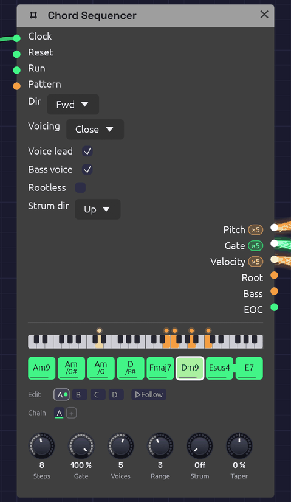
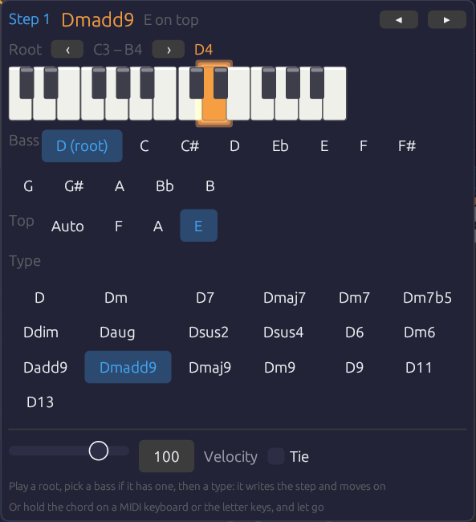
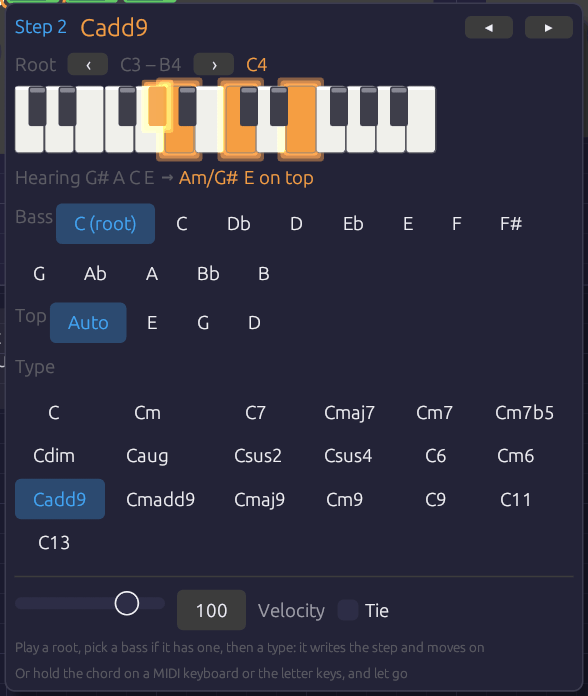

# Chord Sequencer

**Module ID** `seq.chord` · **Category** Utility · **Poly**


*A line cliché, Am9 to E7. The keyboard strip shows Dm9 sounding: the bass voice in amber on D2, and the chord in orange above it, a dot for each voice. Esus4 is tied into E7, so the suspension resolves without a new attack.*

The Chord Sequencer plays a progression. Each of its 16 steps holds a chord: a root, a chord type and, if you like, a slash bass. Each clock pulse moves it on one chord. It sends that chord out as polyphonic **Pitch**, **Gate** and **Velocity**, one channel per note, the way [Note In](../midi/note-in.md) sends the notes you hold. So any polyphonic voice, every [Library](../../concepts/groups.md) voice included, plays it with nothing else in between.

It voices the chords itself. The notes go close together, opened out, or spread wide, in the octave you choose. With **Voice Leading** on, each chord takes the inversion nearest the one before. The voices then move a step or stay put from chord to chord, the way a pianist's hands do, rather than jumping in parallel. Changing one chord means changing one step.

It holds four patterns, A to D, and plays them in the order its **Chain** gives, so one Chord Sequencer can play a 64-chord progression, or a song's verse, chorus and coda through the same voices (see [Patterns and the Chain](#patterns-and-the-chain)).

The **Root** and **Bass** outputs carry single notes as well: a bass line to play on a second voice, or a pitch to move an arpeggio around (see [Afterglow](../../recipes/afterglow.md)).

## Inputs

| Port | Signal Type | Description |
|------|-------------|-------------|
| **Clock** | Gate (Green) | Each rising edge moves to the next chord |
| **Reset** | Gate (Green) | A rising edge jumps back to step 1 |
| **Run** | Gate (Green) | Steps advance only while this is high. With nothing patched, the sequencer runs |
| **Pattern** | Control (Orange) | Picks the pattern for each pass in place of the Chain: 0 to 0.25 is A, 0.25 to 0.5 is B, then C, and D from 0.75 up |

## Outputs

| Port | Signal Type | Description |
|------|-------------|-------------|
| **Pitch** | Control (Orange), poly | One channel per note of the chord, as V/Oct, lowest first |
| **Gate** | Gate (Green), poly | The chord's gate, one channel per note. The channels rise together, or one after another with **Strum**. Stays high across a tie |
| **Velocity** | Control (Orange), poly | The step's velocity, 0 to 1, on every channel, or shaded along the strum by **Taper** |
| **Root** | Control (Orange) | The chord's root as V/Oct, in the octave the step was written in |
| **Bass** | Control (Orange) | The slash chord's bass note, at or below the root; the root when there's no slash |
| **EOC** | Gate (Green) | End of cycle: a 1 ms pulse each time the whole Chain comes round. With a cable in **Pattern**, each time a pattern does |

## Parameters

| Control | Range | Default | Description |
|---------|-------|---------|-------------|
| **Steps** | 1 – 16 | 4 | How many chords each pattern plays before the next pass |
| **Gate** (Gate Length) | 1 – 100% | 100% | How long each chord is held, as a share of the step. 100% holds it up to the next clock |
| **Voices** | 1 – 8 | 4 | How many channels the cables carry: the notes in each chord |
| **Range** | 1 – 6 | 3 | The octave the chord's lowest note sits in. 4 is middle C's octave |
| **Strum** | 0 – 100 ms | 0 ms | Time between one note's gate and the next, as a guitar or harp sounds a chord (see [Strum](#strum)). At 0 every note is struck at once |
| **Dir** (Direction) | Fwd / Bwd / P-P / Rnd | Fwd | Playback order |
| **Voicing** | Close / Open / Spread | Close | How the notes are spread out (below) |
| **Voice lead** (Voice Leading) | on / off | on | Each chord takes the inversion nearest the last |
| **Bass voice** | on / off | off | Puts the bass note under the chord as the first channel (below) |
| **Rootless** | on / off | off | The chord leaves out its root first, for a bass that plays it elsewhere (below). Always so with **Bass voice** on |
| **Strum dir** | Up / Down / Alt | Up | Where a strum starts: on the lowest note, on the highest, or on each in turn, clock by clock. A step can name its own |
| **Taper** (Strum Taper) | −100 – 100% | 0% | Softens the notes struck later in a strum, down to nothing at 100%. Below 0 they grow louder instead (see [Taper](#taper)) |

Each of the 16 steps of each pattern also stores a root (a note, with its octave), a type, a bass (the root, or one of the twelve notes), a gate, a velocity, a tie, a top (Auto, or the chord tone to put on top), and a strum (Auto, Up or Down). The Chain has up to eight slots. Every knob and switch above is shared by all four patterns. A new Chord Sequencer starts every pattern on Cmaj7, Am7, Fmaj7, G7, with the roots walking down from C2. Patch a [Clock](../modulation/clock.md) into it and it plays a progression straight away.

## Writing chords

Each step shows its chord's name, with a slash bass written under it. A line along the foot of the step shows its velocity, a notch in its head shows that it names its top note, and a small arrow in its corner that it names its own strum, up or down. Steps beyond **Steps** are hidden, not lost.

- **Click** a step to switch it on (green) or make it a rest (dark).
- **Shift + click** a step to tie it into the next step. A bar joins the two.
- **Drag** a step up or down to move its root by semitones, or by octaves with **Shift**. The chord it will become shows as you drag.
- **Right-click** a step to open its chord (below).

While the patch plays, the chord sounding is drawn brighter, with a white outline. The keyboard strip above the steps shows its notes, with the bass voice in amber. The strip covers four octaves, starting two below the **Range** octave, so a bass two octaves down still shows. Each voice has a dot that glides to its next note when the chord changes, which makes the voice leading easy to watch. Most dots creep by a step or stay where they are.

### The chord popover


*Step 1 of [From One Sine](../../songs/from-one-sine.md): Dmadd9, with E on top. The bass row is spelled from the root, so the note a half step under D reads C#, as a lead sheet writes it. The top row offers only the tones the chord keeps: with **Rootless** on and three voices, Dmadd9 keeps F, A and E.*

Right-click a step and its chord opens under it:

- **Root.** A two-octave piano with the root lit. Click a key to set the root. **‹ ›** move the piano an octave.
- **Bass.** The root, or a note to put under the chord. The notes are spelled from the root (D/F#, Am/G#), the same way the step writes the name.
- **Top.** **Auto**, or one of the chord's tones to put on top of the voicing (see [The top note](#the-top-note)). Only the tones the voicing keeps are offered.
- **Type.** All 19 chord types, each named on this root. Clicking a type writes the step, switches it on if it was a rest, and moves to the next step.
- **Velocity** and **Tie**, for this step.
- **Strum.** **Auto** follows **Strum dir**. **Up ▴** or **Down ▾** strums this step that way, whatever **Strum dir** says (see [A step's own stroke](#a-steps-own-stroke)).

So a progression goes in the way a lead sheet reads: a root, then a type, then the next root and type. The popover stays where it opened, and an outline marks the step it's writing. **◂ ▸** (or **←** **→**) move between steps without writing. **Esc**, or a click outside, closes it. Each change is one undo step.

Each choice sounds as you make it. Click a type, a bass or a top, and the step's chord sounds for a moment as it now stands, the same way a chord you play on the keys does (see [Playing a chord into a step](#playing-a-chord-into-a-step)): through the sequencer's own cables, voiced as the loop will reach it, and strummed as its step will be struck. A key on the piano sounds just its note, on the first channel, the way a piano would. Click **Up ▴** or **Down ▾** and the chord rolls that way (with **Strum** above 0), or let go of the **Velocity** slider and it's struck that hard. **Tie** stays quiet, because a tie changes the next step's attack, not this one's.

To compare chords before you choose, rest the pointer on a chip without clicking. Its chord sounds, but nothing is written, so you can try Gm7 against Gm9 and then click the one you want. A pointer passing over the popover stays quiet, because it has to rest on a chip for about a third of a second. Once one chip has sounded, the chips next to it sound sooner, so you can play along a row by moving across it. Clicking the chip you're resting on writes it without striking the chord again.

### Playing a chord into a step


*G#, A, C and E held on the letter keys over step 2. The held keys light on the piano, and the popover names the chord as it's played: Am over G#, with the E on top, which voice leading wouldn't have put there. When the keys come up, step 2 becomes Am/G# with E on top, and the popover moves on to step 3.*

With the popover open, you can also play the chord. Hold it on a MIDI keyboard, or on the computer's letter keys, and let go. The popover names what you played and writes it into the step: the root, the type, the slash bass and, where it's needed, the top note. It switches the step on if it was a rest, then moves to the next step. To write a progression, open the popover on its first step and play the chords one after another.

- **The name shows as you play.** The keys you hold light on the piano, and the line under it names the chord ("Hearing G# A C E → Am/G#"). Every note held since the first key went down counts, so the keys don't have to land or lift together.
- **The lowest note is the bass.** If it's a chord tone other than the root, you get an inversion, written as a slash chord (C/E). If it isn't in the chord at all, it goes under the chord as a slash bass (Am/G#). The root's octave is the first one above the bass, so the step's **Bass** output plays the note you held at the bottom.
- **Where the same notes make two chords, the bass decides.** A C E G is C6 over C and Am7 over A.
- **The highest note is the top.** The step keeps the voicing you played, as long as the voicing keeps that tone (see [The top note](#the-top-note)). Usually voice leading would put the same note on top anyway, so **Top** stays on Auto and goes on following the chords around it. It's written only where voice leading would choose another note. Either way, the line under the piano names your top note ("Heard F A E → Dmadd9 E on top"): bright when it's written into the step, dim when voice leading puts it there by itself. The popover works this out from the pattern looping in its **Direction**. Ping-pong and random reach a step from more than one chord, so with those a chord you play always writes its top. A top note the voicing leaves out, such as the root with **Rootless** on, sets **Top** back to Auto. A single note is only a root, and leaves **Top** as it was.
- **Leaving out the 5th is fine.** C E B♭ D is C9, and C E B♭ A is C13: players often leave out the 5th, and a 13's 9th.
- **A single note sets the root.** The step keeps its type and loses any slash bass.
- **Notes that fit no chord get the nearest one.** The popover shows what it heard and what didn't fit, such as "nearest: no G · Db left out". Fix it with the chips, or play it again.
- **You hear the chord as it will play.** While your hand is down, the sequencer plays the chord on its own cables, so the patch's voices sound it whether or not the Clock is running. You hear it already named and voiced: in the **Range** octave, as many notes as **Voices**, with your top note on top and the bass on the first channel if **Bass Voice** is on. Am/G# and G#dim7 sound different, even though you played the same keys. With **Voice lead** on, it's led from the chord before it, as the pattern will reach it once it loops, so a progression you type in sounds as it will play, whatever order you write its steps in. (Ping-pong and random reach a step from more than one chord, so with those you hear it in root position.) With **Strum** up, it's rolled the way its step will be struck: the step's own stroke, or **Strum Dir**'s, with **Alt** taking the step's place in the bar (up on the step a Reset starts on, then down and up in turn), and shaded by **Strum Taper**. Only the first key strikes. Fingers that land after it change the notes under the hand, and strings the strum hasn't reached yet take the new notes on their turn, so a chord you land a little unevenly still sounds as one stroke. When you let go, the chord fades out on its release, and the sequence comes back with its next chord. If a Note In in the patch hears MIDI, it already plays the MIDI keyboard, so only chords with letter keys in them are heard this way. The patch must be playing for any of this to sound.

While the popover is open, the letter keys belong to it, the way a text field takes them. The Note In modules don't hear them, so writing chords plays the chord, not the patch's lead. The letter keys play the popover's piano, with **Z** on its lowest C, and **‹ ›** move them an octave as well. A MIDI keyboard still plays the patch as usual. Each chord you play is one undo step.

## Patterns and the Chain

The tabs under the steps pick which pattern you're editing: clicking, dragging, the popover and chords played in all write to the pattern on show. The one playing wears a green dot, and the one coming next a green ring. **Follow**, beside the tabs, keeps the grid on whichever pattern is playing, so it turns over as the Chain (or the Pattern CV) moves on; clicking a tab to edit one turns it off. The playing step's outline only shows on the pattern playing. Which tab is open isn't saved with the patch. **Right-click** a tab to copy its pattern to another, to start a chorus from the verse, or to clear it. Clearing turns every step into a rest but keeps the chords.

The **Chain** is the order the patterns play in, a pass each, round and round, as on the [Step Sequencer](./sequencer.md#patterns-and-the-chain): **click** a slot to change its pattern, **right-click** it to pick one or remove it, and **+** adds a pass of the pattern you're editing. A new Chord Sequencer plays `A`, and so do patches saved before it had patterns, exactly as they always did.

A pass ends where the pattern comes round: after the last step going **Fwd**, after step 1 going **Bwd**, at each turn in **P-P**, and after **Steps** clocks in **Rnd**. Voice leading carries straight over the join, so the next pattern's first chord is led from this one's last, and a tie on the last step holds the chord into it without a new attack. The popover's preview of how a step will be voiced (and so whether a top note needs writing) assumes its own pattern looping, so a pattern's first chord can come out a little differently after another pattern than the preview suggests.

### Pattern CV

With a cable in **Pattern**, the CV picks the patterns instead, and the Chain dims. It's read once a pass, on the clock that starts it, in the same four zones as the Step and Trigger Sequencers', so one [Arranger](./arranger.md) lane can pick the verse, chorus or coda for all three: hold it at A for the verse and at B for the chorus. Leave that lane's **Glide** at 0.

## Chord types

The tones are listed in the order the sequencer keeps them. With fewer **Voices** than tones, it plays the first ones, so the 5th, which adds the least colour, is the first to go. With more voices than tones, it doubles the chord's notes an octave up, in the same order.

| Type | On C | Tones, kept in this order | Notes |
|------|------|---------------------------|-------|
| maj | C | 1 3 5 | |
| min | Cm | 1 ♭3 5 | |
| 7 | C7 | 1 3 ♭7 5 | Dominant seventh |
| maj7 | Cmaj7 | 1 3 7 5 | |
| m7 | Cm7 | 1 ♭3 ♭7 5 | |
| m7b5 | Cm7b5 | 1 ♭3 ♭5 ♭7 | Half-diminished; the ♭5 is what makes it, so it's kept |
| dim | Cdim | 1 ♭3 ♭5 | |
| aug | Caug | 1 3 ♯5 | |
| sus2 | Csus2 | 1 2 5 | |
| sus4 | Csus4 | 1 4 5 | |
| 6 | C6 | 1 3 6 5 | |
| m6 | Cm6 | 1 ♭3 6 5 | |
| add9 | Cadd9 | 1 3 9 5 | A triad with the 9th, no 7th |
| maj9 | Cmaj9 | 1 3 7 9 5 | In four voices: C E B D |
| m9 | Cm9 | 1 ♭3 ♭7 9 5 | |
| 9 | C9 | 1 3 ♭7 9 5 | |
| 11 | C11 | 1 ♭7 9 11 5 | No 3rd: it would clash with the 11th. A B♭ triad over C, the soft suspended 11 of soul and jazz |
| 13 | C13 | 1 3 ♭7 13 9 5 | No 11th, for the same reason. In four voices: C E B♭ A |
| madd9 | Cmadd9 | 1 ♭3 9 5 | Minor add 9, Cm(add9) on a lead sheet: a minor triad with the 9th, no 7th |

The app writes flats and sharps as `b` and `#`, as in Bbmaj7 and F#m7b5.

## Voicing

**Voicing** decides how the notes are spread out. Cmaj7 with **Range** 3:

| Voicing | Cmaj7 | Sound |
|---------|-------|-------|
| **Close** | C3 E3 G3 B3 | Packed inside an octave, the way a hand plays a chord. Compact, for keys and comping |
| **Open** | G3 C4 E4 B4 | Drop-2: the second note from the top goes down an octave. The jazz guitar and horn-section sound, more open than Close and still in one hand |
| **Spread** | C3 G3 E4 B4 | Every other note goes up an octave, spanning two. Wide and airy, for pads and strings |

**Range** puts the chord's lowest note in its octave. With voice leading on, the lowest note can wander up to a fifth either side of that octave to stay close to the last chord, and no further. A long progression can't climb off the top of the keyboard.

## Voice leading

With **Voice lead** off, every chord is in root position. With it on, the sequencer tries each inversion of the new chord and keeps the one whose notes are nearest the last chord's, note for note. Common tones stay where they are and the rest move by step.

The textbook ii–V–I in C, with **Range** 3 and four voices:

| | Dm7 | G7 | Cmaj7 |
|---|---|---|---|
| Voice lead off | D3 F3 A3 C4 | G3 B3 D4 F4 | C3 E3 G3 B3 |
| Voice lead on | D3 F3 A3 C4 | D3 F3 G3 B3 | C3 E3 G3 B3 |

With voice leading on, D and F hold through G7 while A falls to G and C to B. Then B holds and the rest fall a step into Cmaj7. No voice moves more than two semitones. That's the movement a pad or string section needs: the chords change while the sound stays smooth.

The first chord after **Reset** or a stop is in root position, and the rest lead on from it.

### The top note

A step's **Top** picks the chord tone that goes on top of the voicing, the way an arranger writes a pad's top line. The sequencer then chooses only among the inversions with that tone on top. With voice leading on, it takes the nearest of those; otherwise, the one whose lowest note is in the **Range** octave. **Auto** leaves the choice to the voicing.

Most steps can leave it on Auto. Set it where voice leading picks a different voicing from the one you hear. A progression that loops back to its first chord is the usual case. Voice leading moves the first chord as close to the last one as it can, so each pass round can start lower than the one before. A **Top** on the first step starts every pass from the same place. [From One Sine](../../songs/from-one-sine.md) sets two tops in sixteen chords, and voice leading finds the rest. You don't have to set them by hand: play the voicing you want into the step (see [Playing a chord into a step](#playing-a-chord-into-a-step)) and the popover writes the top if the step needs one.

A top that the voicing can't put on top is ignored, as if it were Auto. That happens if the tone isn't in the chord, or if **Voices** leaves it out, or if a voicing can't reach it: Spread can't put every tone on top. Change the chord and its top stays, so it comes back if the new chord has that tone.

## Slash chords and the bass

A step's **Bass** puts a different note under the chord: C/E is C major over E, and D/F# is D over F#. That's how a line cliché writes a moving bass under a held chord: Am, Am/G#, Am/G, D/F#. The sequencer places the bass note at or below the root you wrote, so write roots where you want the bass line to sit, usually octave 2.

The bass is always on the **Bass** output. Patch it into a second voice for a bass part. **Root** carries the root itself, ignoring the slash.

When another voice plays the bass from **Root** or **Bass**, switch on **Rootless**. The chord then leaves out its own root first, as it does with **Bass voice**, so its voices are free for the 3rd, 7th and 9th. With **Voices** 3, Dmadd9 is F, A and E over a bass playing D.

To hear the bass in the chord itself, switch on **Bass voice**. The cables' first channel then carries the bass note, under the chord, and the chord takes the remaining channels. A single pad then plays the whole slash chord. Because the bass already has the root, the chord drops its own root first when there are more tones than voices. With **Voices** 4, Cmaj9 is C under E, B and D (its 3rd, 7th and 9th), and with 5 it's C under E G B D. These are the rootless voicings a jazz pianist's left hand plays.

## Timing

Timing works as on the [Step Sequencer](./sequencer.md#timing). The sequencer moves on each rising edge at **Clock**, and **Gate** is a share of the time between the last two pulses, so chords follow the tempo and a swung clock.

- At 100%, a chord holds right up to the next clock. The gate then drops for one sample, so each envelope starts again on the new chord.
- A **tie** carries the gate into the next step without that drop. The notes change, but nothing is struck again: the envelope carries on rising or sustaining across the change. A sus4 tied into its major chord resolves this way, as do pads that glide from chord to chord.
- A **rest** lets the gate fall but leaves the notes where they were, so a long release fades out on the chord it began on.
- **Before two clocks** the sequencer has no step to measure. A held first chord then lasts until the next clock, so the first chord after **▶ Play** is as long as the rest. A shorter gate is a share of half a second until the clock is measured.
- **Before the first clock**, the cables already carry the first chord, with the gate low. A voice whose VCA is always a little open plays that chord quietly from the start.

Edits are heard at once. Change the chord that's playing, or **Voices**, **Voicing** or **Range**, and the notes move to match without waiting for the next clock.

## Strum

Normally every note of a chord starts on the same sample. That suits pads and string machines, but a chord sounds stiff on a guitar, a harp or an electric piano, whose players never strike all the notes at once. **Strum** delays each channel's gate by its place in the chord: at 20 ms, the second note starts 20 ms after the first, the third 40 ms after, and so on.

**Strum dir** decides which end starts:

- **Up** starts on the lowest note, like a guitar's downstroke from the bass string, or a harp rolling a chord upward.
- **Down** starts on the highest note.
- **Alt** strums up on one clock and down on the next, like a rhythm guitarist's hand going down and up in time. The hand keeps moving through rests and ties, so the strokes stay on the beat they belong to: the first clock after **Reset** strums up, the next down, and so on.

Until the strum reaches a note, that channel keeps playing the chord before, as a string rings until it's struck again. When the strum reaches it, its pitch changes and its gate drops for one sample and rises, all on the same channel. The pitch never arrives after the gate, so no note is struck on the last chord's pitch.

- **Ties** are never struck again. A tied chord still changes its notes in strum order, one channel after another, under gates that stay high: the chord rolls from one to the next without an attack.
- **A strum fits inside its step.** Once the clock has been measured, the notes are spaced no further apart than the step divided by the number of voices. The last note then sounds before the next chord's first, however fast the clock. Until the clock has been measured, the first chord after **▶ Play** takes the full **Strum** spacing. If the next clock comes before its upper notes, they're skipped.
- **Gate** applies to each note from its own strike, so every note of a strummed chord is held equally long.
- **Bass voice** is the first channel, so **Up** strums the bass first and **Down** strums it last.

For a guitar, 10 to 30 ms is a quick strum, and around 50 ms a slow one. A harp's rolled chord is 60 to 100 ms. Sixteenth notes at a fast tempo leave little room, so there the strum shortens to fit the step.

### Taper

A real strum isn't even. A downstroke digs into the low strings and only brushes the top ones, and an upstroke catches the top few and fades out before the bass. **Taper** gives each note a velocity by its place in the strum. At 50%, the first note plays at the step's velocity and the last at half of it, with the notes between stepping down evenly. At 100% the last note has no velocity at all: an upstroke that misses the bass strings.

Below 0 the shading runs the other way, so the notes struck last are the loudest. With **Strum dir** on **Down**, a negative **Taper** leans on the bass notes at the end of the strum.

- **Taper follows the strum's order**, not the pitch. Up shades from the bottom note, Down from the top, and Alt changes direction with each stroke, as a guitarist's hand does.
- **It works with Strum at 0.** The notes all start together, but they're still shaded lowest first (Up) or highest first (Down). With **Down** and a little **Taper**, the top of a pad's chord carries over the rest.
- **Each note keeps its velocity until the strum reaches it**, along with its pitch. A string still ringing from the chord before stays as loud as it was struck.
- How much you hear depends on the voice. The [Electric Piano](../../concepts/groups.md) gets quieter as its velocity drops, so **Taper** is plain on it. A voice whose velocity only shapes its attack shows it less.

### A step's own stroke

**Alt** strums up and down by the clock, which suits a steady eighth-note rhythm. A written rhythm needs more control than that: an upstroke on the "and" of 2, a downstroke on the next beat after a rest. Each step has a **Strum** of its own in the popover:

- **Auto** follows **Strum dir**, Alt included.
- **Up** or **Down** strums this step that way, whatever **Strum dir** says. A small arrow marks the step.

The hand keeps time through a step that names its own stroke, as it does through rests. Under **Alt**, a step written **Up** where a down was due is strummed up, and the step after it takes the stroke the clock gives it.

## Example patches

### A pad that plays a progression

```text
[Clock Gate] ──> [Chord Sequencer Clock]
[Chord Sequencer Pitch]    ──> [Supersaw Pad Pitch]
[Chord Sequencer Gate]     ──> [Supersaw Pad Gate]
[Chord Sequencer Velocity] ──> [Supersaw Pad Velocity]
[Supersaw Pad Out] ──> [Reverb] ──> [Audio Output]
```

Add the Supersaw Pad from the Library, set the Clock to a slow division (1/1, a chord a bar), and leave **Voice lead** on. Try **Voicing** Spread with **Voices** 5 or 6 for strings.

### Electric piano comping with a bass

```text
[Chord Sequencer Pitch / Gate / Velocity] ──> [a mallet or FM voice]
[Chord Sequencer Bass] ──> [Oscillator V/Oct] (a second, mono voice)
[Chord Sequencer Gate] ──> [ADSR Gate]       (the bass's envelope)
```

**Voicing** Close, **Range** 4, **Gate** around 60%, and velocities that vary from step to step. Write the roots in octave 2 so **Bass** plays a real bass line, slash notes included. A **Strum** of 10 to 15 ms loosens the chords the way a player's hand does.

### Moving an arpeggio through the chords

Patch **Root** into an oscillator's **Exp FM** (at 1.0 octave per volt) while a Step Sequencer plays an arpeggio into its **V/Oct**. The oscillator adds the two pitches, so the arpeggio follows the chord roots. [Afterglow](../../recipes/afterglow.md) is built this way, with the chords themselves on a pad underneath.

## Tips

1. **Voices sets the colour.** Three voices give shells (root, 3rd, 7th), and four give full seventh chords. Five or more add the 9ths and doublings that make pads lush.
2. **Bass voice and four Voices** give the classic rootless voicings for jazz and neo-soul. **Rootless** gives the same when the bass is a voice of its own.
3. **Ties on a pad** turn a progression into one long breath.
4. **Dir Rnd** over a set of related chords (Fmaj7, Am7, Cmaj7, Em7) makes ambient harmony that never quite repeats.
5. **EOC** can clock a second sequencer once per progression, or a Clock Divider for a turnaround every few passes.
6. **Strummed rhythm guitar:** clock at eighth notes, write each chord on two steps, set **Strum dir** to Alt, **Strum** to about 25 ms and **Taper** to about 40%, and give the upstrokes a lower velocity. Where the rhythm needs a stroke the clock doesn't give, set that step's **Strum** to **Up** or **Down**. **Voicing** Spread with five or six voices and **Bass voice** on spreads the notes out like a guitar's six strings. [Front Porch](../../recipes/front-porch.md) is built this way, with ties for the strokes the hand misses.
7. **A song in one sequencer:** a chord a bar and 16 steps make each pattern a 16-bar section. Write the verse in A and copy it to B for a chorus that starts the same way. A Chain of `A B A C` gives verse, chorus, verse, coda.

## Related Modules

- [Step Sequencer](./sequencer.md): one note per step, and the same clocking and ties
- [Note In](../midi/note-in.md): chords played live, on the same kind of cable
- [Polyphony](../../concepts/polyphony.md): how one cable carries several voices
- [Arranger](./arranger.md): a song's sections, which can clock or reset the progression, or pick its pattern through **Pattern**
- [Vocoder](../effects/vocoder.md): a whole chord on one cable makes a carrier that speaks in harmony, as in [Soba Speaks](../../recipes/soba-speaks.md)
