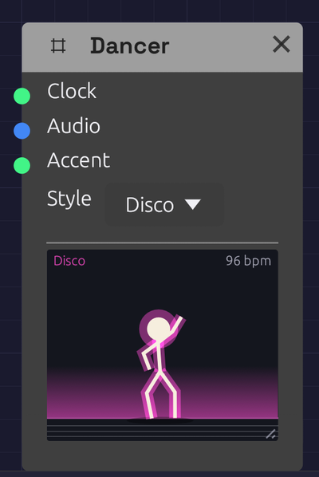

# Dancer

**Module ID** `util.dancer` · **Category** Utility


*Mid-step in the Disco style, the floor still lit from the beat.*

The Dancer is a stick figure who dances to your patch. It doesn't make a sound or change one; it's there for fun, and for company while you play. Drop one into any patch with a [Clock](../modulation/clock.md) and press play: it's already dancing on the beat. Patch the mix into it and it dances harder as the music gets louder.

## Inputs

| Port | Signal Type | Description |
|------|-------------|-------------|
| **Clock** | Gate (Green) | Each pulse is a step. Leave it empty and the Dancer follows the patch's Clock |
| **Audio** | Audio (Blue) | The music to dance to: the louder it plays, the bigger the moves. A sudden hit, such as a kick, dips the hips |
| **Accent** | Gate (Green) | A rising edge asks for a big move: a jump, a spin, or arms flung up |

Every input is optional.

## Parameters

| Control | Range | Default | Description |
|---------|-------|---------|-------------|
| **Style** | Bounce / Disco / Robot / Headbang | Bounce | How the Dancer dances |

Drag the grip in the stage's bottom-right corner to make the stage bigger, up to three times its first size. Double-click the grip to put it back. The size is saved with the patch and can be undone like any other change.

## How it works

**The beat.** Without a cable in **Clock**, the Dancer follows the patch's tempo and beat, the same ones a tempo-synced Delay follows. A cable in **Clock** takes over once two pulses have come in, so the Dancer can follow a different clock from the rest of the patch, such as a Clock Divider. If the clock stops, the Dancer stops dancing.

**Dancing tempo.** People dance at roughly 75 to 150 steps a minute, whatever the music's tempo, and so does the Dancer. It doubles or halves the beat until each step falls in that range. A sixteenth-note clock at 120 BPM is danced on the quarter notes, and a 60 BPM ballad is danced double time. The header shows the tempo it's dancing at. During a ritardando it keeps its pace and slows with the music, rather than jumping to double time partway through.

**Energy.** **Audio** sets how big the moves are. Quiet music gets a gentle sway and loud music gets deep knee bends and wide arms. A sudden jump in level, such as a drum hit, dips the hips on the hit. With nothing in **Audio**, the Dancer dances at a steady, medium energy.

**Steps.** Each style has four steps, and the Dancer changes step every four bars. It begins with the style's first step, then picks a different one each phrase. The routine is the same every time the patch plays, so a recording looks the same on each take.

| Style | Steps |
|-------|-------|
| **Bounce** | Bob, side step and clap, running man, jumping jacks |
| **Disco** | The point (up and out, down and across), hip sway, the roll, the bump |
| **Robot** | Tutting, head ticks, an arm wave, a jerky slide. Moves snap into place every half beat |
| **Headbang** | Whip, air guitar, fist pump, stomp |

**Accents.** Each rising edge at **Accent** starts a big move that lasts one dancing beat. The moves take turns: a jump, arms flung up, and a spin. The order depends on the style.

**Between songs.** While the transport is stopped, or if the patch has no beat, the Dancer stands around: it breathes, shifts its weight, taps a foot now and then, and looks around. If music without a beat is playing (a drone, a pad), it sways to it.

## The stage

- The **floor** flashes in the style's color on each beat, brighter when the music is louder.
- The **shadow** spreads when the Dancer lands, and shrinks and fades while it's in the air.
- A faint **trail** shows where the limbs were a moment ago.

## Patches

### On the mix

Put a Dancer at the end of any patch:

```text
[Tape Out L] ──> [Dancer Audio]
```

It dances on the patch's Clock, as big as the mix is loud.

### A big move each phrase

The Clock Divider's **Trig** fires once a phrase. Patched into **Accent**, it makes the Dancer jump or spin as each new section starts:

```text
[Clock Gate] ──> [Clock Divider Clock]      (Divide 64: four bars of sixteenths)
[Clock Divider Trig] ──> [Dancer Accent]
```

### A dance floor

Several Dancers in different styles, all on the same mix, dance in time with each other. Each one's routine depends on its style, so no two styles dance the same steps.

## Related modules

- [Clock](../modulation/clock.md): sets the beat the Dancer follows
- [Clock Divider](../utilities/divider.md): a phrase-long trigger for **Accent**
- [Oscilloscope](./oscilloscope.md): the other module that only watches
