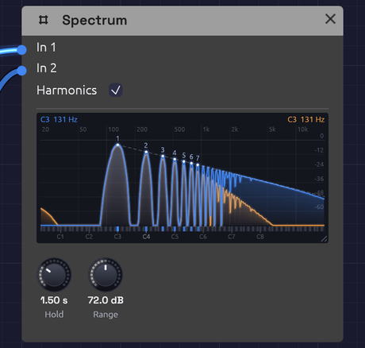

# Spectrum

**Module ID** `util.spectrum` · **Category** Utility


*A saw on In 1, its harmonics numbered and stepping down the dashed line, and the same saw through a lowpass on In 2, its upper harmonics gone.*

The Spectrum shows what a sound is made of. Every sound that has a pitch is a stack of sines: one at the note's frequency, the **fundamental**, and others at two, three, four times it and so on, the **harmonics**. The Spectrum draws each one as a line standing up from the floor, as tall as that sine is loud. A sine is a single line. A saw is a whole row of them, each a little shorter than the last, and that row is why a saw sounds bright and a sine sounds pure.

The [Oscilloscope](./oscilloscope.md) shows a wave's shape over time; the Spectrum shows its ingredients. Put them side by side on the same cable and you can watch a corner on the scope turn into a row of harmonics here.

Like the scope, it has two inputs, drawn in blue and orange, so you can compare a sound before and after a module. It passes nothing on.

## Inputs

| Port | Signal Type | Description |
|------|-------------|-------------|
| **In 1** | Audio (Blue) | The sound to look into, drawn blue. Its note's harmonics are numbered |
| **In 2** | Audio (Blue) | A second sound, drawn orange behind the first |

A polyphonic cable is summed, so a chord shows every note's harmonics at once.

## Parameters

| Control | Range | Default | Description |
|---------|-------|---------|-------------|
| **Hold** | 0 to 5 s | 1.5 s | How long each peak is held before it falls away |
| **Range** | 24 to 120 dB | 72 dB | How far below full scale the floor is |
| **Harmonics** | On / Off | On | Number the harmonics of the note heard, light their keys and draw the 1/n line |

Drag the grip in the bottom-right corner to make the display bigger, up to three times its first size: a big Spectrum has room for more labels, and finer lines. Double-click the grip to put it back.

## Reading the display

**Across** is frequency, from 20 Hz on the left to 20 kHz on the right. The axis is logarithmic, so every octave is the same width, just as on a keyboard, and a keyboard runs along the floor to match, with **C1** to **C8** named beneath it (C4 is middle C). Frequencies in hertz are marked along the top. Hover anywhere to read the frequency, the nearest note and how far off it is in cents, and each input's level there.

**Up** is level, in decibels. The 0 line is full scale: a sine that swings all the way from -1 to +1 reaches it. Each line below is 12 dB quieter, which is about a quarter of the height of the wave. The floor is as far down as **Range** says.

**Two lines per sound.** The filled shape is what's sounding now. The finer, paler line above it holds each peak for the **Hold** time, then lets it sink. Play a single pluck and its harmonics stay drawn for a moment after the sound has gone, long enough to read. Set **Hold** to 0 to follow the sound alone.

**The note.** The header names the note each input is playing, and its frequency, once it hears one. With **Harmonics** on, the partials of In 1's note (or In 2's, if In 1 is empty) are numbered over their peaks, and their keys light up on the keyboard. A harmonic that's missing has its number dimmed on the floor. Noise has no note, so it gets no numbers.

**The dashed line** falls from the fundamental by 6 dB every octave. That's where a saw's harmonics stand: the second at half the level of the first, the third at a third, the *n*th at 1/*n*.

## What it's good for

- **Why a saw is bright.** Patch an [Oscillator](../sources/oscillator.md) into In 1 and step through its waves. The **sine** is one line. The **saw** has every harmonic, each standing on the dashed line. The **square** has only the odd ones (1, 3, 5…), still on the line, with the even numbers dimmed on the floor: that's its hollow sound. The **triangle** has the same odd harmonics, falling away twice as fast, below the line: softer, nearer a sine.
- **Pulse width.** On the square, turn **PW** (Pulse Width) away from the middle and the even harmonics come back. At a quarter width every fourth harmonic is missing.
- **Harmonics are a chord.** Watch the lit keys: the second harmonic is an octave up, the third an octave and a fifth, the fourth two octaves, the fifth a major third above that. Every note already holds a major chord.
- **What a filter does.** Put the oscillator on In 1 and the filter's output on In 2. Sweep the **Cutoff** and watch the orange harmonics above it sink while the blue ones stay. Turn up **Resonance** and see the harmonics near the cutoff stand taller.
- **FM sidebands.** Frequency modulation adds lines either side of each harmonic. Turn the FM depth up slowly and watch them spread.
- **Noise colours.** [Noise](../sources/noise.md) has no note, so nothing is numbered: just a rough band across the whole axis. White noise rises gently to the right, pink leans gently down, and brown falls away steeply.
- **Checking a mix.** Patch the mix in and see where its energy sits, and whether anything is crowding the low end.

## Patches

### Before and after a filter

```text
[Oscillator Out] ──> [Spectrum In 1]
[Oscillator Out] ──> [SVF Filter In]
[SVF Filter LowPass] ──> [Spectrum In 2]
```

Set the Oscillator to a saw an octave down. Sweep the filter's **Cutoff** and watch it take the top off the row of harmonics.

### Beside the scope

```text
[Oscillator Out] ──> [Oscilloscope In 1]
[Oscillator Out] ──> [Spectrum In 1]
```

The same sound, as a shape and as its harmonics.

## Notes

The analysis runs on the screen, not in the audio: the audio thread only copies the two inputs for the display to read, so a Spectrum costs the sound nothing, and a Spectrum scrolled out of view costs nothing at all. Each picture looks at the last 4,096 samples, about 85 ms. That's enough to tell apart the harmonics of a note as low as C1, though their lines draw closer together than a higher note's.

## Related Modules

- [Oscilloscope](./oscilloscope.md): the same sound as a waveform
- [Oscillator](../sources/oscillator.md): four waves with four different sets of harmonics
- [SVF Filter](../filters/svf-filter.md) and [Ladder Filter](../filters/ladder-filter.md): their own displays show the sound under the filter's response
