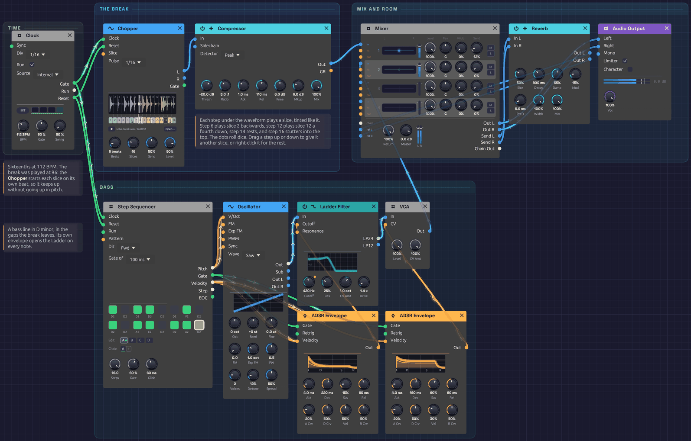

# Cut-Up

A sampled break is the backbone of hip-hop, jungle and a great deal in between. A drummer played two bars, someone lifted them off a record, and producers cut them up and put them back together in an order the drummer never played. The cuts are as much the music as the drumming.

This patch does that with a [Chopper](../modules/sources/chopper.md). Its break was played at 96 BPM and the patch runs at 112, yet nothing goes up in pitch: each slice starts on its own beat and plays at its own speed. The row of steps under the waveform rearranges it. One hit is played twice, another backwards, a snare a fourth down, a step left empty, and the bar ends in a stutter. A few steps roll dice, so it never quite repeats. A bass line in D minor sits in the gaps. It plays itself; press Play and let it run.

> **Load it:** choose **📚 Examples → Cut-Up** in the toolbar and press **▶ Play**. It needs no keyboard.
> The patch file is [`patches/cut-up.json`](https://github.com/chrischaps/Soba/blob/master/patches/cut-up.json).

<iframe class="patch-embed" src="../play/?patch=cut-up" title="Cut-Up, playable in the browser" loading="lazy"></iframe>
*Or play it here: press **▶ Play** in the corner. The full app is a click away under **Open in Soba**.*


*The Clock is at the left. The break and its compressor are in the blue frame, the Mixer, Reverb and Output in the cyan one, and the bass line beneath them.*

## What it teaches

- **Tempo without pitch.** On tape, or on a Sampler, a break played faster goes up in pitch. Started slice by slice, each on its own beat, it keeps its pitch at any tempo.
- **Rearranging a break.** Re-sequencing slices is the craft of jungle and hip-hop production: a hit moved, doubled, reversed or dropped.
- **Variation by chance.** A step that sometimes plays another slice keeps a two-bar loop alive for minutes.
- **Colour as notation.** Each slice has a hue, and each step wears the hue of the slice it plays. You can read the chop without hearing it.

## The break

The break is Soba's own: two bars of [Drums](../modules/sources/drum.md) (kick, snare with ghost notes, closed and open hats) under a [Trigger Sequencer](../modules/utilities/trigger-sequencer.md), swung at 57%, at 96 BPM. `tools/breaks/make_break.py` plays it, keeps the second pass so the loop starts with the tails of its own last bar, and drives it gently into a soft curve, as tape rounds off a break lifted from a record. It's five seconds long, cut on the downbeat, and free to use for anything.

## The chop

Sixteen slices of two bars: an eighth note each. Unlisted steps play their own slice.

| Step | Plays | Why |
|------|-------|-----|
| 4 | Slice 3 | The kick again, an eighth early |
| 6 | Slice 2, backwards | A hat and a ghost note, sucked in |
| 7 | Its own, 25% chance of another | |
| 8 | Its own, ×2 | A doubled eighth into the second bar |
| 10 | Its own, 20% chance of another | |
| 11 | Slice 5 | The first bar's snare where the second bar had a kick |
| 12 | Its own, −5 semitones | A snare a fourth down, played slower and so cut short |
| 13 | Its own, 15% chance of another | |
| 14 | A rest | Room to breathe |
| 15 | Slice 13, backwards | The backbeat, reversed, into… |
| 16 | Its own, ×4 | …a stutter, back to the top |

## Modules

| Module | Settings |
|--------|----------|
| [Clock](../modules/modulation/clock.md) | **BPM** 112, **Div** 1/16 |
| [Chopper](../modules/sources/chopper.md) | `samples/soba-break.wav`, **Pulse** 1/16, **Beats** 8, **Slices** 16, **Level** 90%. Steps as in the chop |
| [Compressor](../modules/effects/compressor.md) | **Thresh** −20 dB, **Ratio** 3:1, **Atk** 1 ms, **Rel** 110 ms, **Mkup** 6 dB |
| [Step Sequencer](../modules/utilities/sequencer.md) | **Steps** 16, **Gate** 60%. D2 on 1, 3 and 9, then D3, F2, A1, C2, D2 and A2 between the hits |
| [Oscillator](../modules/sources/oscillator.md) | **Wave** Saw, **Voices** 2, **Detune** 12% |
| [Ladder Filter](../modules/filters/ladder-filter.md) | **Cutoff** 420 Hz, **Res** 25%, **Drive** 1.4×, LP24 |
| [ADSR Envelope](../modules/modulation/adsr.md) (filter) | **Atk** 4 ms, **Dec** 220 ms, **Sus** 15%, **Rel** 60 ms |
| [ADSR Envelope](../modules/modulation/adsr.md) (amp) | **Atk** 4 ms, **Dec** 180 ms, **Sus** 60%, **Rel** 80 ms |
| [VCA](../modules/utilities/vca.md) | Defaults |
| [Mixer](../modules/utilities/mixer.md) | **Level 1** (break) 100%, **Send 1** 12%; **Level 2** (bass) 100% |
| [Reverb](../modules/effects/reverb.md) | **Size** 30%, **Decay** 800 ms, **Mix** 100%, on the Mixer's send |
| [Audio Output](../modules/output/audio-output.md) | **Vol** 100% |

## How it's built

### The break in time

```text
[Clock Gate]  ──> [Chopper Clock]
[Clock Reset] ──> [Chopper Reset]
[Chopper L]   ──> [Compressor In] ──> [Mixer Ch 1]
```

The Chopper counts the Clock's sixteenths. **Pulse** says each is a sixteenth, and **Beats** 8 says the break is two bars long, so the loop comes round every 32 pulses. At 112 BPM that's 4.3 seconds, where the break itself lasts 5: each slice's turn is a little shorter than the slice, and the next one cuts in. Turn the Clock down to 96 and the break plays back exactly as it was recorded. Turn it lower and you'll hear a hairline gap after each slice.

The [Compressor](../modules/effects/compressor.md) catches each hit within a millisecond and lifts what's between them, the ghost notes and the room, as a mix bus does to drums.

### The bass

```text
[Clock Gate] ──> [Step Sequencer Clock]
[Step Sequencer Pitch] ──> [Oscillator V/Oct] ──> [Ladder Filter] ──> [VCA] ──> [Mixer Ch 2]
[Step Sequencer Gate]  ──> [ADSR (filter)] ──> [Ladder Filter Cutoff]
                       ──> [ADSR (amp)]    ──> [VCA CV]
```

A one-bar line on the same Clock: the root on the downbeats, the rest in the spaces the kick leaves. Two detuned saws through a Ladder lowpass, its envelope opening it on every note and Drive giving it a little grit.

## Things to try

- **Change the tempo.** Drag the Clock's **BPM** anywhere from 70 to 170. The break follows, and keeps its pitch.
- **Rearrange it.** Drag a step up or down to give it another slice, or right-click one for **Shuffle the slices** and listen to a new break. Undo brings the old one back.
- **Cut at the hits.** Turn **Slices** past 64 to **Onsets**. The fan under the waveform leans, as the hits fall where the drummer's swing put them, and every hit gets a step of its own.
- **Let it roll.** Ctrl+click a few more steps for dice, or patch a [Sample & Hold](../modules/utilities/sample-hold.md) of [Noise](../modules/sources/noise.md) into **Slice** for a break that's different every bar.
- **Follow the chop.** Patch the Chopper's **Gate** into the Step Sequencer's **Clock** in place of the Clock's: the bass then steps with every slice, stutters and all.
