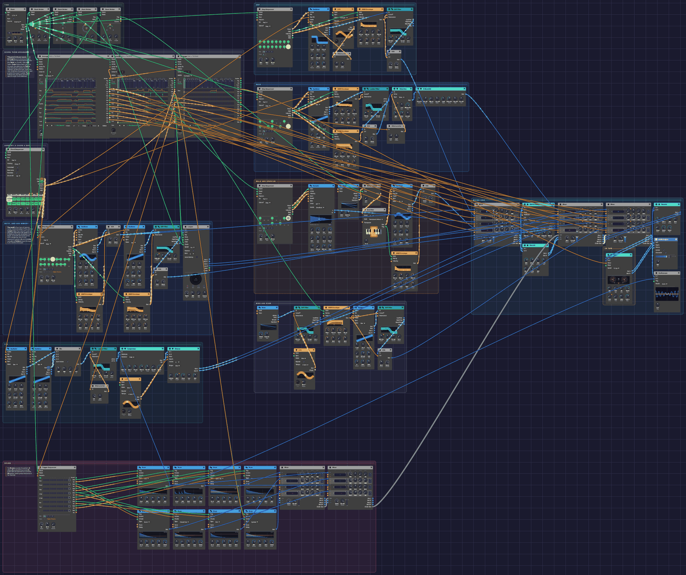
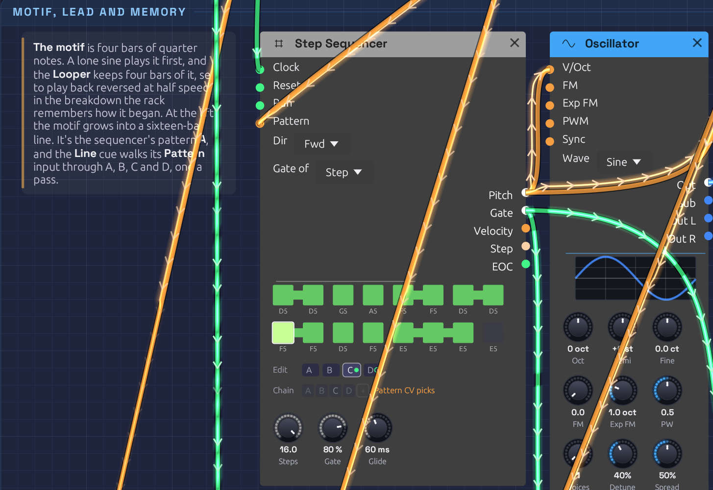

# From One Sine

A whole song in one patch: four and a half minutes of D minor at 112 BPM, from a first note to a last one, with nobody at the keys. It opens the way every patch in this manual opens, on one sine wave playing a short tune, and part by part the rest of the rack joins in: a pad, an arpeggio, a bass, drums, bells, a supersaw lead. In the breakdown a [Looper](../modules/utilities/looper.md) plays the opening back to itself, reversed and an octave down. The song ends where it began, on the sine alone.

Nothing outside the patch tells it what to do. Two [Arrangers](../modules/utilities/arranger.md) are the score: they count the song in bars, through 22 named sections, and each of their lanes rides one part's fader, picks a pattern for the drums or the melody, strikes the crash or presses a pedal. Eighty modules play their part, of 28 kinds. Left running, it plays the song again from the top.

> **Load it:** choose **📚 Examples → From One Sine** in the toolbar and press **▶ Play**. It needs no keyboard.
> The patch file is [`patches/from-one-sine.json`](https://github.com/chrischaps/Soba/blob/master/patches/from-one-sine.json).

<iframe class="patch-embed" src="../play/?patch=from-one-sine" title="From One Sine, playable in the browser" loading="lazy"></iframe>
*Or play it here: press **▶ Play** in the corner. The full app is a click away under **Open in Soba**.*


*The whole song at the widest zoom, at the drop. The score's two Arrangers and the harmony are on the top left, the instruments are in strips with signal running left to right, the drums run along the bottom, and the mixing desk is on the right. Orange cables from the score reach every fader.*

## The song

<iframe class="patch-film" src="https://www.youtube-nocookie.com/embed/xvmurP7NABw?rel=0" title="From One Sine, filmed in Soba as it plays" allow="accelerometer; clipboard-write; encrypted-media; gyroscope; picture-in-picture; web-share" referrerpolicy="strict-origin-when-cross-origin" allowfullscreen loading="lazy"></iframe>
*The whole song, filmed in the app as it plays. The camera follows the score: it opens close on the lone sine, visits each part as it enters, pulls back to the whole rack for the drop, and ends where it began. [Watch on YouTube](https://youtu.be/xvmurP7NABw).*

Each section of the song is sixteen bars. On the Arrangers they're 22 sections: a new one wherever a part enters or the band changes, a one-bar **Fill** to close each phrase of the groove, and a long last one where the song fades back to its first sound.

| Bars | Section | What happens |
|------|---------|--------------|
| 1–16 | First Sound | The sine plays the motif alone, with echoes and a hall, over a breath of wind. The pad, then sparkles, then a soft arpeggio fade in around it. The Looper records bars 5–8. |
| 17–32 | Pulse | The sine rests. The arpeggio steps forward, then the bass and the bells come in, over a heartbeat of kick, rim and offbeat hats. A small riser leads out. |
| 33–48 | Groove | A crash, and the full beat. The pad ducks under the kick. A fill closes the section. |
| 49–64 | Lift | The motif comes back on a seven-voice supersaw, and this time it doesn't stop at four bars: it grows into a sixteen-bar line that runs the length of the progression. The pad and bass grow brighter. |
| 65–80 | Memory | The drums, bass and lead drop out. The Looper's take of bars 5–8 plays reversed at half speed under the open pad and sparkles. The sine answers its own ghost with the motif played forward. Then a four-bar build with a riser, where the line's last phrase turns back toward the top. |
| 81–96 | Everything | Drums, bass, arpeggio, pad, bells, sparkles and the lead's whole line at once, at the brightest the score sets. |
| 97–112 | Second wave | The lead rests and the sine sings the line over the groove instead, with the ghost underneath. The lead returns for its second half. |
| 113–128 | Return | The lead fades and the drums fall back to the pulse. Then the sine returns to the motif alone, and the other parts fade away around it in the reverse of the order they came, until it's alone again. |

## What it teaches

- **A patch can hold its own arrangement.** An [Arranger](../modules/utilities/arranger.md) is a timeline of named sections, and its lanes are faders that move on cue. Each section jumps, ramps, holds or hits each lane as it starts.
- **Swells and fades.** A Ramp can start from a level of its own and take a curve. The parts swell in on lines and fade out on **Log** curves, which fall fast and tail away, much as a fade sounds to the ear.
- **Smoothing a control voltage.** A lane's **Glide** turns a jump into a glide, so a fader can move under a ringing note without a click: a second for the sustained parts, 40 ms for the rhythmic ones.
- **One lane, two jobs.** A lane's **Gate** is high while the lane is above zero, so the riser's lane sets its level and opens its envelope for exactly its section.
- **A line longer than a sequencer's sixteen steps.** The motif's sequencer holds four patterns, and an Arranger lane picks one for each pass through its **Pattern** input. Where the line should run on, the lane ramps in a straight line, so the four passes play A, B, C and D.
- **Harmony from mono parts.** A sequencer for each pad voice, stepping once a bar, sings real chords with real voice-leading. A root sequencer transposes the arpeggio and bass through **Exp FM**.
- **Hits press buttons.** A Hit is a trigger with a level on it: the crash and its accent, and the Looper's **Rec** and **Clear**.
- **Sidechain ducking.** The [Compressor](../modules/effects/compressor.md) on the pad listens to the kick.
- **Send and return.** Four [Mixers](../modules/utilities/mixer.md) chain their mixes and their sends along one cable each, so one delay and two reverbs serve the whole song.

## Modules

| Module | Role |
|--------|------|
| [Clock](../modules/modulation/clock.md) | **BPM** 112, **Div** 1/16, **Swing** 54% |
| [Clock Divider](../modules/utilities/divider.md) ×4 | Beats (÷4), eighths (÷2), bars (÷16), and ÷3 for the sparkles |
| [Arranger](../modules/utilities/arranger.md) ×2 | The score: 22 sections, 128 bars. **Desk** rides eight faders. **Cues** picks the drum pattern and the melody's, strikes the crash, holds the riser, sets the brightness and the Looper's level, and presses its pedals |
| [Sample & Hold](../modules/utilities/sample-hold.md) | Samples the sparkles' random voltage |
| [Step Sequencer](../modules/utilities/sequencer.md) ×8 | Roots and three pad voices (a step a bar), the motif and the line it grows into (quarters, four patterns), the arp and bass (sixteenths), the bells (eighths) |
| [Oscillator](../modules/sources/oscillator.md) ×10 | The sine, the supersaw lead (**Voices** 7), four pad saws, the arp (Square), the bass (Saw), the sparkles (Tri), the riser |
| [ADSR Envelope](../modules/modulation/adsr.md) ×7 | One per voice, two for the bass (filter and amp) |
| [SVF Filter](../modules/filters/svf-filter.md) ×4 | Lead, arp, wind (band-pass) and riser (high-pass) |
| [Ladder Filter](../modules/filters/ladder-filter.md) ×2 | Pad and bass |
| [VCA](../modules/utilities/vca.md) ×6 | Each voice's envelope |
| [LFO](../modules/modulation/lfo.md) ×3 | The chorus depth and the wind's sweep (4 bars), the arp's pulse width (1 bar) |
| [Attenuverter](../modules/utilities/attenuverter.md) ×3 | Scaling: the pad's brightness, the bass drive, the arp's PWM |
| [Noise](../modules/sources/noise.md) ×2 | Pink wind, and the Random voltage for the sparkles |
| [Quantizer](../modules/utilities/quantizer.md) | D minor pentatonic for the sparkles |
| [Sampler](../modules/sources/sampler.md) | The bell from [Sampled Keys](./sampled-keys.md) |
| [Looper](../modules/utilities/looper.md) | **Bars** 4, **Speed** ½×, **Reverse** on, **Dry** 0 |
| [Drum](../modules/sources/drum.md) ×8 | Kick (tuned to A1), Snare, Clap, Closed Hat, Open Hat (choked by the closed hat), Rim, Tom (A2), and a Cymbal for the crash |
| [Trigger Sequencer](../modules/utilities/trigger-sequencer.md) | The drums: four patterns, picked by **Pattern** CV |
| [Compressor](../modules/effects/compressor.md) | Pad, sidechained by the kick |
| [Chorus](../modules/effects/chorus.md) | Pad, into stereo |
| [Distortion](../modules/effects/distortion.md) | Bass, **Tube** |
| [3-Band EQ](../modules/effects/eq.md) | Bass: lows up, boxiness out |
| [Mix](../modules/utilities/mix.md) | The pad's four voices |
| [Mixer](../modules/utilities/mixer.md) ×5 | Two for the kit, and Echoes, Body and Sky |
| [Stereo Delay](../modules/effects/delay.md) | **Sync** 1/8D, **P-P** and **Tape** on, on the Echoes send |
| [Reverb](../modules/effects/reverb.md) ×2 | A hall on Echoes, a plate on the send everyone shares |
| [Oscilloscope](../modules/visualization/oscilloscope.md) | The mix and the kick, to watch |
| [Audio Output](../modules/output/audio-output.md) | **Limiter** and **Character** on |

## How it's built

### The score

```text
[Clock Gate] ──> [Desk Clock]
             ──> [Cues Clock]
[Desk Section] ──> [Cues Follow]              (Cues follows Desk's sections)
[Desk Lane 6] ──> [Mixer Body Level 2]        (the pad, both sides)
              ──> [Mixer Body Level 3]
[Cues Lane 3] ──> [Mixer Sky Level 4]         (the riser's level)
[Cues Gate 3] ──> [Riser ADSR Gate]           (and its envelope)
```

Both Arrangers count the Clock's sixteenths, sixteen to a bar, through the same 22 sections: First Sound, Echo, Sparkles, Arp, Pulse, Bass, Bells, Riser, Groove, Fill, Lift, Fill, Memory, Answer, Build, Everything, Fill, Second Wave, Lead Returns, Fill, Return and One Sine. They change section on the same clock edge as the sequencers step on, so the score and the music can't drift apart. **Loop to** is 1, so the song goes round again.

**Desk**, the Arranger on the left, has a lane for each fader: the sine, arpeggio, bells, sparkles, bass, pad, wind and lead. On the Echoes, Body and Sky mixers each channel's **Level** knob is at zero, and its **Level** input adds the lane on top.

The faders swell and fade more than they jump. The wind breathes in over the first twelve bars on a Log curve. Echo brings the pad in at 28% and ramps it in a line to 42% over twelve bars, through Sparkles and Arp, which hold. The sparkles rise over eight bars and thin away over the next twelve as the band arrives. The arpeggio swells in under the sine, then lifts into the Pulse as the sine rests. The bass and the bells come in on swells of their own. Where the music turns on a downbeat (a crash, the breakdown, the drop) the faders still jump: everything that leaves at Memory, or comes back at Everything, goes or comes at once.

One Sine, the last twelve bars, is the score's longest fade. Each part falls on its own curve over its own length, so they leave one after another in the reverse of the order they came: bells, bass, arpeggio, sparkles, pad and wind. Meanwhile the sine climbs a little, to stand alone at the end, as it began. The pad and wind, the bed under everything, fade last, on the gentler S-curve.

The mixer adds a control voltage without smoothing it, so each lane has a **Glide** for its jumps: a second for the pad, wind and sparkles, 0.8 s for the sine, 0.3 s for the lead, and 40 ms for the arp, bass and bells, which still land on the downbeat but never cut a tail short.

**Cues**, on the right, has the rest. It [follows](../modules/utilities/arranger.md#more-than-eight-lanes-follow) Desk: Desk's **Section** is patched into its **Follow**, so its sections are always Desk's, and an edit to them on Desk is made on Cues too. **Drums** picks the drum pattern (see [Drums and fills](#drums-and-fills)). **Crash** hits on the downbeat of each big section, and its level is the cymbal's accent. **Riser** jumps to 30% for the Riser section and 32% for the Build. Its CV is the riser's level, and its gate holds the riser's envelope open for exactly those four bars. **Heat** ramps up through the opening, 8% to 48% over seven sections, and keeps climbing through the groove. The Build drops it to 50% and sweeps it up an Exp curve to its peak, 86%, on the drop. The ending darkens it back down to 10% as the parts fade. Through two Attenuverters it opens the pad's Ladder and drives the bass harder. **Memory** is the Looper's level. It swells in over the breakdown's first four bars and recedes under the Build's riser. **Rec** and **Clear** hit the Looper's pedals. **Line** picks the melody's pattern (see [The motif and the line](#the-motif-and-the-line)).

### Harmony, a chord a bar

```text
[Clock Divider ÷16 Trig] ──> [Roots Clock], [Pad Voice 1–3 Clock]
[Roots Pitch] ──> [Pad Root Oscillator V/Oct]
              ──> [Arp Oscillator Exp FM]
              ──> [Bass Oscillator Exp FM]
[Pad Voice n Pitch] ──> [Pad Oscillator n V/Oct]
```

Sixteen bars of chords: Dm9, Bbmaj7, Fmaj7 and Cadd9 twice, then Gm7, Bb, Dm, C, Gm7, Bbmaj7, Csus4 and C. Four sequencers each take a step a bar. **Roots** plays the low voice, an octave down. The other three are the upper voices, and each one sings its own line through the changes, so the chords move by step instead of jumping in parallel. The four saws meet in a [Mix](../modules/utilities/mix.md), pass through one Ladder Filter, and duck under the kick in the Compressor. The Chorus spreads them into stereo.

The arpeggio and the bass are written over C, and **Roots** moves them to each chord through **Exp FM** at 1 octave per volt, as in [Afterglow](./afterglow.md). That only stays in key if the shapes have no third, so the arpeggio is made of roots, ninths and fifths, and the bass of roots, fifths and octaves. Over these roots, every note they play is in D minor.

### The motif and the line

```text
[Clock Divider ÷4 Trig] ──> [Motif Clock]
[Cues Lane 8] ──> [Motif Pattern]             (the Line: a pattern a pass)
[Motif Pitch] ──> [Sine V/Oct], [Supersaw V/Oct]
[Sine VCA Out] ──> [Mixer Echoes Ch 1]
               ──> [Looper In L]
[Cues Gate 6] ──> [Looper Rec]
[Clock Divider ÷16 Trig] ──> [Looper Clock]
[Looper Loop L/R] ──> [Mixer Sky Ch 2/3]
```

The motif is four bars of quarter notes, A, D E | F, D | C, A C | G, with ties for the long notes. It leans on notes that both halves of the progression share. A over Dm is the fifth and over Gm the ninth. C over F is the fifth and over Dm the seventh. So it fits whichever chords it lands on.

It's pattern **A** of the motif's [Step Sequencer](../modules/utilities/sequencer.md), and three more patterns make it a sixteen-bar line, one for each four bars of the progression. The second half of the progression gets patterns of its own, written to its chords, so the line follows the harmony instead of sitting over it:

| Pattern | Over | Notes | Its part in the line |
|---------|------|-------|----------------------|
| A | Dm9, Bbmaj7, Fmaj7, Cadd9 | A, D E / F, D / C, A C / G | The motif. It ends open, on the fifth of C |
| B | the same | A, F E / D, F / E, C A / C | The answer. It starts on the motif's note, leaps where the motif stepped, and comes to rest on C |
| C | Gm7, Bb, Dm, C | D, G A / F, D / F, D F / E | The motif a fourth higher, and the top of the line |
| D | Gm7, Bbmaj7, Csus4, C | G, F E / D, Bb / C, A C / G | Down the scale, and home on the motif's own last two bars, which lead back to A |


*The motif's sequencer at the Lift, two bars into pattern C. C wears the green dot and D, ringed, comes next. The Chain is dimmed, because the orange cable into **Pattern** picks the patterns instead.*

The **Line** lane on Cues picks which pattern plays. The sequencer reads its **Pattern** input once a pass, on the clock that starts it, and each quarter of the range is a pattern, so 12.5% is the middle of A and 87.5% the middle of D. Where the song wants the motif alone, the lane jumps to A and stays there. Where it wants the whole line, the lane ramps in a straight line, **Linear**, from A to D over twelve bars. On the first beat of each pass it stands in the middle of the next pattern's quarter, so the four passes play A, B, C and D, and then it holds D. On the Cues timeline you can see where the line grows: a flat lane, then a slope.

- **First Sound:** the sine plays the motif alone, four times. That's what the Looper keeps.
- **Lift:** the lead plays the whole line for the first time.
- **Answer and Build:** over its reversed ghost, the sine plays the motif forward. The Build plays D, and D's descent leads into the drop.
- **Everything:** the whole line on the lead.
- **Second Wave:** the sine sings the line, and the lead returns for C and D.
- **Return and One Sine:** back to the motif alone, so the song ends as it began.

The Looper listens to the sine. At bar 5, the Echo section hits **Rec**. With bar pulses on its **Clock** and **Bars** at 4, the take starts on the downbeat and closes itself after four bars. The Looper is set to **½×** and **Rev** from the start. Neither changes what it records, only how it plays it back, so the loop plays reversed, an octave down, at half speed: eight bars, landing on the progression's own eight-bar grid. Its level stays at zero until the breakdown. First Sound hits **Clear** at bar 1, so each time the song comes round the Looper records the opening afresh.

### Drums and fills

```text
[Cues Lane 1] ──> [Drum Trigger Sequencer Pattern]
[Cues Gate 2] ──> [Cymbal Trig]
[Cues Lane 2] ──> [Cymbal Accent]
```

The drum sequencer's **Pattern** input picks a pattern for each new bar in quarters: 0 to 0.25 is A, then B, C and D. A is silence, B is a pulse of kick, rim and offbeat hats, C is the groove, and D is a build: four-on-the-floor kicks, toms, and a snare roll whose ratchets climb to four hits a step.

The **Drums** lane jumps to 0.10 for A, 0.35 for B, 0.52 for C and 0.85 for D. Each phrase of the groove ends on a one-bar **Fill** section, which jumps it to D for that bar, and the section after jumps it back. The sequencer reads its **Pattern** on the same sample the lane jumps, so the lane has no Glide.

The closed hat's gate chokes the open hat. The kick is tuned to A1, the fifth of D, and the tom to A2, so the drums sit in the key.

### The desk

```text
[Mixer Kit 2 Chain Out] ──> [Mixer Kit Chain In]
[Mixer Kit Chain Out] ──> [Mixer Body Chain In]
[Mixer Body Chain Out] ──> [Mixer Sky Chain In]
[Mixer Sky Out L/R] ──> [Audio Output Left/Right]
[Mixer Sky Send L/R] ──> [Plate Reverb In L/R] ──> [Mixer Sky Return L/R]
[Mixer Echoes Send L/R] ──> [Stereo Delay] ──> [Mixer Echoes Return L/R]
[Mixer Echoes Out L/R] ──> [Hall Reverb] ──> [Mixer Body Return L/R]
```

The sine, arpeggio, bells and sparkles share the Echoes mixer, whose send feeds a ping-pong tape delay on dotted eighths. Its output passes through a big hall and comes back on Body's **Return**. Body carries the bass, the pad in stereo and the wind. Sky carries the lead, the Looper's two sides and the riser. The two kit mixers chain into Body, and Body into Sky. Each chain cable carries a mixer's mix and its sends together, so the sends of all four ride along to Sky, where one plate reverb serves them. Echoes keeps its send for the delay.

## Variations

**Rearrange it.** Drag a lane on the Desk up or down in any section to move that fader, or right-click it to ramp instead of jump. Delete a **Fill** section on the Desk for a phrase of groove without a fill: Cues follows, and its cues for the Fill go with it.

**A shorter song.** Set the Desk's **Loop to** to 9, the Groove, and Cues follows. The opening plays once, and then the song goes round from the groove to the end.

**The line all through.** Pull the Line cable out of the motif sequencer's **Pattern**. Its Chain is A B C D, so the sine plays the whole line from the very first bar, and the breakdown remembers the answer, B, instead of the motif.

**Remember something else.** Patch the Arp's VCA into the Looper's **In L** instead of the sine. The breakdown then hears the arpeggio, slowed and backwards.

**Brighter all through.** Raise the **Offset** on the pad's brightness Attenuverter: each 0.1 opens the Ladder a tenth of an octave further, all song long.

**Straighter.** Set the Clock's **Swing** to 50%. Arp, bass and drums all straighten together, because they share its sixteenths.

## Related

- [Arranger](../modules/utilities/arranger.md): sections, lanes, and the cues that move them
- [Afterglow](./afterglow.md): transposing an arpeggio with a second sequencer
- [Roll Call](./roll-call.md): one Trigger Sequencer, eight drums
- [Live Looper](./live-looper.md): the Looper with your own instrument
- [Interlock](./interlock.md): Logic deciding whose turn it is
- [Tempo and Sync](../concepts/tempo-and-sync.md): one Clock for the whole patch
