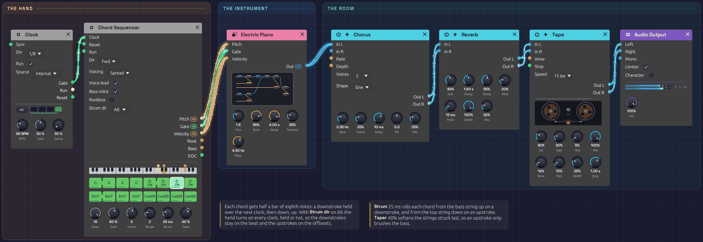

# Front Porch

Rhythm guitar played on an electric piano. A Chord Sequencer strums G, D/F♯, Em7 and Cadd9 the way a guitarist's hand moves: down on the beat and up on the offbeat, rolling each chord across its strings, digging into the first strings it hits and only brushing the last. Under the chords, the bass walks down G, F♯, E, C.

> **Load it:** choose **📚 Examples → Front Porch** in the toolbar and press **▶ Play**. It needs no keyboard.
> The patch file is [`patches/front-porch.json`](https://github.com/chrischaps/Soba/blob/master/patches/front-porch.json).

<iframe class="patch-embed" src="../play/?patch=front-porch" title="Front Porch, playable in the browser" loading="lazy"></iframe>
*Or play it here: press **▶ Play** in the corner. The full app is a click away under **Open in Soba**.*


*The hand, the instrument and the room, left to right. Everything that makes it sound like strumming happens in the Chord Sequencer: the Electric Piano is the Library's, unchanged.*

## What it teaches

- **Strum.** Each note of a chord starts a little after the one before it, as a pick crosses the strings one at a time.
- **Strum dir Alt.** The hand goes down on one clock and up on the next. It keeps moving through held chords, so downstrokes always land on the beat.
- **Taper.** The strings struck last are softer, so an upstroke brushes the bass instead of hitting it.
- **A rhythm from ties and velocities.** A tie leaves out a stroke, and a lower velocity makes an upstroke lighter. Together they make a strumming pattern out of a plain eighth-note clock.
- **A guitar's voicing.** **Spread** voicing with a bass voice puts five notes over two octaves, about where a guitar's six strings put them.

## Modules

| Module | Settings |
|--------|----------|
| [Clock](../modules/modulation/clock.md) | **BPM** 96, **Div** 1/8 |
| [Chord Sequencer](../modules/utilities/chord-sequencer.md) | **Steps** 16, **Gate** 60%, **Voices** 5, **Range** 2, **Voicing** Spread, **Voice lead** on, **Bass voice** on, **Strum** 25 ms, **Strum dir** Alt, **Taper** 40%. Four steps each of G (G2), D/F♯ (D3), Em7 (E2) and Cadd9 (C2) |
| Electric Piano (from the [Library](../concepts/groups.md#the-library)) | As it comes |
| [Chorus](../modules/effects/chorus.md) | **Rate** 0.35 Hz, **Depth** 25%, **Delay** 10 ms, **Mix** 25% |
| [Reverb](../modules/effects/reverb.md) | **Size** 45%, **Decay** 1.6 s, **Damp** 55%, **PreD** 12 ms, **Mix** 22%, **Mod** 20% |
| [Tape](../modules/effects/tape.md) | **Speed** 15 ips, **Sat** 30%, **Age** 20%, **Hiss** 5%, **Wow** 12%, **Flut** 10%, **Width** 25% |
| [Audio Output](../modules/output/audio-output.md) | **Vol** 80% |

## How it's built

### The hand

```text
[Clock Gate] ──> [Chord Sequencer Clock]
```

The Clock ticks in eighth notes, eight to a bar. Each step is one movement of a guitarist's strumming hand, and the progression is four chords of half a bar each, two bars in all. Every half bar has the same shape:

| Step | 1 | 2 | 3 | 4 |
|------|---|---|---|---|
| Hand | down | up | down | up |
| Strikes? | yes, tied into 2 | no, held | yes | yes |
| Velocity | 104 | – | 92 | 70 |

Count it "**1** (and) **2** and": a downstroke that rings, the hand coming up without touching the strings, then down and up. Step 1 is **tied** into step 2, which holds the chord instead of playing it again. With **Strum dir** on **Alt**, the hand still turns on that clock, so step 3 is a downstroke and step 4 an upstroke. Upstrokes play at a lower velocity than downstrokes, as a guitarist's do.

Cadd9, the last chord, plays all four strokes, down up down up, at velocities 104, 64, 92 and 76. The extra strokes push the progression back round to G.

### Rolling the chord

```text
[Chord Sequencer Pitch]    ──> [Electric Piano Pitch]       (poly, 5 channels)
[Chord Sequencer Gate]     ──> [Electric Piano Gate]
[Chord Sequencer Velocity] ──> [Electric Piano Velocity]
```

With **Strum** at 25 ms, the five notes of a chord start 25 ms apart, so a stroke takes 100 ms to cross the strings. That's fast enough to hear as one chord, and slow enough to hear it ring out from one end. **Alt** sets which end: a downstroke starts on the bass note and an upstroke on the top note.

**Taper** at 40% gives the first note of each stroke the step's full velocity, and each later note a little less, down to 60% for the last. A downstroke lands hardest on the bass, and an upstroke on the top strings. The Electric Piano's tine gets quieter and less bright as its velocity drops, so the shading is easy to hear.

**Gate** at 60% lifts each note a little before the next stroke, as the strumming hand damps the strings in passing. At 100% every chord would ring into the next, and the rhythm would blur into a pad.

### Voicing like a guitar

The roots are written where a guitar's bass strings play them: G2, F♯2 (under the D, as a slash chord), E2 and C2. With **Bass voice** on, the first channel plays that bass note, and the other four play the chord above it. **Spread** voicing raises every other note an octave, so the chord spans two octaves, much as an open chord does on a guitar's neck:

| Chord | Bass | Above it |
|-------|------|----------|
| G | G2 | B2 G3 D4 B4 |
| D/F♯ | F♯2 | A2 F♯3 D4 A4 |
| Em7 | E2 | B2 E3 D4 G4 |
| Cadd9 | C2 | C3 E3 D4 G4 |

**Voice lead** keeps the top notes moving by step: B, A, G, G, a line that falls with the bass. Cadd9's root is written as C2 rather than C3. As C3 the bass would double the C3 in the chord, and it would land well above the E2 before it. As C2 it ends the walk down an octave lower, under the whole chord.

### The room

```text
[Electric Piano Out] ──> [Chorus In L]
[Chorus Out L/R] ──> [Reverb In L/R]
[Reverb Out L/R] ──> [Tape In L/R]
[Tape Out L/R] ──> [Audio Output Left/Right]
```

A light chorus widens the piano into stereo, as two microphones would a guitar. A small room with a short decay keeps the strokes distinct, so each one is heard. The Tape at 15 ips adds a little warmth and sway, and enough hiss to hear between the chords.

## Variations

**Push the change.** Set step 8 to Em7 (right-click it: root E, type m7). The Em7 now comes in on the last upstroke of the bar before, an eighth early, as a rhythm guitarist often plays a chord change. Do the same on step 16 with G to push into the top of the loop.

**Every stroke down.** Set **Strum dir** to **Up**, so every stroke starts from the bass, and **Gate** to 30%. It's now a chugging eighth-note rhythm, as a punk band plays it.

**A stroke of your own.** Right-click step 4 and set its **Strum** to **Up**. That upstroke turns into a downstroke on the "and" of 2, an accent against the beat. Under **Alt**, the hand keeps time around it, so the rest of the pattern doesn't change.

**More or less dig.** At **Taper** 0 every string sounds equally, which is stiffer. At 80% the strokes just catch the first few strings and fade before the others.

**A slower hand.** Raise **Strum** to 50 ms for a lazy strum. At 80 ms with **Strum dir** on Up, a chord rolls upward like a harp.

**Another instrument.** Swap the Electric Piano for the Library's Mallet or String Machine. The strum works on any voice. **Taper** shows most on a voice that gets quieter as its velocity drops, as the Electric Piano and the Mallet do.

## Related

- [Chord Sequencer](../modules/utilities/chord-sequencer.md) – Strum, Taper and a step's own stroke, in detail
- [Groups and the Library](../concepts/groups.md#the-library) – the Electric Piano and the other voices it can swap for
- [Afterglow](./afterglow.md) – the Chord Sequencer playing a pad and moving an arpeggio
- [Clair de Satellite](./clair-de-satellite.md) – an electric piano comping in a whole song
