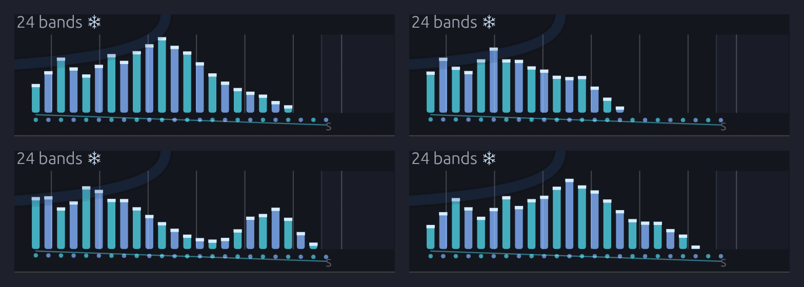

# Held Vowels

A pad that sings. A soft triangle chord moves through Dmaj9, Bm9, Gmaj9 and A11, a bar each, and each chord holds a vowel: *ohh*, *ooh*, *ee*, *ahh*. A singer is heard for only one beat in four. On the last beat of each bar it sings the next chord's vowel, the [Vocoder](../modules/effects/vocoder.md)'s **Freeze** catches it on the downbeat, and the new chord goes on saying it for the whole bar, long after the singer has stopped.

> **Load it:** choose **📚 Examples → Held Vowels** in the toolbar and press **▶ Play**. It needs no keyboard.
> The patch file is [`patches/held-vowels.json`](https://github.com/chrischaps/Soba/blob/master/patches/held-vowels.json), and its singer is [`patches/samples/held-vowels.wav`](https://github.com/chrischaps/Soba/blob/master/patches/samples/held-vowels.wav).

<iframe class="patch-embed" src="../play/?patch=held-vowels" title="Held Vowels, playable in the browser" loading="lazy"></iframe>

*Or play it here: press **▶ Play** in the corner. The full app is a click away under **Open in Soba**. The bar, the singer and the vocoder along the top, the pad and the room beneath. Each time the Vocoder freezes on a vowel, its snowflake shows and its bars stand solid.*

## What it teaches

- **Freeze.** While the Vocoder's **Freeze** gate is high, every band holds the level it had, and the carrier goes on wearing that vowel whatever the voice does next.
- **A gate that holds, then breathes.** A [Clock Divider](../modules/utilities/divider.md)'s **Gate** stays open for as many clocks as its **Length**. Three beats out of four freeze the vowel, and one lets the next vowel in.
- **Flatten.** A triangle chord is loud low down and nearly silent at 2 kHz, where an *ee* lives. **Flatten** evens the carrier out before the voice is put on it, so a soft pad speaks its vowels.
- **One clock, three jobs.** The same quarter-note Clock steps the chords, times the freeze and cues the singer, through two Clock Dividers, so nothing can drift.
- **A note two chords share.** Each vowel is sung on a note common to the chord it leaves and the chord it's sung for, so the singer belongs to both.

## Modules

| Module | Settings |
|--------|----------|
| [Clock](../modules/modulation/clock.md) | **BPM** 66, **Div** 1/4 |
| [Clock Divider](../modules/utilities/divider.md) (the bar) | **Div** 4, **Offset** 0, **Length** 3 |
| [Clock Divider](../modules/utilities/divider.md) (the cue) | **Div** 16, **Offset** 3, **Length** 1 |
| [Sampler](../modules/sources/sampler.md) | `samples/held-vowels.wav`, **Mode** One-Shot, **Atk** 2 ms, **Rel** 50 ms, **Level** 100% |
| [Chord Sequencer](../modules/utilities/chord-sequencer.md) | **Steps** 4, **Gate** 100%, **Voices** 5, **Range** 3, **Voicing** Close, **Voice lead** on, **Bass voice** on. Chords Dmaj9 (D3), Bm9 (B2), Gmaj9 (G2), A11 (A2) |
| [Oscillator](../modules/sources/oscillator.md) | **Wave** Tri |
| [Vocoder](../modules/effects/vocoder.md) | **Bands** 24, **Attack** 30 ms, **Release** 180 ms, **Formant** 0, **Flatten** 100%, **Sibil** 0%, **Unvoic** 0%, **Width** 70%, **Mix** 85% |
| [Mixer](../modules/utilities/mixer.md) | **Level 1** and **Level 2** 17%, **Pan 1** L 70, **Pan 2** R 70. **Level 3** 50%, **Mute 3** on (the singer) |
| [Chorus](../modules/effects/chorus.md) | **Rate** 0.2 Hz, **Depth** 30%, **Delay** 14 ms, **Mix** 35% |
| [Reverb](../modules/effects/reverb.md) | **Size** 85%, **Decay** 6 s, **Damp** 55%, **PreD** 30 ms, **Mix** 35%, **Mod** 40% |
| [Audio Output](../modules/output/audio-output.md) | **Vol** 80%, **Limiter** on |

## How it's built

### The bar: hold, then breathe

```text
[Clock Gate] ──> [Clock Divider Clock]          (both Dividers)
[Clock Reset] ──> [Clock Divider Reset]         (both)  [Chord Sequencer Reset]
[Clock Divider Trig] ──> [Chord Sequencer Clock] (the bar)
[Clock Divider Gate] ──> [Vocoder Freeze]        (the bar)
[Clock Divider Trig] ──> [Sampler Gate]          (the cue)
```

The Clock ticks once a beat. The first Clock Divider counts four of them to a bar. Its **Trig** fires on each downbeat and steps the Chord Sequencer, and its **Gate** opens on the same downbeat and stays open for three beats, **Length** 3:

```text
Beat:     1     2     3     4     1     2     3     4     1
Chord:   Dmaj9 ───────────────── Bm9 ─────────────────── Gmaj9
Freeze:  ‾‾‾‾‾‾‾‾‾‾‾‾‾‾‾‾‾|_____|‾‾‾‾‾‾‾‾‾‾‾‾‾‾‾‾‾|_____|‾‾‾‾
Singer:                   ohh                     ooh
```

While Freeze is high, the bands hold. On beat 4 it falls, the bands follow the singer again, and over that beat the old vowel melts into the new one at the Vocoder's **Attack** and **Release**. On the downbeat Freeze rises, and the vowel the singer has just sung is held, now on the new chord. The new chord's notes come in under bands that are already shaped, so each chord *starts* on its vowel instead of growing into it.

The second Clock Divider cues the singer. At **Div** 16 it fires once every four bars, and **Offset** 3 puts that on the fourth beat of the first bar, the first time Freeze lets go. The first bar is the bare chord, quietly, because nothing has been sung yet.

### The singer

```text
[Sampler L] ──> [Vocoder Modulator]
           ──> [Mixer Ch 3]          (muted)
```

The singer isn't anyone's recording. It's the formant synthesizer that speaks in [Soba Speaks](./soba-speaks.md), [`tools/voice/speak.py`](https://github.com/chrischaps/Soba/blob/master/tools/voice/speak.py), asked with `--vowels` to sing instead: four pure vowels, a bar apart, each with a singer's slow vibrato and soft edges. Each lasts a beat and a half, from the moment Freeze lets go to a little past the downbeat that catches it.

Each vowel is sung on a note the two chords around it share. The *ohh* that Bm9 will hold is sung on D, in both Dmaj9 and Bm9. The *ooh* for Gmaj9 is on B, the *ee* for A11 on A, and the *ahh* that takes the progression home to Dmaj9 is on D again. To a vocoder only the vowel matters, not the pitch, but unmute **Ch 3** on the Mixer and you hear the singer itself, in tune with the pad.

The open vowels, *ohh* and *ahh*, are sung louder, as a singer sings them. They need it here: their first formant, 570 to 730 Hz, falls among the chord's harmonics rather than its notes, where a triangle has little to give. Sung at one level, they'd come out of the Vocoder 4 to 8 dB under the *ooh* and the *ee*.

### The pad

```text
[Chord Sequencer Pitch] ──> [Oscillator V/Oct]
[Oscillator Out] ──> [Vocoder Carrier]
```

Four chords, a bar each, voiced **Close** with a **Bass voice** under them: D3 under F♯3 A3 C♯4 E4, then B2, G2 and A2 under the nearest notes of each next chord. The top voice moves only a step, E to D, and stays on D. They're played on one Oscillator, a triangle, so the whole chord comes down one polyphonic cable into the Vocoder's **Carrier**.

The Oscillator plays one voice, with no unison detune. Two detuned voices would beat slowly against each other, and a held vowel would swell and sink by several dB through the bar. The Chorus after the Vocoder gives the pad its movement without that.

### The vocoder and the room

```text
[Vocoder Out L] ──> [Mixer Ch 1]   (panned L 70)
[Vocoder Out R] ──> [Mixer Ch 2]   (panned R 70)
[Mixer Out L/R] ──> [Chorus] ──> [Reverb] ──> [Audio Output]
```

**Flatten** at 100% is what lets this pad speak. A triangle's harmonics fall away fast, a ninth as loud at three times the pitch, so unflattened its bands at 2 to 3 kHz sit 35 to 40 dB under its lowest ones. The *ee*'s second formant is up there, and without Flatten it has almost nothing to open. Flattened, every band of the chord is brought to one level first, and the *ee* comes through as plainly as the *ooh*.

**Bands** 24 draws the vowels most finely. **Release** 180 ms is far slower than speech wants: it's there to make the change of vowel on beat 4 a glide rather than a cut. **Sibilance** and **Unvoiced** are off, because pure vowels have no consonants to carry. **Mix** 85% keeps a little of the raw chord in the middle, so the first bar has a pad before anything has been sung.

The room is wide and long, a 6-second hall, so each held vowel blooms into the next.


*The four held vowels, as the Vocoder's face shows them: ohh and ooh on top, ee and ahh below. An ooh piles up at the left, low down. An ee has its first formant low and its second high, with a valley between. The frost caps and the snowflake say the bands are held; the level row of dots underneath is Flatten at work on the carrier.*

## Try this

- **Pull the Freeze cable.** Unplug the Vocoder's **Freeze** input. Now the pad speaks only while the singer sings, one beat in four, and the plain chord fills the rest. Freeze is what makes a vowel outlast its singer.
- **Turn off Flatten.** Turn **Flatten** to 0%. Every vowel loses its upper formant, and the *ee* goes so dull it's nearly an *ooh*. The pad is as loud as before: only what it says has changed. Watch the dots under the bars: they tip down to the right, the slope of a triangle chord.
- **Hear the singer.** On the Mixer, unmute **Ch 3**. You hear the voice for one beat, then the chord carries the vowel on without it.
- **Hold for less.** Set the bar Divider's **Length** to 2. Freeze lets go on beat 3, the held vowel fades away for a beat while the singer is still silent, and the next one swells in on beat 4.
- **A choir of children.** Turn **Formant** to +0.4 oct, and the same vowels come from a smaller throat.
- **A choir of robots.** Set **Bands** to 8.
- **Sing it yourself.** Patch an [Audio Input](../modules/sources/audio-input.md)'s **L** into the Vocoder's **Modulator** in place of the Sampler, pick your microphone under **Input** in the toolbar, and sing a vowel on each fourth beat. Wear headphones, or the mic hears the speakers. Whatever you sing on beat 4, the next chord holds.
